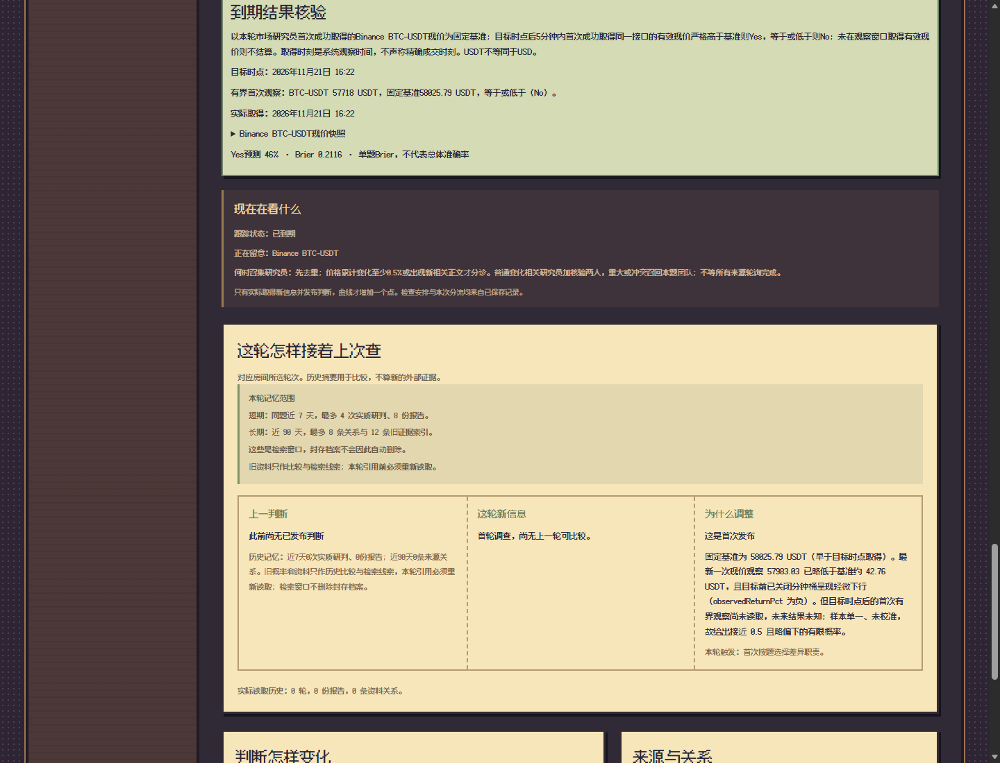

# 股票预测事务所 / Stock Prediction Studio

股票预测事务所（LLMword）是一个面向 COMP5584 课程项目的像素风多 Agent 研究工作台。用户写下关注的股票、证券或基金以及预测期限，主 Agent 按问题从十类研究员席位中选择团队；研究员实际调用工具查找公开资料、提交带引用的报告，主 Agent 比较支持与反证后封存二元判断。

Stock Prediction Studio (LLMword) is a pixel-style multi-agent research workstation built for the COMP5584 course project. A user enters a stock, security, or fund of interest and a forecast horizon. The main Agent selects a team from ten researcher roles according to the question. Researchers call real tools to inspect public sources and submit cited reports; the main Agent then compares supporting evidence and counterevidence before sealing a binary judgment.

当前代码分支为 **V4.4**。公开入口已收口为真实环境，根地址先进入欢迎页；欢迎页提供产品说明、三条只读教程和研究员介绍。界面支持简体中文与 English，新任务会保存创建时的报告语言。

The current code branch is **V4.4**. The public entry now targets the live environment, and the root address opens a welcome page with a product introduction, three read-only tutorials, and researcher profiles. The interface supports Simplified Chinese and English, and each new task preserves the report language selected at creation time.

本文只说明当前版本的内容和用法。版本改动、提交对应关系与历史验收见 **[开发历史 / Development History](DEVELOPMENT_HISTORY.md)**；产品契约见 **[PRD](docs/PRD.md)**，已验证范围见 **[实现状态](docs/IMPLEMENTATION_STATUS.md)**。

This document describes only the current version and its usage. See **[Development History](DEVELOPMENT_HISTORY.md)** for version changes, commit mapping, and historical acceptance results. The **[PRD](docs/PRD.md)** is the product contract, and **[Implementation Status](docs/IMPLEMENTATION_STATUS.md)** records the verified scope.

## 项目截图 / Project Screenshots

### 01｜中英文研究室 / Chinese and English Research Room


V4.3 已完成当前工作台、辅助页面和旧案例入口的 English 界面覆盖；V4.4 沿用这一研究室。人物、气泡、工具动作和结论来自已保存的后端事件，不用预设对白填充真实运行。

V4.3 completed English interface coverage for the current workstation, supporting pages, and legacy case entry; V4.4 retains this research room. Actors, bubbles, tool actions, and conclusions are projected from committed backend events rather than scripted dialogue during real runs.

### 02｜公开协作与逐条引用 / Public Collaboration and Itemized Citations


这张截图来自 V3.0 的真实金融样例，用于说明公开协作记录：可以查看每位研究员实际查到的材料、引用支持的结论，以及主 Agent 的采纳、保留或拒绝结果。界面布局已随后续版本更新。

This V3.0 live financial example illustrates the public collaboration record. Users can inspect the material each researcher actually retrieved, the claims supported by each citation, and whether the main Agent accepted, reserved judgment on, or rejected a claim. The layout has changed in later versions.

### 03｜封存预测与到期核验 / Sealed Forecasts and Outcome Verification



这张截图同样属于 V3.0 固定 BTC-USDT 规则样例。实际结果与单题 Brier 误差另行保存，不回写原概率；单个案例不代表总体准确率，也不代表普通股票已经具备通用自动结算能力。

This screenshot also comes from the V3.0 fixed-rule BTC-USDT example. The outcome and single-question Brier score are stored separately without rewriting the original probability. One case establishes neither overall accuracy nor general automatic settlement for ordinary stocks.

## 在本地运行 / Run Locally

需要 **Node.js 22.17 或更高版本**及 npm；`.nvmrc` 固定为 22.17.1。服务使用内置 `node:sqlite`，部分 Node 版本会显示 experimental 提示。普通运行不需要 Python、浏览器插件或图数据库。

Install **Node.js 22.17 or later** and npm; `.nvmrc` pins version 22.17.1. The service uses the built-in `node:sqlite` module, and some Node versions may print an experimental warning. Python, browser extensions, and a graph database are not required for normal use.

在项目根目录执行：

Run the following commands from the project root:

```bash
npm ci
npm start
```

`npm start` 等价于 `npm run start:live` 和 `node start-live.mjs`。打开 [http://127.0.0.1:4174](http://127.0.0.1:4174)，服务默认只监听本机。

`npm start` is equivalent to `npm run start:live` and `node start-live.mjs`. Open [http://127.0.0.1:4174](http://127.0.0.1:4174). By default, the service listens only on the local machine.

- 根地址与空 hash 进入 `#/welcome`；`#/predictions`、`#/course/:id`、`#/room` 等深链接仍直接进入对应研究室页面。

  The root address and an empty hash open `#/welcome`. Deep links such as `#/predictions`, `#/course/:id`, and `#/room` still open their corresponding research-room pages directly.
- 未配置 API Key 时可以浏览欢迎页、教程和已有记录，但不能创建或恢复真实调查。

  Without an API Key, users can browse the welcome page, tutorials, and existing records, but cannot create or resume live investigations.
- 公开 mock 启动入口已移除。mock provider、测试夹具、`web/demo` 与 `.data/mock` 仅保留给自动化测试和教程归档。

  The public mock startup entry has been removed. The mock provider, test fixtures, `web/demo`, and `.data/mock` remain only for automated tests and tutorial archives.

默认真实数据目录为 `.data/live/`。需要隔离端口和存档时，可使用 `PORT` 与 `WORLD_DATA_DIR`：

The default live data directory is `.data/live/`. Use `PORT` and `WORLD_DATA_DIR` to isolate the port and archive:

```bash
PORT=4196 WORLD_DATA_DIR=.data/live-b npm start
```

Windows PowerShell 可先设置 `$env:PORT = '4196'` 和 `$env:WORLD_DATA_DIR = '.data/live-b'`，再运行 `npm start`。同一数据目录只供一个服务实例使用，不要混用 mock 与 live 数据。

In Windows PowerShell, set `$env:PORT = '4196'` and `$env:WORLD_DATA_DIR = '.data/live-b'` before running `npm start`. Use only one service instance per data directory, and never mix mock and live data.

## 快速上手 / Quick Start

1. **先看教程**：欢迎页提供“完整协作”“新证据局部复核”“失败与恢复”三条路径。教程只读本地模拟／回放档案，不调用模型、不创建任务、不写预测数据库；学习进度只保存在本机浏览器。

   **Start with the tutorials:** The welcome page offers three paths: full collaboration, targeted review with new evidence, and failure recovery. Tutorials read only local simulated or replayed archives. They do not call models, create tasks, or write to the prediction database; progress is stored only in the local browser.
2. **连接模型**：从欢迎页进入研究室，打开“模型连接”，保存自己的 Key、完整聊天 URL 和模型名。默认使用 DeepSeek 官方配置，也可选择校园或自定义兼容端点。

   **Connect a model:** Enter the research room from the welcome page, open “Model Connection,” and save your Key, full chat URL, and model name. The official DeepSeek configuration is the default; campus and custom compatible endpoints are also available.
3. **开始预测**：输入股票、证券或基金问题，选择 1、3、5、20 个交易日，默认 5 日。新任务默认只研究一次，只有显式开启“持续预测”才安排后续检查。

   **Start a prediction:** Enter a stock, security, or fund question and select a horizon of 1, 3, 5, or 20 trading days; the default is 5. A new task runs one investigation by default. Follow-up checks are scheduled only when “Continuous Prediction” is explicitly enabled.
4. **查看研究过程**：研究室右侧“预测结果与进度”集中展示公开分工、实际工具回执、报告、来源、裁决和结果。切换历史记录只恢复所选运行，不会把其他任务的对白混入当前房间。

   **Inspect the research process:** “Prediction Results and Progress” on the right side of the room consolidates public assignments, actual tool receipts, reports, sources, adjudication, and results. Switching history restores only the selected run and never mixes dialogue from another task into the current room.
5. **保存或清理入口**：可查看概率轨迹、导出所选 Run 的公开协作 JSON；已有判断、资料不足或失败的历史入口可在确认后删除。活动调查、持续预测和结果核验受保护，删除入口不会物理清除原始运行、判断和证据档案。

   **Save or remove entries:** Users can inspect probability trajectories and export the selected run's public collaboration JSON. History entries with an existing judgment, insufficient evidence, or failure can be removed after confirmation. Active investigations, continuous predictions, and outcome verification are protected. Removing an entry does not physically erase the original run, judgment, or evidence archive.

教程完成页的示例可以编辑，并带入真实预测表单，但不会自动提交。预测会继续消耗所配置模型账户的额度，应在开始前确认预算和连接。

Examples on tutorial completion pages are editable and can prefill the live prediction form, but are never submitted automatically. Predictions continue to consume quota from the configured model account, so confirm the budget and connection before starting.

## 研究室与多 Agent 协作 / Research Room and Multi-Agent Collaboration

一次典型预测按以下顺序执行：

A typical prediction follows this sequence:

**整理问题并封存期限 → 主 Agent 派工 → 研究员独立取证 → 提交支持、反证与缺口 → 围绕争议定向补查 → 主 Agent 裁决并发布 → 可选后续检查**。

**Normalize the question and seal the horizon → main Agent assigns work → researchers gather evidence independently → submit support, counterevidence, and gaps → conduct targeted follow-up around disputes → main Agent adjudicates and publishes → optional follow-up checks**.

普通新任务按题选择三种不同职责，并包含核验席；不是每轮都调用全部十个席位。概率、证据充分度与团队一致性分别保存，资料不足时不补造 0 或 50% 的概率。

A typical new task selects three distinct responsibilities according to the question, including verification; it does not call all ten roles in every round. Probability, evidence sufficiency, and team agreement are stored separately. The system does not invent a 0% or 50% probability when evidence is insufficient.

| 角色 ID / Role ID | 职责重点 / Responsibility | 当前边界 / Current Boundary |
| --- | --- | --- |
| `official` | 官方公告、原始文件与正式结果<br>Official announcements, primary documents, and formal outcomes | 指定域名取证；是否取得原文以工具回执为准<br>Retrieves evidence from specified domains; tool receipts determine whether source text was obtained |
| `timeline` | 首发、更正、转载和时间线<br>Initial publication, corrections, republication, and timelines | 区分发布时间、取得时间与事件时间<br>Separates publication time, retrieval time, and event time |
| `industry` | 技术、行业和制度条件<br>Technical, industry, and institutional conditions | 行业假设与已核实事实分开<br>Keeps industry assumptions separate from verified facts |
| `people` | 人物身份、组织与利益关系<br>People, organizations, and interests | 旧职位和旧引语不直接移用于当前<br>Does not apply old roles or quotations directly to the present |
| `statistics` | 单位、期间、样本和计算口径<br>Units, periods, samples, and calculation conventions | 支持财报指标及固定价格规则中的统计检查<br>Supports statistical checks for financial metrics and fixed price rules |
| `market` | 报价、价格基准和市场口径<br>Quotes, price benchmarks, and market conventions | 不把所有网页价格当作已核验交易基准<br>Does not treat every web price as a verified trading benchmark |
| `social` | 社群线索、传播和样本偏差<br>Community leads, dissemination, and sampling bias | 不声称拥有私有平台或全量舆情权限<br>Claims no private-platform access or comprehensive sentiment coverage |
| `analogy` | 相似历史、差异和失败反例<br>Historical analogies, differences, and failed counterexamples | 旧资料须重新读取，不能用后见结果回填当时判断<br>Re-reads historical material and never backfills an earlier judgment with hindsight |
| `graph` | 实体关系、支持／反证和影响假设<br>Entity relationships, support/counterevidence, and influence hypotheses | 当前是有限关系线索，不是完整因果图模拟<br>Provides bounded relationship leads rather than a full causal-graph simulation |
| `verification` | 反例、引文、数值、时间和来源独立性<br>Counterexamples, citations, numbers, time, and source independence | 披露缺口；主 Agent 在汇总阶段比较各席报告<br>Discloses gaps while the main Agent compares reports during adjudication |

像素房间只展示公开计划、操作和结论，不展示模型隐藏推理。一个房间由当前选中的 Run 持有；刷新恢复已保存状态，不补播旧发言。

The pixel room exposes only public plans, actions, and conclusions, never hidden model reasoning. The selected run owns the room. Refreshing restores committed state without replaying old dialogue.

## 接入真实模型 / Connect a Live Model

推荐在网页“模型连接”中配置。默认端点为 `https://api.deepseek.com/chat/completions`，默认模型为 `deepseek-flash`；校园预设与自定义完整 URL 也可编辑。连接校验只说明对应模型服务可访问，不等于整轮预测、搜索或正文读取已经成功。

Use the web page's “Model Connection” panel for the recommended setup. The default endpoint is `https://api.deepseek.com/chat/completions`, and the default model is `deepseek-flash`. Campus presets and custom full URLs are editable. A successful connection check only proves that the model service is reachable; it does not prove that a full prediction, search, or source retrieval will succeed.

也可以在项目根目录复制 `.env.example` 为 `.env`，填写服务端配置后运行：

Alternatively, copy `.env.example` to `.env` in the project root, fill in the server settings, and run:

```bash
node --env-file=.env start-live.mjs
```

`npm start` 不会自动加载 `.env`。不要把 Key 写入 `web/`、README 或提交到 Git。

`npm start` does not load `.env` automatically. Never write Keys into `web/` or this README, and never commit them to Git.

| 环境变量 / Variable | 用途 / Purpose |
| --- | --- |
| `WORLD_API_KEY` | 启动时加载的模型凭据；也可改用网页会话配置<br>Model credential loaded at startup; a web-session configuration can be used instead |
| `WORLD_CHAT_COMPLETIONS_URL` | 完整聊天地址，优先于 `WORLD_BASE_URL`<br>Full chat URL; takes precedence over `WORLD_BASE_URL` |
| `WORLD_MODEL_NAME` | 模型名称<br>Model name |
| `WORLD_SEARCH_API_KEY` | 校园／自定义模型场景下独立配置的官方资料服务凭据<br>Separately configured official-source credential for campus or custom model setups |
| `WORLD_COURSE_POLL_MS` | 持续预测检查间隔，默认 3600000 毫秒<br>Continuous-prediction polling interval; defaults to 3,600,000 ms |
| `WORLD_BING_SEARCH` | 设为 `enabled` 时启用可选公开 Bing RSS 适配器<br>Set to `enabled` to activate the optional public Bing RSS adapter |
| `PORT` / `WORLD_DATA_DIR` | 覆盖本机端口与独立数据目录<br>Override the local port and isolated data directory |

通过网页保存的 Key 只用于当前服务进程，不写入项目文件或浏览器 localStorage/sessionStorage。连接成功后，当前网页文档会在密码框中脱敏保留输入，切换操作窗口后可恢复；整页刷新不回填，服务重启后网页会话 Key 需要重新填写。环境变量凭据仍按启动环境加载。

A Key saved through the web page is used only by the current service process and is not written to project files or browser localStorage/sessionStorage. After a successful connection, the current page document retains the input as a masked password value so it can survive switching between operation windows. A full page refresh does not refill it, and a server restart requires re-entering a web-session Key. Credentials supplied through environment variables are still loaded from the startup environment.

校园或自定义模型凭据不会自动转发给官方搜索／正文服务。模型与资料服务可能分别计费，实际用量以供应商回执为准。

Campus or custom model credentials are not automatically forwarded to official search or document services. Model and source services may charge separately; provider receipts remain the source of truth for actual usage.

## 界面语言与报告语言 / Interface and Report Languages

- 菜单右端可切换“简体中文 / English”。切换只更新系统界面，不重建房间或表单，也不调用外部翻译服务。

  Use “简体中文 / English” at the right end of the menu to switch the interface. Switching updates system UI only; it does not rebuild the room or forms and does not call an external translation service.
- 用户原问题、历史报告、证据原文、直接引文、自定义名称和配置值保持原文，不因界面切换而改写。

  Original questions, historical reports, evidence text, direct quotations, custom names, and configuration values remain unchanged when the interface language changes.
- 新任务在创建时保存 `outputLanguage: zh-CN` 或 `en`。主 Agent、研究员、补查、恢复和后续持续预测沿用该语言，不额外发起翻译调用；已有任务不随后续界面切换改变报告语言。

  Each new task stores `outputLanguage: zh-CN` or `en` at creation. The main Agent, researchers, follow-up checks, recovery, and continuous predictions retain that language without extra translation calls. Existing tasks do not change report language when the interface is switched later.

## Harness、工具、技能与学习 / Harness, Tools, Skills, and Learning

- **Harness**：使用显式状态机、结构化契约和 SQLite 检查点管理派工、权限、预算、证据、发布、取消与恢复。业务记录和公开事件用于驱动前端投影。

  **Harness:** An explicit state machine, structured contracts, and SQLite checkpoints manage assignments, permissions, budgets, evidence, publication, cancellation, and recovery. Domain records and public events drive frontend projections.
- **工具**：搜索、正文读取、现价等能力由后端注册并实际执行，返回与调用匹配的结果；搜索摘要不会自动成为已读引用。

  **Tools:** Search, document retrieval, current-price access, and other capabilities are registered and executed by the backend, which returns results matched to each call. A search snippet does not automatically become a read citation.
- **技能**：`docs/agent-playbooks/` 与角色方法快照规定调查方法、证据要求和报告边界。角色版本随任务保存，旧运行继续使用原快照。

  **Skills:** `docs/agent-playbooks/` and versioned role-method snapshots define investigation methods, evidence requirements, and report boundaries. Each task preserves its role versions, and old runs continue to use their original snapshots.
- **学习**：当前主要是检索有界历史判断、报告、来源关系和已结算结果，再据此复核或修正；不训练模型权重，也不把完成研究报告当作预测结算。

  **Learning:** The current implementation retrieves bounded historical judgments, reports, source relationships, and settled outcomes for review or correction. It does not train model weights or treat completion of a research report as forecast settlement.
- **预算**：研究室设置可为新任务选择有限或无限 Token 总预算，默认有限 1,000,000 tokens。无限只移除整轮总量限制，单次输出、请求数、局部预算和超时仍然生效；旧任务保留原预算。

  **Budget:** Research-room settings allow a finite or unlimited total Token budget for new tasks, with a finite default of 1,000,000 tokens. “Unlimited” removes only the whole-round total cap; per-call output, request counts, local budgets, and timeouts still apply. Existing tasks retain their original budgets.

## 数据范围与当前边界 / Data Scope and Current Limits

真实环境默认在 `.data/live/` 中分别保存 domain、course 与 runtime SQLite 数据。`.data`、`.env`、Key 和 `node_modules` 不属于源码交付内容。旧混合归档应先使用 `npm run migrate:data` 预览，确认停止相关服务后再按交接文档处理。

The live environment stores domain, course, and runtime SQLite data separately under `.data/live/` by default. `.data`, `.env`, Keys, and `node_modules` are not part of the source deliverable. Preview old mixed archives with `npm run migrate:data`, stop the relevant services, and then follow the handoff documentation.

当前边界必须与实际执行记录一起理解：

The current limits must be read together with the actual execution records:

- **只开放 binary 输出**：结果是带有明确期限和判定含义的 Yes 概率；“下跌”类问题中，Yes 可能表示下跌，不能固定理解为上涨。

  **Binary output only:** A result is a Yes probability with an explicit horizon and decision meaning. For a “price decline” question, Yes may mean decline; it must not be interpreted universally as an increase.
- **普通股票不等于通用行情系统**：未核验基准的结果可以是初步条件估计，并标记需复核、不计分；未上市公司、同名公司和跨市场标的仍需要语义澄清。

  **Ordinary stock questions do not imply a general market-data system:** A result without a verified benchmark may be a preliminary conditional estimate marked for review and excluded from scoring. Unlisted companies, identical names, and cross-market securities still require semantic clarification.
- **自动结果核验仅覆盖固定子集**：严格 BTC-USDT 与官方警告已有闭环，普通股票的通用结构化报价、自动到期评分和长期校准尚未完成。

  **Automatic outcome verification covers fixed subsets only:** Strict BTC-USDT and official-warning cases have closed loops. General structured quotes, automatic expiry scoring, and long-term calibration for ordinary stocks remain incomplete.
- **角色目录不等于外部渠道全部接通**：X、Reddit、小红书等专用授权接口、完整时序因果图和大规模对照评估不属于当前已交付能力。

  **A role catalog does not mean every external channel is connected:** Dedicated authorized integrations for X, Reddit, Xiaohongshu, and similar services, a full temporal causal graph, and large-scale controlled evaluations are not currently delivered.
- **真实验证与模拟测试分开**：历史真实样本存在失败、取消、引用拒绝和较高成本；当前概率未经过充分校准，不构成投资建议或收益承诺。

  **Live validation is separate from simulated tests:** Historical live samples include failures, cancellations, rejected citations, and substantial cost. Current probabilities are not sufficiently calibrated and are neither investment advice nor a promise of returns.
- **仍有明确未验项**：4.2 验收中的 20 交易日完整概率发布、浏览器下载实际落地和学习页面真实结算 UI 留缺；后续 UI 版本没有替代这些专项验收。

  **Explicit verification gaps remain:** The 4.2 acceptance record still lacks a complete 20-trading-day probability publication, an actual browser-download landing check, and a live-settled learning-page UI check. Later UI releases do not replace those acceptance items.

完整真实样例、失败记录和用量见 [4.2 发布说明](docs/V4_2_RELEASE_NOTES.md)、[预测可靠性记录](docs/FORECAST_RELIABILITY.md)与 [金融预测报告](docs/FINANCIAL_PREDICTION_REPORT.md)。

See the [4.2 Release Notes](docs/V4_2_RELEASE_NOTES.md), [Forecast Reliability Record](docs/FORECAST_RELIABILITY.md), and [Financial Prediction Report](docs/FINANCIAL_PREDICTION_REPORT.md) for complete live examples, failures, and usage.

## 目录与验证 / Structure and Verification

| 路径 / Path | 用途 / Purpose |
| --- | --- |
| `start-live.mjs` / `server/app.mjs` | 唯一公开启动包装与服务装配<br>Sole public startup wrapper and service composition |
| `server/course/` | 当前预测编排、工具、预算、期限、记忆、报告和结果核验<br>Current prediction orchestration, tools, budgets, horizons, memory, reports, and outcome verification |
| `server/domain/` / `server/runtime/` | M1 领域记录与 M0 工具循环运行时<br>M1 domain records and the M0 tool-loop runtime |
| `server/` 顶层模块<br>Top-level `server/` modules | 旧版案例、回放、公开监测与 SSE 等独立能力<br>Independent legacy cases, replay, public monitoring, and SSE capabilities |
| `web/` | 欢迎页、教程、常驻像素研究室、操作窗口、双语和公开协作投影<br>Welcome page, tutorials, persistent pixel room, operation windows, bilingual UI, and public collaboration projection |
| `web/demo/` / `scripts/` | 教程与测试归档、受控案例和验证脚本<br>Tutorial and test archives, controlled cases, and verification scripts |
| `docs/PRD.md` / `docs/ARCHITECTURE.md` | 产品契约、目标边界与实际代码结构<br>Product contract, target boundaries, and actual code structure |
| `docs/IMPLEMENTATION_STATUS.md` / `docs/evidence/` | 按日期记录的实现状态与机器证据<br>Date-stamped implementation status and machine evidence |

运行全量测试与公开协作验证：

Run the full test suite and public collaboration verification:

```bash
npm test
npm run verify:collaboration
```

截至 2026-11-23，当前实现状态记录全量回归 **659/659 通过**；本次文档整理也在 Node.js 22.23.5 下重新运行全量测试并通过。自动化测试主要使用模拟响应、本地 HTTP 与临时存档，不调用真实模型，不能据此宣称预测准确率或真实模型语言服从率。

As of 2026-11-23, the implementation status records **659/659 passing tests**. The full suite was also rerun successfully under Node.js 22.23.5 during the documentation revision. Automated tests primarily use simulated responses, local HTTP, and temporary archives. They do not call live models and cannot establish forecast accuracy or live-model language compliance.

需要复查 English 界面且本机已安装 Chrome 时，可在服务运行后执行：

To recheck the English interface with Chrome installed, start the service and run:

```bash
node scripts/verify-english-ui.mjs
```

可用 `CHROME_BINARY` 指定浏览器、`UI_CHECK_URL` 指定服务地址，默认地址为 4174。脚本使用临时独立浏览器配置。

Use `CHROME_BINARY` to select a browser and `UI_CHECK_URL` to select the service address, which defaults to port 4174. The script uses a temporary, isolated browser profile.

需要重新生成本地只读案例时，可分别运行 `npm run cases`、`npm run cases:finance`、`npm run cases:warning` 和 `npm run cases:price`。这些命令不是日常启动或查看现有教程的前置条件。

To regenerate local read-only cases, run `npm run cases`, `npm run cases:finance`, `npm run cases:warning`, or `npm run cases:price` as needed. None of these commands is required for normal startup or for viewing existing tutorials.

## 项目文档 / Project Documentation

- [开发历史](DEVELOPMENT_HISTORY.md)：版本、提交、历史开发更新与文档口径审阅。

  [Development History](DEVELOPMENT_HISTORY.md): Versions, commits, historical development updates, and documentation-consistency review.
- [实现状态](docs/IMPLEMENTATION_STATUS.md)：按时间记录的最新实现、测试和真实运行边界。

  [Implementation Status](docs/IMPLEMENTATION_STATUS.md): Chronological implementation updates, tests, and live-run boundaries.
- [PRD](docs/PRD.md) 与 [课程交付范围](docs/COURSE_MVP.md)：产品目标、binary 契约和课程要求。

  [PRD](docs/PRD.md) and [Course Delivery Scope](docs/COURSE_MVP.md): Product goals, the binary contract, and course requirements.
- [架构说明](docs/ARCHITECTURE.md) 与 [决策记录](docs/DECISION_LOG.md)：代码落点及后续决策对旧方案的替代关系。

  [Architecture](docs/ARCHITECTURE.md) and [Decision Log](docs/DECISION_LOG.md): Code locations and the later decisions that supersede earlier designs.
- [交接入口](docs/DELIVERY_HANDOFF.md) 与 [质量报告](docs/DELIVERY_STATUS_REPORT.md)：历史交接、失败样例和剩余工作。

  [Handoff Entry](docs/DELIVERY_HANDOFF.md) and [Quality Report](docs/DELIVERY_STATUS_REPORT.md): Historical handoffs, failure examples, and remaining work.

旧发布说明和截图按各自日期保留，不代表当前界面或当前版本再次通过相同验收。发生冲突时，以当前代码、最新决策记录及对应版本的真实证据为准。

Old release notes and screenshots remain tied to their own dates. They do not imply that the current interface or version has repeated the same acceptance checks. When documents conflict, use the current code, latest decision record, and evidence for the corresponding version as the authority.

## 设计参考 / Design References

代码为这个课程项目独立实现。角色分工、工具注册、持久化与回放设计参考了 [Anthropic 多 Agent 研究系统](https://www.anthropic.com/research/multi-agent-research-system)、[LangGraph 持久化](https://docs.langchain.com/oss/javascript/langgraph/persistence)、[MCP 工具契约](https://modelcontextprotocol.io/specification/2025-11-25/server/tools)、[Agent Skills](https://agentskills.io/specification)、[Reflexion](https://arxiv.org/abs/2303.11366) 和 [FutureSim](https://arxiv.org/abs/2605.15188)。

The code is independently implemented for this course project. Role allocation, tool registration, persistence, and replay were informed by [Anthropic's multi-agent research system](https://www.anthropic.com/research/multi-agent-research-system), [LangGraph persistence](https://docs.langchain.com/oss/javascript/langgraph/persistence), the [MCP tool contract](https://modelcontextprotocol.io/specification/2025-11-25/server/tools), [Agent Skills](https://agentskills.io/specification), [Reflexion](https://arxiv.org/abs/2303.11366), and [FutureSim](https://arxiv.org/abs/2605.15188).

研究室图片 `web/assets/lab.png` 与 `web/assets/lab-play.png` 由内置 ImageGen 生成／编辑；像素研究员由浏览器单独绘制和移动。原始设计说明、历史截图和版本材料继续保留在 `docs/` 与 [开发历史](DEVELOPMENT_HISTORY.md) 中。

The room images `web/assets/lab.png` and `web/assets/lab-play.png` were generated or edited with the built-in ImageGen service; pixel researchers are drawn and moved separately by the browser. Original design notes, historical screenshots, and version materials remain in `docs/` and [Development History](DEVELOPMENT_HISTORY.md).
