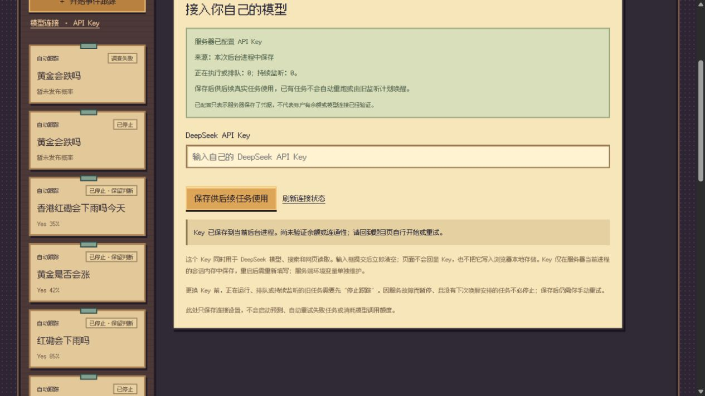
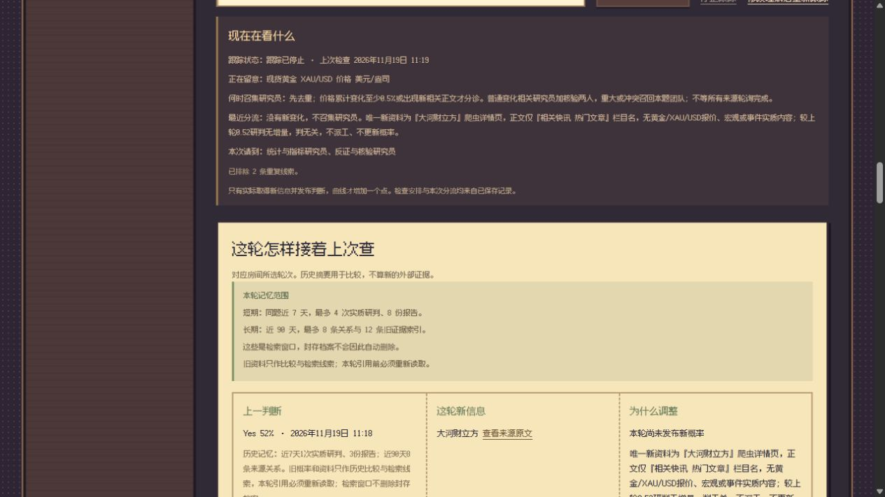

# 世界事务所

世界事务所是一个中文像素风事件判断器，服务于 COMP5584 多 Agent 课程项目。直接说“马斯克会不会发推特”或“黄金会跌吗”，主 Agent 简短整理题意，从十类研究员中按题派出三位，资料调查交给子 Agent。默认关注未来48小时，可选24小时或一周；“今天”跟踪到创建当天结束。研究员通过真实工具搜索、阅读并交报告，再围绕具体分歧补查、汇总“是／否”倾向及概率。

## V2.0 协作与连接

- **先派工**：主Agent第一步只整理和分配任务，子Agent先取证，再根据真实资料核定预测契约。
- **运行时看得见**：每位研究员调用模型时头顶显示“等待模型”；工具、报告和会议随真实执行事件更新。刷新恢复状态，不回放旧气泡。
- **有界循环**：每位研究员最多5次调查决策，第6次预留报告；初次汇报后最多2次定向补查。资料足够可提前总结，不为了展示凑轮数。输出字数、token与剩余预算写入system prompt并由后端限制。
- **记忆**：短期检索同题最近7天最多4次实质研判；长期检索90天内的有限来源关系和证据索引。档案不自动删除，旧资料需复查，未训练模型参数。[记忆规则](docs/MEMORY_POLICY_V2.md)
- **自己的Key**：打开顶部“模型连接”，用密码框输入DeepSeek API Key。Key只留在服务端会话内存，不写浏览器存储或项目数据；重启后需重填。保存后用于模型及搜索/网页读取，保存本身不发起预测；运行或排队期间不能换Key。

本版完整的改动对照、Agent 循环、记忆与监听规则、真实验证、已知问题和分优先级后续任务见 **[V2.0 详细改动与开发清单](docs/V2_CHANGELOG_AND_ROADMAP.md)**；简版及截图见 [V2.0交付记录](docs/V2_RELEASE.md)。内部harnessVersion=3是执行协议版本，与产品分支V2.0分别编号。

**当前为课程协作版，仅开放 binary 二元题型。** 普通入口不用选 Agent、配工具或提交材料；严格模式可覆写期限、规则、来源和时区，其余由系统补齐。SQLite 保存任务、检查点、工具回执、证据、关系及概率；后台按固定间隔检查，没有新正文不刷新概率。前端以持久执行事件的 HTTP 快照驱动人物、本人气泡、记录和阶梯曲线，历史刷新不补播发言。

当前已接通按题选人、历史判断／报告／关系摘要检索，以及新信息分流：普通更新由相关研究员和核验席两人复核，重大变化召回本题三人团队，重复内容不调用模型、不新增概率。市场和统计席另可调用只读现价工具，系统自动建立固定价格基准。监听频率仍由服务端配置；自主调整频率、通用时间图推理及自动到期评分尚未实现。默认 mock 使用虚构来源，只验证流程，不能作为真实预测或准确率证据。

真实 Pro 思考模式已用两条原问法完成验收，并验证后续检查读入 3 份报告、8 条关系和上一判断，无有效变化时保留原概率、不召集研究员。见[口语输入、监听与记忆说明](docs/DEMO_USABILITY.md)。这些是执行与可用性验收，不是预测准确率成绩。

旧版 2025 年 AI 芯片出口许可案例保留在 `/legacy.html`：固定五席会议、侧桌复核、历史预测和原有后台监测可以继续使用，与新工作台的通用预测能力分开。

下一版的产品边界、十类 Agent、工具循环、图记忆、持续监听、前端事件契约和验收计划见 [产品与开发规范](docs/PRD.md)。文档明确区分当前能力和待开发目标；后续开发入口为 [AGENTS.md](AGENTS.md)。

当前需求以 [PRD v0.6 源文档](docs/PRD.md)及[课程交付版](docs/COURSE_MVP.md)为准，实际交付与限制见[课程验收记录](docs/COURSE_ACCEPTANCE.md)。[PRD v0.2 阅读版](docs/LLMword_PRD_v0.2.pdf)及[横版展示附录](docs/LLMword_Presentation_Appendix.pdf)是历史会议材料，其其他题型规划不代表当前开放范围。

模型或资料服务发生额度、鉴权、权限错误时会暂停监听并说明原因；临时服务故障采用有界重试。失败题目可点击“重试本次调查”，无需重新输入；已有答案和失败历史保留。处理与验收见 [服务故障恢复](docs/PROVIDER_RECOVERY.md)。

## 项目截图

### V2.0｜真实调用期间可见每位研究员


这张截图来自真实DeepSeek调用期间。主Agent先派工，市场、统计、核验分别调查；等待标记由每位实际模型请求驱动，返回或失败后清除，刷新不会补播历史。该题最终给条件估计，缺固定价格基准，不计分。[本版真实验收](docs/V2_RELEASE.md)

### V2.0｜输入自己的API Key



入口在顶部和侧栏。Key只保留在服务器会话，重启需重填；有运行、排队或持续监听时不能更换，保存不会自动重跑旧任务。

### V2.0｜下一次检查真正带着记忆



短期检索近7天最多4次实质研判，长期检索90天有限关系和来源索引；窗口滑动不删除原档案。此次检查确认新页无实质内容，保留原概率。真实公开摘要见[初始研判](docs/evidence/v2-live-gold-summary.json)和[后续检查](docs/evidence/v2-live-memory-summary.json)。

### 早期实跑｜口语输入、按题选人


截图为真实 Pro 思考模式。主 Agent 从十类目录按题选人，右侧是答案、概率与资料充分度，默认假设及真实价格基准可展开。完整调查记录、原文、支持／反证关系和历史发布点可回查。概率轨迹记录实际提交的判断，没有未来外推线；47% 是模型事件估计，尚非准确率结果。

### 早期实跑｜历史记忆与安静监听


后台先去重并判断影响，再决定是否复核。图中实际保留原概率，未追加一个假的更新点；普通新信息派相关加核验两人，重大变化召回本题团队。详细实际回归与课堂操作见 [DEMO_USABILITY.md](docs/DEMO_USABILITY.md)。

### M1 历史｜多题目材料研读工作台


截图使用明确标注的虚构验收材料和 mock 协议。左侧是三道独立题目，中间是实际报告事件触发的气泡，右侧是期限与来源清楚的二元目标卡。材料收报、研究员定义、学习档案各有独立入口。

下面三张来自旧版案例，使用模拟模型，保留展示原有会议过程。

### 01｜收报后自动开会


后台收到模拟芯片许可公告后自动召集会议。图中小策已经完成政策研判，结论从他头上冒出，供应链、公司和市场席仍在各自核查。

### 02｜到侧桌复核分歧


主持人请公司研究员区分 AMD 此前的出口许可敞口和本次措施覆盖的产品。两人在侧桌核对证据后，回圆桌汇总判断。

### 03｜从关系图查回证据


点开「关系黑板」可看到同一项出口许可与两家公司产品的联系。每条关系附有出处，证据区只显示回放时点已公开的材料。

## 在本地运行

默认新工作台需要可直接加载 `node:sqlite` 的 Node 版本，本机验证为 Node v23.5.0，该版本的 SQLite 会显示 experimental 提示。旧案例仍支持 Node.js 20：设置 `WORLD_WORKBENCH=off`、`WORLD_RUNTIME=off` 即可。前端使用原生浏览器 JavaScript，服务端使用 Node.js；工具循环与数据契约采用 Ajv 校验。

在项目根目录运行：

```powershell
npm.cmd ci
npm.cmd run start:mock
```

打开 [世界事务所](http://127.0.0.1:4173)，输入问题、点击“开始跟踪”。可选24小时、48小时和7天；明确时长优先，“今天”固定到当地当天结束。该入口是明确标识的虚构演示，不能拿来预测现实问题；模型连接在此入口已锁定，真实运行请改用 `start:live` 入口。

领域数据默认写入 `${WORLD_STATE_PATH}.domain.sqlite`，课程协作、监听及发布写入 `${WORLD_STATE_PATH}.course.sqlite`；M0/M1 单人验证使用 `${WORLD_STATE_PATH}.runtime.sqlite`。分别支持 `WORLD_DOMAIN_PATH`、`WORLD_COURSE_PATH`、`WORLD_RUNTIME_PATH`。旧案例及监测另存档。只要 Node 服务保持运行，关闭网页不影响任务；服务重启恢复检查点和到期待办。

真实调查用 `npm.cmd run start:live`：入口默认监听 4174、使用 `.data/live/`，可以不带 Key 先启动；打开 [真实环境](http://127.0.0.1:4174) 后先在“模型连接”保存自己的 DeepSeek API Key，未保存前不会创建或恢复任何调查。保存后会自动调用 `/models` 校验连接：成功显示“已连接”，失败显示“已配置，未连接”，但 Key 仍会保留在当前服务进程内。Key 不写入浏览器存储、不回显输入框，刷新后需要重新输入。模型名、端点、思考与超时已有 DeepSeek 默认值。也可复制 `.env.example` 为被忽略的 `.env`，填好后运行 `node --env-file=.env start-live.mjs`，此时 Key 从服务端环境读取。`WORLD_COURSE_POLL_MS` 默认一小时，演示可缩短；真实网络使用时自行控制调用费用。`WORLD_COURSE=off` 可关闭课程入口后端。需要自定义端口、存档路径或旧版自动模式的调试场景，直接运行内部装配入口 `node server/app.mjs`，它不做模拟/真实环境锁。

默认端口 4173/4174、数据目录 `.data/mock/` / `.data/live/`。需要同模式多实例时，用 `PORT` 和 `WORLD_DATA_DIR` 指定独立端口与目录；同一数据目录仍只能有一个进程：

```powershell
$env:PORT = '5173'
$env:WORLD_DATA_DIR = '.data/mock-b'
npm.cmd run start:mock
```

旧 `.data/world.json*` 混合归档可用 `node scripts/legacy-data.mjs` 预览；停止相关服务后运行 `node scripts/legacy-data.mjs --apply`，会按课程运行记录迁移到 `.data/mock/legacy/`、`.data/live/legacy/`；混合或无法判断时放入 `.data/legacy/`。

## 按 PRD 开发

分工、各批依赖和验收出口见 [开发执行计划](docs/DEVELOPMENT_PLAN.md)，进度以[实现状态](docs/IMPLEMENTATION_STATUS.md)为准。本轮结果见 [课程验收](docs/COURSE_ACCEPTANCE.md)。[M1 验收](docs/M1_ACCEPTANCE.md)及[后端交叉审查](docs/M1_INDEPENDENT_REVIEW.md)保留历史批次。M0 独立入口继续用于验证工具协议、SQLite 检查点和恢复；[M0 独立校验](docs/M0_INDEPENDENT_REVIEW.md)和[框架选型](docs/M0_FRAMEWORK_DECISION.md)保留最初验证记录。

以下命令使用独立存档，启动无 key 的离线协议验证：

```powershell
$env:PORT = '4186'
$env:WORLD_RUNTIME = 'probe'
$env:WORLD_MODEL = 'mock'
$env:WORLD_MONITOR = 'off'
$env:WORLD_STATE_PATH = '.data/probe-legacy.json'
$env:WORLD_RUNTIME_PATH = '.data/runtime-probe.sqlite'
node server/app.mjs
```

在另一个终端创建验证任务：

```powershell
$taskInput = @{
  objective = '核实这份材料说明了什么，保留来源。'
  evidence = @(@{ evidenceId = 'source_one'; title = '提供的公告'; text = '这里填写需要核实的原文。' })
} | ConvertTo-Json -Depth 5
$probe = Invoke-RestMethod 'http://127.0.0.1:4186/api/v1/runtime/probes' -Method Post -ContentType 'application/json; charset=utf-8' -Body ([Text.Encoding]::UTF8.GetBytes($taskInput))
Invoke-RestMethod "http://127.0.0.1:4186/api/v1/runs/$($probe.runId)"
```

`GET /api/v1/runtime` 查看验证能力，`GET /api/v1/events` 订阅持久事件，`POST /api/v1/runs/:runId/cancel` 取消。服务启动会恢复未结束运行；模型配置变化则等待原配置恢复。客户端只得到公开报告与用量，不得到模型内部消息或检查点。

模拟协议会选择实际本地处理器并提交报告，明确标记为 mock，不能作为真实模型预测或准确率证据。本轮已用真实 DeepSeek 验证原生工具协议及网络 Search/Fetch；整轮实跑记录与用量见课程验收。高级材料研读继续复用原有 V1 SSE，课程主页面读取新的持久运行快照；两者按运行隔离。

运行完整测试使用 `node --test`，需要支持 `node:sqlite` 及本机回环 HTTP 访问的环境。

Node 服务只监听本机。旧版回放状态默认存到 `.data/world.json`。可用环境变量 `PORT` 和 `WORLD_STATE_PATH` 指定端口与存储文件。

## 旧版案例研究室

- 回放与自动会议都由实际任务事件驱动。研究员完成取证、核查或研判时，结果会从该研究员头上冒泡；完整研判同时留在会议记录。角色按任务状态在待机、工作、走路和发言的像素帧之间切换。产品范围未核实或判断分歧达到阈值时，相关研究员走到侧桌复核，之后回圆桌汇总。断线重连可以补收近期事件，完成后的回放和会议记录也可继续查看。
- 后台默认每五分钟检查 NVIDIA、AMD 的 SEC EDGAR 申报索引和 Polymarket 的相关合约。每个来源首次成功检查时建立基线。后续通过申报条目或合约主题、价差、流动性及报价变化判断是否开会。监测收件箱显示最近一次同步、各来源状态、原始链接、调度理由与最近一次自动会议。
- 浏览器可以关闭。只要 Node 进程和网络在运行，检查及自动会议会继续。重启后读取去重记录、排队任务及最近一次会议。实时监测与历史回放分别存档，公开来源的当前数据不会进入历史预测。后台初步研判不会把 Gamma 合约报价当作股价预测，也不会自动结算或训练。

环境变量 `WORLD_MONITOR` 支持 `public`（默认）、`demo`（无网络模拟）、`off`。可用 `WORLD_POLL_MS` 修改检查间隔，公开模式最短一分钟。部署者可把 `SEC_USER_AGENT` 设为应用名与有效联系邮箱。用 `WORLD_MONITOR_PATH` 可为观察任务指定单独的持久化文件。

想立即观看一次自动会议，可以从新存档启动模拟观察。模拟信号在启动约 12 秒后到达，随后还有一条被跳过的行政事项。重新使用同一存档不会重复召开该会。

```powershell
$env:WORLD_MONITOR = 'demo'
$env:WORLD_MONITOR_PATH = '.data/monitor-demo.json'
node server/app.mjs
```

模拟模型用固定间隔交付各席实际生成的结果，便于观看。自动化测试可设 `WORLD_MOCK_PACING=0`，真实模型按实际返回进度推送。

## 接入真实模型

在本机环境中设置 `WORLD_API_KEY`，再按供应商选择模型和端点。兼容端点应提供 Chat Completions 接口。真实模型默认使用独立的 `.data/world-live.json` 存档。

```powershell
$env:WORLD_MODEL = 'openai'
$env:WORLD_MODEL_NAME = '<模型名称>'
$env:WORLD_BASE_URL = 'https://api.openai.com/v1'
$env:WORLD_STATE_PATH = '.data/world-live.json'
node server/app.mjs
```

密钥由 Node 后端读取。真实模型模式会把当前角色技能、允许读取的案例数据和已结算经验发往配置的模型端点。演示自带的数据来自公开披露。

## 旧版案例两分钟演示

1. 从「初始披露」召集会议，打开会议记录查看研究员的工具调用、各自的判断和汇总结果。历史主线的预测在当前截止时点封存。
2. 切换到「限制范围较窄」或「限制范围较广」再推演。分支共用同一份已观察证据，假设只影响分支结果。
3. 回到主线并揭示下一事件。AMD 披露后，可在「学习档案」看到第一项预测的结算。接着召集会议，查看第二个预测怎样使用已结算经验。
4. 揭示 NVIDIA 的季度业绩后再次查看学习档案。事件尾声提供 AMD 的后续实际计提。重开回放会清除本次演示进度和学习记录。

## Harness、工具、技能与学习

- **Harness** 负责共享时间截点、角色分派、运行顺序、调用限制、证据校验、情景隔离和提交。浏览器通过同源 HTTP API 获取状态和结构化记录。
- **工具** 是后端可执行能力，接收参数并返回结构化数据。工具箱可以查看它们的用途，会议记录可以查看实际调用。
- **技能** 是仓库内角色工作手册，告诉 Agent 如何检查信息、采用证据和处理不确定性。点开研究员席位可查看其技能和工具。
- **持续学习** 是应用层记忆与有界概率修正。后续材料首次满足结算条件时写入一条带出处的结果，计算 Brier 误差 `(p - y)^2`。后续预测读取已结算经验。模型权重保持固定。情景推演和重复运行不会增加已结算样本。

## 数据范围

回放使用可查的公司披露。时间轴采用 SEC 接收时间作为演示时钟。模拟模式中的 Agent 发言与概率由可复现的规则生成，用来验证流程。当前案例只有两个可结算的经营事件，股价回测、预测效果评估及 X、Reddit、小红书等授权渠道属于下一阶段。Polymarket Gamma 返回的合约价格在缺少明确报价时间时标记为未知，监测以本次观察时间记录。

- [NVIDIA 初始 8-K](https://www.sec.gov/Archives/edgar/data/1045810/000104581025000082/nvda-20250409.htm)
- [AMD 后续 8-K](https://www.sec.gov/Archives/edgar/data/2488/000000248825000039/amd-20250415.htm)
- [NVIDIA 财务结果](https://www.sec.gov/Archives/edgar/data/1045810/000104581025000115/q1fy26pr.htm)
- [AMD 财务结果](https://www.sec.gov/Archives/edgar/data/2488/000000248825000106/q22025991.htm)

## 目录与验证

- `web/` 包含页面、交互与像素画。
- `server/harness.mjs` 管理会前研究、质疑、复核、校验及汇总。
- `server/tools.mjs` 注册工具并按角色检查访问权限，`server/skills/` 存放各席工作手册。
- `server/case.mjs` 保存历史证据和可结算问题，`server/world.mjs` 管理回放时钟、预测封存、持久化及学习记录。
- `server/provider.mjs` 提供可复现的模拟模型和 OpenAI 兼容适配器。
- `server/sources.mjs` 管理公开来源，`server/monitor.mjs` 维护独立的后台调度和观察存档，`server/events.mjs` 管理会议的 SSE 推送和断线补收。

在本机运行 `node --test` 可验证后端及 HTTP 集成。兼容适配器测试使用注入的传输，不会发真实 API 请求。

## 设计参考

代码为这个课程项目独立实现。角色分工、工具注册、持久化及回放的设计参考来自 [Anthropic 多 Agent 研究系统](https://www.anthropic.com/research/multi-agent-research-system)、[LangGraph 持久化](https://docs.langchain.com/oss/javascript/langgraph/persistence)、[MCP 工具契约](https://modelcontextprotocol.io/specification/2025-11-25/server/tools)、[Agent Skills](https://agentskills.io/specification)、[Reflexion](https://arxiv.org/abs/2303.11366) 和 [FutureSim](https://arxiv.org/abs/2605.15188)。

研究室图片 `web/assets/lab.png` 由内置 ImageGen 生成。原始生成提示如下。

> Use case: stylized-concept. Asset type: decorative full-width game scene in an original Chinese-language web app, no UI/text baked in. Wide 2:1 landscape, edge to edge, an exquisitely composed isometric 2D pixel-art field research room for a friendly team of technology-world investigators, strongly nostalgic handheld 16-bit RPG but original. Four clearly distinguishable small human pixel characters seated/gathered around a big oblong honey-colored wooden conference table in the central-lower third, clothing dusty orange, sage green, lake blue, and dark grape, varied hairstyles, miniature laptops and paper diagrams. Behind them at upper center a large dark teal wall-mounted display with a simple glowing node network, no glyphs or text. Broad window at upper left overlooks twilight city, distant lavender blue skyline and warm window lights. Bookshelves, potted plants, beige lab walls, cozy dark timber floors, tiny coffee mugs, old computer station at far right. Strong clean clustering, visible large pixel grid rendered with crisp stepped edges and dither, no smoothing, little shadow color clusters, premium contemporary indie game pixel art. Cream, amber and moss accents on warm brown, midnight navy and dusky teal shadows, cozy lamplight. Main characters visually readable at website hero width, all fully inside frame. Keep the table and team as unmistakable focal point, no overcrowding, no lettering, no logos, no captions, no badges, no UI.

当前场景 `web/assets/lab-play.png` 也由内置 ImageGen 编辑生成，提示要求保留夜景、灯光、关系黑板和木质像素画风，移除原图中的人物，添加圆桌旁的双人侧桌并留出连续可走动的前景地板。研究员由浏览器单独绘制和移动。
