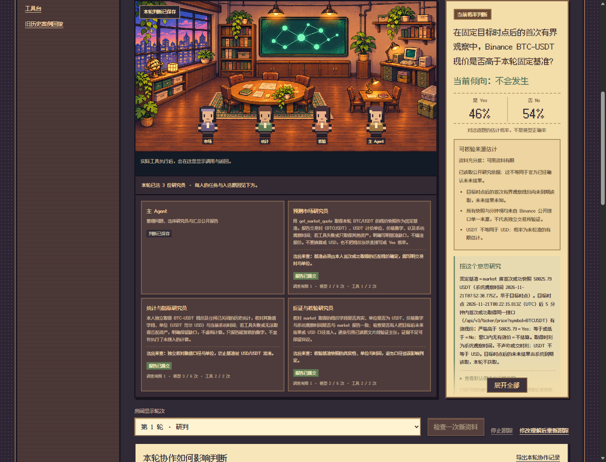
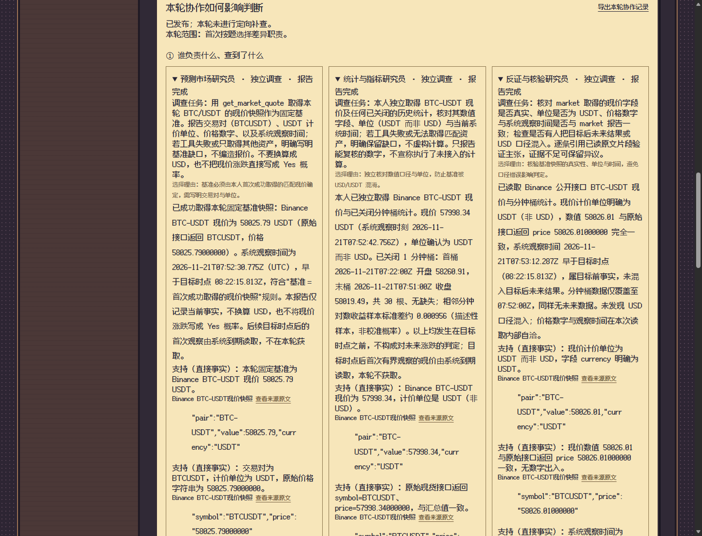
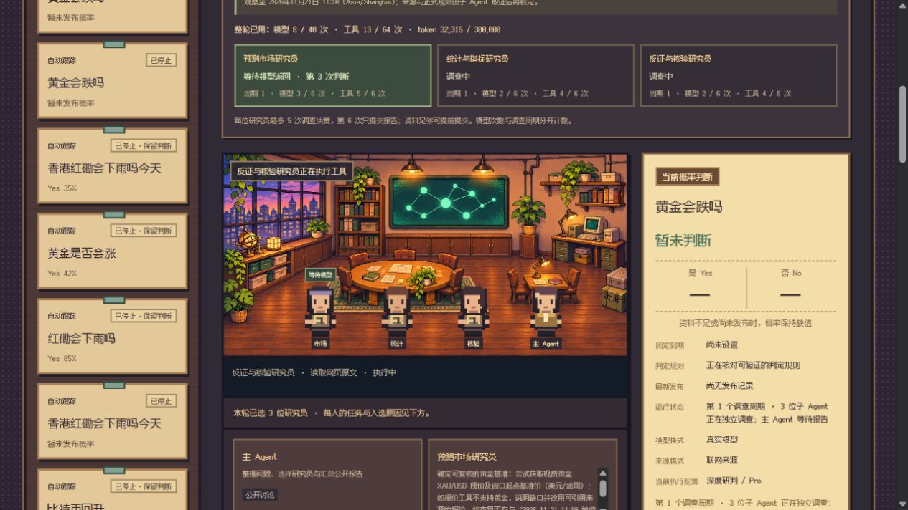
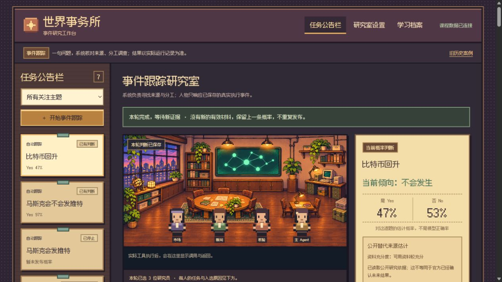
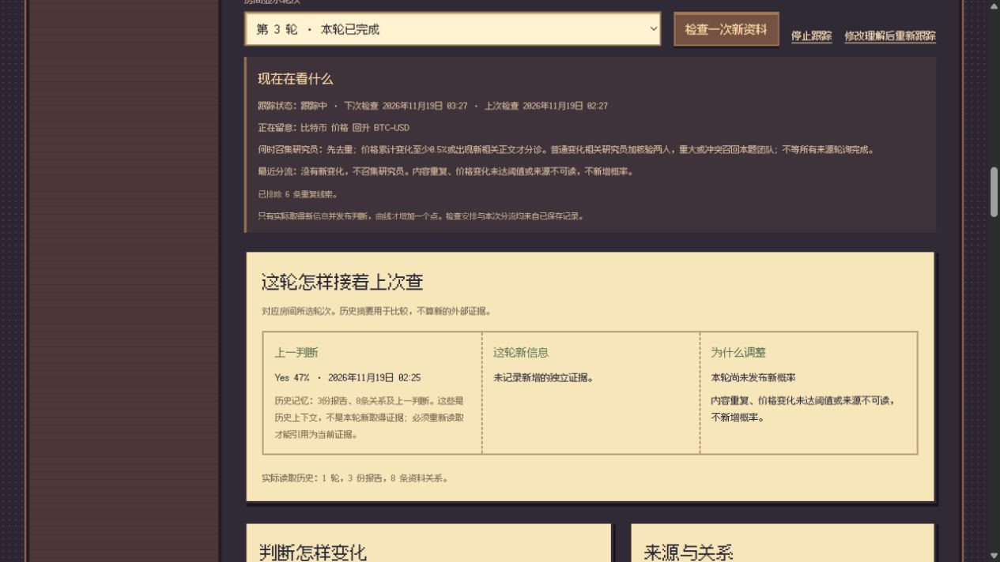

# 金融预测事务所 V4.0 · 多 Agent 事件研究工作台

<!-- current-handoff-20261122 -->

面向 COMP5584 的像素风多 Agent 金融预测工作台，支持主要界面简体中文／English切换。用户输入关注的股票、证券或基金，主 Agent 从当前可用研究员目录中按题选三类，研究员实际调用工具取证、提交带来源的报告，主 Agent 比较支持与反证并封存判断。默认提供十类角色模板，可按需新增或删除；财报解读与未来事件预测使用不同任务目的，概率、证据充分度、协作一致性分别记录。

当前工作版本：**V4.0**，验证日期：**2026-11-22**，开发分支为 `V4.0`。本轮延续 V3.0 的调查执行与证据约束，完善金融预测入口、研究室交互、模型配置及成本管理。V3.0 的版本范围和真实验收见[原发行说明](docs/V3_RELEASE.md)，V2.0 分支及既有运行隔离继续保留；早期说明和截图收在本页末尾的历史折叠区。

**建议阅读顺序：**[交接入口](docs/DELIVERY_HANDOFF.md) → [金融预测真实验收状态](docs/FINANCIAL_PREDICTION_REPORT.md) → [质量与限制](docs/DELIVERY_STATUS_REPORT.md)。完整需求见[PRD](docs/PRD.md)，开发约束见[AGENTS.md](AGENTS.md)。姓名、学号、实际贡献及贡献声明由小组后续填写。

## 设计背景与版本延续

“世界事务所”最初面向持续变化的公开事件：用户用一句话提出关注的问题，系统把它整理成有期限、来源和判定规则的二元预测，再调查、复核和记录后续变化。早期 NVIDIA、AMD 公司披露案例用于展示按信息截点研究、封存预测及结果反馈；科技商业、政策和公开机构事件仍是整体设计的适用方向。V3.0 的财报研读和 BTC-USDT 短窗口预测，是验证不同任务流程的代表案例。

原设计采用“主 Agent + 按题选择的研究员”：主 Agent 拆题、派工、比较报告和形成最终输出；研究员具有不同职责、独立上下文及工具许可，先取证，再就具体争议补查。十类能力目录默认选三席，避免每道题都调用全部角色。像素研究室展示后端实际发生的任务、工具和会议事件；带时间与出处的历史摘要、支持/反证关系为后续研究提供线索。完整时序因果图与自动校准仍属于后续目标。

V3.0 延续前面同学建立的 mock/live 隔离、模型连接、像素界面和执行框架，重点完善角色调查方法、市场基准与财报口径、多语言检索、逐条引用、报告裁决、预算恢复及固定规则的结果核验。多 Agent 的设计目标是让不同调查职责相互补充、暴露分歧；目前已有可追溯的协作执行记录，是否优于单 Agent 仍需同题对照验证。原有设计说明、参考资料和开发记录保留在本页历史区及 Git 提交历史中。

## V4.0 开发更新记录

| 日期 | 负责人／提交 | 改动 | 验证 | 边界与状态 |
| --- | --- | --- | --- | --- |
| 2026-11-22 | Codex 辅助；团队成员／提交待填 | 主视图改为全屏像素研究室，开始预测、研究室设置、模型连接通过弹窗操作；真实预测历史改为顶部下拉，统一品牌、字体和页面文案，精简重复入口及房间状态条。 | [研究室与弹窗回归](docs/evidence/v4-room-shell-regression.json)；状态条调整后 workflow 定向检查 8/8 通过。 | 房间与弹窗独立维护；暂隐藏页面和严格模式的源码及路由保留，调查明细集中到“预测结果与进度”。 |
| 2026-11-22 | Codex 辅助；团队成员／提交待填 | DeepSeek Key、完整 URL 和 model 可编辑，提供官方／校园预设与 URL 自动匹配；成功连接后密码框脱敏保留输入。 | [模型配置回归](docs/evidence/v4-provider-configuration-regression.json)。 | Key 仅存当前文档及服务会话内存；校园／自定义凭据不转发给官方资料服务，连接校验不代表整轮任务成功。 |
| 2026-11-22 | Codex 辅助；团队成员／提交待填 | 新增有限／无限任务 Token 总预算及可编辑预设；每次保存模型连接后刷新公开价格，按输入缓存、输出和峰谷时段对齐展示。 | [预算与价格回归](docs/evidence/v4-research-settings-regression.json)。 | 新预测默认有限 1,000,000 tokens，设置只作用于新任务；无可靠收费来源时明确显示未公开。 |
| 2026-11-22 | Codex 辅助；团队成员／提交待填 | 新增研究员席位删除和页面主题二次确认，保留历史角色版本、报告与运行快照。 | [删除与主题确认回归](docs/evidence/v4-theme-confirmation-regression.json)。 | 运行中或版本冲突拒绝删除；缺少所需角色会在模型调用前提示，重启不恢复已删除席位。 |
| 2026-11-22 | Codex 辅助；团队成员／提交待填 | 金融标的入口改为单输入，期限提供 1/3/5/20 个交易日，默认 5 日；未注明市场默认港股，创建时封存对应市场的目标收盘时间。 | [金融入口与交易日回归](docs/evidence/v4-financial-entry-regression.json)。 | 使用已核验休市、半日市及市场时区；超出日历覆盖范围拒绝计算，不新增全市场行情或通用自动结算能力。 |
| 2026-11-22 | Codex 辅助；团队成员／提交待填 | 新增界面中英切换，完善弹窗生命周期、过期异步回调保护与用户数据翻译边界，并补充说明和测试记录。 | [447/447 全量回归](docs/evidence/v4-locale-navigation-regression.json)。 | 切换语言保留输入和当前房间；历史题名、报告与证据原文保持原样，偏好只保存语言码。 |

以上为本轮本地实现与验证记录，实际成员归属和提交号由团队填写；此前的真实样例继续按其原版本、日期和证据边界引用。

## 当前能做什么

| 能力 | 当前实现 | 范围与限制 |
| --- | --- | --- |
| 按题派工 | 默认十类角色模板，从当前可用目录初始选择三类不同职责并含核验；按争议定向补查 | 可新增／删除席位；缺少必要角色时预检拒绝，真实覆盖以实际记录为准 |
| 公开调查 | Search/Fetch、定位正文、任意语言检索意图、最多三路新闻查询 | 搜索摘要不成为引用；语言/地区参数不证明来源独立 |
| 财报研究 | `purpose: research`，财报/指引/管理层表述分开，金额口径比较，研报独立封存 | 不输出未来事件概率；无全市场股票价格与交易接口 |
| 市场基准 | 原有 BTC/ETH-USD 报价匹配、本人本轮读取及固定基准守卫 | Coinbase 来源可用性取决于网络，缺报价明确保留缺口 |
| 短窗口金融预测 | 严格 BTC-USDT 规则使用固定 Binance 公开来源；三席完整才发布，汇总前刷新最新行情 | USDT 不等同 USD；原始 K 线归档、模型读取统计摘要；未来概率未校准 |
| 逐条证据 | `fact/inference`、本人/本轮已读、真实原文片段、数字与时间检查 | 片段匹配不是任意自然语言的完整语义证明；旧封存不追改 |
| 协作追溯 | 公开分工、工具回执、报告、争议补查、逐报告裁决及 JSON 导出 | 不展示模型隐藏推理，不伪造未记录的采纳理由 |
| 到期核验 | 官方警告、严格 BTC-USDT 两个固定规则子集；独立结果证据与单题 Brier | 通用题自动结算、长期回测和准确率校准仍待完善 |
| 记忆与恢复 | 有界历史摘要、支持/反证关系、版本与检查点、明确失败/恢复事件 | 无参数训练、完整时序因果图或全平台社交连接 |

## 网页实景

下面三张为 **V3.0、2026-11-21 金融预测验收的存档截图**，展示完整三席、固定基准、概率和来源。截图中的 46% 是当时封存的模型事件概率；V4.0 的界面布局已更新，这些截图继续作为原样例的执行证据，实际结果及验收边界见[运行报告](docs/FINANCIAL_PREDICTION_REPORT.md)。



像素研究室绑定已持久化的派工、工具、报告和发布事件；主 Agent 加三位研究员，共四个角色。图片没有拍摄 API Key 输入页。



此面板可查看“谁查了什么、引用支持什么、哪些结论被采纳或保留”。初始研究员上下文独立；核验席会明确披露未取得的同伴材料，主 Agent 在汇总阶段比较全部报告。


结果核验后，原 46% 预测仍保持封存，实际结果和单题评分另列。该截图说明执行闭环，不以单题成绩代替总体准确率。

## 五分钟运行

需要 **Node.js 22.17 或更高版本**及 npm，本轮 V4.0 自动化回归使用 **Node.js 24.22.3**。服务使用内置 `node:sqlite`，可能显示 experimental 提示。普通运行无需 Python、浏览器插件或图数据库。

在项目根目录运行（Windows PowerShell；macOS/Linux 使用 `npm`）：

```powershell
npm.cmd ci
npm.cmd run start:mock
```

打开 [模拟工作台](http://127.0.0.1:4173)。模拟入口不需要 Key，模型和来源均明确标为 mock/replay，只验证流程。默认显示全屏研究室。顶部依次为开始预测、预测历史记录、研究室设置和模型连接；三个操作菜单打开站内编辑弹窗，预测历史记录下拉展示实际保存任务。其他辅助入口暂时隐藏，页面与路由保留，旧版研究室仍位于 `/legacy.html`。

重新生成本地只读案例：

```powershell
npm.cmd run cases
npm.cmd run cases:finance
npm.cmd run cases:warning
npm.cmd run cases:price
```

对应七个原流程受控案例、财报案例、警告闭环和金融价格闭环。生成器保留各自公开真实存档，失败与恢复单独显示。查看真实存档不会重新调用模型，mock 分数不能计入真实预测成绩。

### 真实环境与 Key

```powershell
npm.cmd run start:live
```

打开 [真实工作台](http://127.0.0.1:4174)，先在“模型连接”保存 DeepSeek Key。

V4.0 的模型连接页可同时编辑 Key、完整聊天 URL 与 model；URL/model 都支持下拉预设及手动输入。默认 `https://api.deepseek.com/chat/completions` ＋ `deepseek-flash`；校园预设为 `https://genai.comp.polyu.edu.hk/api/v1//chat/completions` ＋ `DeepSeek-V4-Flash`，选择 URL 自动匹配模型。保存后只在当前服务进程生效。校园/自定义模型凭据不会发送给官方搜索/正文服务；如需这些来源工具，可在服务端独立配置官方 `WORLD_SEARCH_API_KEY`。校园接口的实际账户权限与工具协议需使用自己的 Key 调试，连接状态仅反映对应 `/models` 检查。连接成功后，当前页面会以密码框圆点保留本次输入的 Key，并支持直接编辑与菜单切换后恢复。Key 仅在当前页面文档及后台进程内存中保留，不写入浏览器本地存储或项目文件；刷新整个网页后不会自动恢复输入值；通过网页保存的会话 Key 在服务重启后需重新填写，显式配置的环境变量凭据按启动环境加载。保存本身不创建预测。角色、工具及用量以实际执行回执为准。

以下命令会显式创建一条真实金融预测，**查看已有案例无需运行它**：

```powershell
node scripts/live-price-case.mjs --start --base=http://127.0.0.1:4174
```

脚本固定约 30 分钟后的目标，按严格 BTC-USDT 规则运行三席，并在目标后核验一次结果，不开启模型持续监听。中断后以相同端口 `--resume` 继续同一个 requestId；已有状态文件存在时不会另建案例。真实任务的模型调用会消耗用户账户额度。V4.0 新价格任务的总 token 预算取当前研究室设置，新环境默认有限 1,000,000；旧样例封存的 300,000 上限及实际用量继续保留，后续修改设置不会回写历史预算。

### 单次预测预算与模型价格

在“研究室设置”顶部选择有限/无限预算并保存。新预测默认总预算1,000,000 tokens，可选100,000、300,000、500,000、1,000,000或手填正整数；无限仅移除整轮token总量限制，其他调用和输出限制仍保留。设置持久保存，只对新建预测生效，旧任务与财报专项预算保持原值。

右侧按当前连接的精确模型名展示公开单价。每次保存模型连接后读取[官方最新价格](https://api-docs.deepseek.com/quick_start/pricing/)，分别列出峰/谷时段的输入缓存命中、输入缓存未命中及输出价格，并显示单位、来源及更新时间。校园或自定义网关没有已核验收费来源时显示未公开；获取失败不显示旧值冒称最新，价格读取不发送Key或调用模型。

### 删除研究员席位

研究室设置中，每张席位卡右上角的“删除”会先弹出与页面同主题的确认框；取消、Esc或关闭弹框均不操作，确认后该席位从可用目录移除。角色旧版本、历史运行和报告保留，重启不会重新生成已删除席位。调查进行中不能删除；版本冲突时刷新再试。新预测需要至少三种可用职责及原核验席，固定规则题还需对应角色；缺少时会在模型调用前明确提示，不会偷偷恢复已删除席位。

### 数据与多实例隔离

| 入口 | 默认端口 | 默认数据目录 |
| --- | --- | --- |
| `start:mock` | 4173 | `.data/mock/` |
| `start:live` | 4174 | `.data/live/` |

同一目录只供一个实例使用。需要单独端口/存档时：

```powershell
$env:PORT = '4196'
$env:WORLD_DATA_DIR = '.data/financial-prediction-live'
npm.cmd run start:live
```

运行入口验证模式并清除旧分库路径覆盖，避免 mock/live 混用。旧根目录归档迁移先运行 `npm.cmd run migrate:data` 预览；实际迁移方法见[交接](docs/DELIVERY_HANDOFF.md)。源码包不包含 `.data`、Key、`.env`、`node_modules` 或 `.git`。

## 十类 Agent 怎样分工

| 角色 ID | 职责重点 | 已接入的能力或边界 |
| --- | --- | --- |
| `official` | 正式公告、原始数据、版本 | 指定域名取证，警告子集直接读取官方 JSON |
| `timeline` | 首发、更正、转载及时间线 | 多语言新闻查询与正文读取，区分取得/发布/事件时间 |
| `industry` | 机制、条件、反例 | 使用公开资料，行业假设与已核实事实分开 |
| `people` | 当时身份、说话人、场合 | 旧引语与旧职位不直接移用于当前 |
| `statistics` | 单位、期间、样本、口径 | 财报指标比较；严格价格题的已关闭分钟桶统计 |
| `market` | 匹配报价、固定基准、市场口径 | 已验证的报价工具；缺价格或错资产时保留不足 |
| `social` | 公开社群线索与样本偏差 | 不声称有私有平台或全量舆情权限 |
| `analogy` | 可比条件、差异和失败反例 | 只读本轮固定历史摘要，旧来源须重读 |
| `graph` | 支持/反证关系与条件 | 只读历史关系线索，不冒称完整因果图推理 |
| `verification` | 片段、数值、时间和来源独立性 | 独立核查并披露缺口；主 Agent 比较最终报告 |

调查方法为 `investigation-methods-v2`，金融研究另有专项方法快照。实际许可按每次派工保存。五种受控问题各实际执行三席，累计覆盖十类；这不等于十类均完成真实渠道验收。

## 证据、最新数据与结果

流程为：**整理问题/派工 → 独立取证 → 核定契约 → 汇报与必要补查 → 封存预测或研报 → 对已支持的固定规则到期核验**。

- 引用须提供真实已读正文片段；搜索结果只是候选。直接事实与推断/计算分别标记，数值比较保留无损十进制精度。机器 JSON 只容忍字符串外空白，不接受改字段、改值或给子集补造括号。
- 初始固定基准、汇总前最新观察、目标后的实际结果分别保存。严格价格题在三席后刷新现价/已关闭分钟桶，发布前新现价最多两分钟旧；之后不会把更新后的价格回写成原始基准。
- 原始 K 线与确定性统计保存在证据，模型只接收统计摘要，避免把重复数组塞满上下文。结果核验读取固定公共接口，不调用模型。
- 目标后的有效观察严格高于基准记 Yes，等于或低于记 No；提前、迟到、无效数据或来源失败不能判 No。单题 Brier 记录一次误差，不代表整体准确率。
- 首次金融失败、旧财报引用问题及警告维护恢复均保留，参见[质量记录](docs/DELIVERY_STATUS_REPORT.md)和[财报复核](docs/FINANCE_RESEARCH_REPORT.md)。正常发布与维护恢复分开标识。

### 多语言与可选 Bing

默认使用既有 DeepSeek 搜索/正文服务，允许按主体原始语言提交检索；`search_news` 最多三路，兼容旧 `queryZh/queryEn`。`language/market` 是检索意图，不保证地理索引或来源独立性。

`WORLD_BING_SEARCH=enabled` 可显式启用公开 RSS 适配器，查询可选国内/国际入口。未启用、超时、访问拒绝、验证码或非 RSS 时记录原因并回退默认服务。不依赖本机 Edge、账户登录或固定地区网络，不将两种入口自动计为两份独立来源。公开行情来源同样应在目标电脑预检可达性，不能根据当前电脑就承诺所有网络可用。

## 测试与真实记录

```powershell
npm.cmd test
npm.cmd run verify:collaboration
```

V4.0 最新完整回归 **447/447 通过**，见[机器记录](docs/evidence/v4-locale-navigation-regression.json)，覆盖模型配置、预算、删除、交易日、房间／弹窗隔离、界面语言及数据保护。随后移除房间两条重复状态摘要的 workflow 定向复验 **8/8 通过**；两者为不同范围的检查，不相加。

V3.0 的 **333/333** 回归保留在[历史机器记录](docs/evidence/collaboration-regression-summary.json)。自动化测试使用模拟响应和本地 HTTP 服务，不调用真实模型；部分测试需要本机回环 HTTP 与临时文件权限。本轮另核对运行服务的静态资源和历史接口，未新增 V4.0 真实模型验收或新版桌面／手机视觉验收记录。

真实测试和 mock 分开记录。保留的 V3.0 金融样例正常三席完成、正常自动发布，没有维护重验或汇总续写；原始运行、实际发布时间、数据新鲜度、用量及到期状态见[金融预测报告](docs/FINANCIAL_PREDICTION_REPORT.md)。预测方向命中率、概率校准和多 Agent 的相对优势仍需要多样本及同题对照。

## 下一位同学从哪里接手

1. 先用无 Key 模拟环境复现案例，核对[交接说明](docs/DELIVERY_HANDOFF.md)、公开运行证据及已知限制。
2. 优先做小规模同题对照：相同资料截点与预算，比较单 Agent/三席或有无记忆，记录事实/引用错误、完成率、成本和耗时；不要以一个样本声称准确率提升。
3. 完成演示视频、PPT、运行说明和课程提交材料；成员身份、实际贡献及贡献声明由团队填写。
4. 完整时序图、全平台社交连接、任意股票行情、通用自动结算和大规模校准属于后续扩展，按需单独验收。

当前工作分支为 `V4.0`；原仓库的 [V3.0 分支](https://github.com/Bryce0312/LLMword/tree/V3.0)、[V2.0 分支](https://github.com/Bryce0312/LLMword/tree/V2.0)及其提交历史保留。下方历史区与旧验收记录中的“未上传”指各自当时的本地开发阶段；当前功能范围以上文及本轮更新记录为准。

## 常驻研究室与操作弹窗

默认空地址或 `#/room` 为全屏空闲研究室，不会自动创建任务或调用模型。“开始预测”“研究室设置”“模型连接”打开独立操作面板；关闭后回到当前房间，弹窗切换不销毁所选任务的轮询与运行归属。当前任务的答案、来源和过程位于右侧“预测结果与进度”折叠面板；全屏房间的重复阶段条与工具状态条已隐藏，详细周期和工具记录统一在该面板查看。

“预测历史记录”在开始预测后，展开时只读刷新实际任务接口；区分空记录、读取失败和已保存任务，点击只恢复所选记录及对应运行，不自动新建、检查或重试。研究室图片与人物共用同一坐标画布，发言仍来自已保存的真实事件。编辑面板关闭后，过期异步回调不会覆盖新面板、跳转或清除新凭据缓存。

## 界面语言

菜单最右侧提供“简体中文 / English”。切换会原位更新主要菜单、表单、按钮、状态和常用帮助，保留当前输入、操作监听与所选研究室；默认简体中文，只将语言码存入 `world-lab.locale`。历史题名、模型报告、证据原文、角色名称、配置值和密码输入不做机器翻译，不改变已保存内容。未收录的界面文案保留原文。顶部菜单去除底色、外框与装饰，四个菜单与站点名称使用同款像素字体并采用较小字号。

## 金融标的入口与交易日窗口

点击顶部“开始预测”弹出标的输入面板，显示“写下一个你关注的股票证券基金”标题及名称／代码输入；预测窗口为1、3、5、20个交易日，默认5个交易日。未注明市场时按用户选择的港股日历；明确A股、港股或美股代码时优先识别对应市场，冲突输入须修正。市场选择只是日历假设，不能代替核验实际上市证券及基金类型。

从创建时市场日期之后的下一开市日起计数，目标为第N个交易日收盘；周末及公告休市日跳过，半日市计一天，美股时区处理夏令时。新任务封存市场、期限、官方日历版本与来源，旧任务和后续检查不重算。港股／NYSE日历覆盖2026、2027；沪深A股目前仅核验2026，超出已核验范围会明确拒绝，不能用自然日或仅跳周末代替。事实与来源见 `server/course/calendars/market-holidays.json`；个股停牌、场外基金净值估值日及后续临时休市仍需另行核验。

## 临时隐藏入口的恢复方式

主页 `web/index.html` 的 body 上，`data-hide-secondary-navigation="true"` 暂时隐藏高级材料研读、工具台、旧历史案例回放、学习档案和财报案例入口；移除该属性或改为 `false` 即可恢复。`data-financial-entry="true"` 启用精简金融标的入口；移除或改为 `false` 可恢复原研究目的与小时窗口表单源码。`data-hide-strict-mode="true"` 独立隐藏模式切换和严格配置；需要恢复严格模式时，金融入口开关与严格模式隐藏开关均须移除或改为 `false`。页面、路由、严格模式字段和 API 均保留。

## 代码导航

| 入口 | 用途 |
| --- | --- |
| [start-mock.mjs](start-mock.mjs) / [start-live.mjs](start-live.mjs) | 模式、端口及数据隔离 |
| [course-service.mjs](server/course/course-service.mjs) / [course-store.mjs](server/course/course-store.mjs) | 编排、预算、持久回执、封存与结果 |
| [investigation-profiles.mjs](server/course/investigation-profiles.mjs) / [research-profiles.mjs](server/course/research-profiles.mjs) | 十类通用方法和财报专项方法 |
| [web-tools.mjs](server/course/web-tools.mjs) / [news-search.mjs](server/course/news-search.mjs) / [bing-search.mjs](server/course/bing-search.mjs) | 搜索、正文、语言与可选渠道 |
| [market-report.mjs](server/course/market-report.mjs) / [market-resolution.mjs](server/course/market-resolution.mjs) | 原市场基准约束及严格价格子集 |
| [claim-grounding.mjs](server/domain/claim-grounding.mjs) | 本轮/本人、时间、片段与数值守卫 |
| [collaboration.mjs](server/course/collaboration.mjs) / [course-collaboration.js](web/course-collaboration.js) | 公开协作投影、报告裁决和引用展示 |
| [workbench-room-shell.js](web/workbench-room-shell.js) / [room-shell-navigation.mjs](web/room-shell-navigation.mjs) | 常驻研究室、操作弹窗、独立生命周期及历史切换 |
| [locale.mjs](web/locale.mjs) / [locale-zh-en.mjs](web/locale-zh-en.mjs) | 界面中英切换、原位更新与数据原文保护 |
| [trading-calendar.mjs](server/course/trading-calendar.mjs) / [日历事实数据](server/course/calendars/market-holidays.json) | 交易日期限、市场休市与半日市、时区及来源版本 |
| [prediction-budget.mjs](server/course/prediction-budget.mjs) / [research-settings.js](web/research-settings.js) | 新任务预算设置与前端成本管理 |
| [model-endpoint.mjs](server/runtime/model-endpoint.mjs) / [model-pricing.mjs](server/runtime/model-pricing.mjs) | 模型地址／协议及公开价格读取 |
| [scripts/](scripts/) / [web/demo/](web/demo/) | 独立受控案例与公开只读存档 |

模块文件的完整路径见对应目录；[架构](docs/ARCHITECTURE.md)、[实现状态](docs/IMPLEMENTATION_STATUS.md)、[决策记录](docs/DECISION_LOG.md)保留历史及范围。

<details>
<summary>早期 V2.0 说明、开发记录与原有截图（历史原文）</summary>

以下保留此前协作版本的说明。旧版能力、端口示例、测试数量及待办须按其日期理解，当前运行方法以上文与最新交接为准。

# 世界事务所

本地最新交接入口：[十角色、可移植搜索、逐条引用与结果核验](docs/DELIVERY_HANDOFF.md)。Node要求22.17或更高；原版本记录按日期保留，不代表所有设计目标已经实现。当前改动尚未上传GitHub。

追加金融预测的当前真实验收见[金融预测报告](docs/FINANCIAL_PREDICTION_REPORT.md)：三席完整、初始固定基准与汇总前最新行情分开，实际结果按事先固定的目标核验。`npm.cmd run cases:price`生成mock及真实只读案例；新价格任务预算300000tokens是程序配置，实际用量单独记录。

世界事务所是一个中文像素风事件判断器，服务于 COMP5584 多 Agent 课程项目。直接说“马斯克会不会发推特”或“黄金会跌吗”，主 Agent 简短整理题意，从十类研究员中按题派出三位，资料调查交给子 Agent。默认关注未来48小时，可选24小时或一周；“今天”跟踪到创建当天结束。研究员通过真实工具搜索、阅读并交报告，再围绕具体分歧补查、汇总“是／否”倾向及概率。

## 开发更新记录

| 日期 | 负责人／提交 | 改动 | 验证 | 边界与状态 |
| --- | --- | --- | --- | --- |
| 2026-11-20 | Codex 辅助；团队合并人及提交待填 | 市场 Agent 首次建立 BTC/ETH 涨跌题时，报告须引用本轮由自己取得的对应现价；缺失或错配时标为资料不足。新派工记录规则版本，旧检查点沿用原行为；后续检查沿用固定基准。模拟适配器按原题选交易对并引用报价。 | Node v22.17.1，`node --test`：264/264 通过；新增 4 条市场报告回归，另核对已有课程端到端用例。 | 仅覆盖 BTC/ETH 现价，不是预测市场盘口；本地工作副本，待团队合并。未新增真实模型实跑。 |

每次功能更新继续追加一行，注明实际负责人、对应提交及真实验证记录；完整运行证据和限制可链接到 `docs/`。此行的成员归属由团队合并时填写。

## V2.0 协作与连接

- **先派工**：主Agent第一步只整理和分配任务，子Agent先取证，再根据真实资料核定预测契约。
- **运行时看得见**：每位研究员调用模型时头顶显示“等待模型”；工具、报告和会议随真实执行事件更新。刷新恢复状态，不回放旧气泡。
- **有界循环**：每位研究员最多5次调查决策，第6次预留报告；初次汇报后最多2次定向补查。资料足够可提前总结，不为了展示凑轮数。输出字数、token与剩余预算写入system prompt并由后端限制。
- **记忆**：短期检索同题最近7天最多4次实质研判；长期检索90天内的有限来源关系和证据索引。档案不自动删除，旧资料需复查，未训练模型参数。[记忆规则](docs/MEMORY_POLICY_V2.md)
- **自己的Key**：打开顶部“模型连接”，用密码框输入DeepSeek API Key。Key只留在服务端会话内存，不写浏览器存储或项目数据；重启后需重填。保存后用于模型及搜索/网页读取，保存本身不发起预测；运行或排队期间不能换Key。
- **市场基准核验**：首次 BTC/ETH 涨跌题的市场研究员必须引用自己本轮实际取得的匹配现价；缺少时报告明确标为资料不足。固定基准在后续检查中保持不变。

本版完整的改动对照、Agent 循环、记忆与监听规则、真实验证、已知问题和分优先级后续任务见 **[V2.0 详细改动与开发清单](docs/V2_CHANGELOG_AND_ROADMAP.md)**；简版及截图见 [V2.0交付记录](docs/V2_RELEASE.md)。内部harnessVersion=3是执行协议版本，与产品分支V2.0分别编号。

**当前为课程协作版，仅开放 binary 二元题型。** 普通入口不用选 Agent、配工具或提交材料；严格模式可覆写期限、规则、来源和时区，其余由系统补齐。SQLite 保存任务、检查点、工具回执、证据、关系及概率；后台按固定间隔检查，没有新正文不刷新概率。前端以持久执行事件的 HTTP 快照驱动人物、本人气泡、记录和阶梯曲线，历史刷新不补播发言。

当前已接通按题选人、历史判断／报告／关系摘要检索，以及新信息分流：普通更新由相关研究员和核验席两人复核，重大变化召回本题三人团队，重复内容不调用模型、不新增概率。市场和统计席另可调用只读现价工具，系统自动建立固定价格基准。监听频率仍由服务端配置；自主调整频率、通用时间图推理及自动到期评分尚未实现。默认 mock 使用虚构来源，只验证流程，不能作为真实预测或准确率证据。

真实 Pro 思考模式已用两条原问法完成验收，并验证后续检查读入 3 份报告、8 条关系和上一判断，无有效变化时保留原概率、不召集研究员。见[口语输入、监听与记忆说明](docs/DEMO_USABILITY.md)。这些是执行与可用性验收，不是预测准确率成绩。

旧版 2025 年 AI 芯片出口许可案例保留在 `/legacy.html`：固定五席会议、侧桌复核、历史预测和原有后台监测可以继续使用，与新工作台的通用预测能力分开。

下一版的产品边界、十类 Agent、工具循环、图记忆、持续监听、前端事件契约和验收计划见 [产品与开发规范](docs/PRD.md)。文档明确区分当前能力和待开发目标；后续开发入口为 [AGENTS.md](AGENTS.md)。

当前需求以 [PRD v0.6 源文档](docs/PRD.md)及[课程交付版](docs/COURSE_MVP.md)为准，实际交付与限制见[课程验收记录](docs/COURSE_ACCEPTANCE.md)。[PRD v0.2 阅读版](docs/LLMword_PRD_v0.2.pdf)及[横版展示附录](docs/LLMword_Presentation_Appendix.pdf)是历史会议材料，其其他题型规划不代表当前开放范围。

模型或资料服务发生额度、鉴权、权限错误时会暂停监听并说明原因；临时服务故障采用有界重试。失败题目可点击“重试本次调查”，无需重新输入；已有答案和失败历史保留。处理与验收见 [服务故障恢复](docs/PROVIDER_RECOVERY.md)。

## 项目截图

### V2.0｜真实调用期间可见每位研究员



这张截图来自真实DeepSeek调用期间。主Agent先派工，市场、统计、核验分别调查；等待标记由每位实际模型请求驱动，返回或失败后清除，刷新不会补播历史。该题最终给条件估计，缺固定价格基准，不计分。[本版真实验收](docs/V2_RELEASE.md)

### V2.0｜输入自己的API Key


入口在顶部和侧栏。Key只保留在服务器会话，重启需重填；有运行、排队或持续监听时不能更换，保存不会自动重跑旧任务。

### V2.0｜下一次检查真正带着记忆


短期检索近7天最多4次实质研判，长期检索90天有限关系和来源索引；窗口滑动不删除原档案。此次检查确认新页无实质内容，保留原概率。真实公开摘要见[初始研判](docs/evidence/v2-live-gold-summary.json)和[后续检查](docs/evidence/v2-live-memory-summary.json)。

### 早期实跑｜口语输入、按题选人



截图为真实 Pro 思考模式。主 Agent 从十类目录按题选人，右侧是答案、概率与资料充分度，默认假设及真实价格基准可展开。完整调查记录、原文、支持／反证关系和历史发布点可回查。概率轨迹记录实际提交的判断，没有未来外推线；47% 是模型事件估计，尚非准确率结果。

### 早期实跑｜历史记忆与安静监听



后台先去重并判断影响，再决定是否复核。图中实际保留原概率，未追加一个假的更新点；普通新信息派相关加核验两人，重大变化召回本题团队。详细实际回归与课堂操作见 [DEMO_USABILITY.md](docs/DEMO_USABILITY.md)。

### M1 历史｜多题目材料研读工作台


截图使用明确标注的虚构验收材料和 mock 协议。左侧是三道独立题目，中间是实际报告事件触发的气泡，右侧是期限与来源清楚的二元目标卡。材料收报、研究员定义、学习档案各有独立入口。

下面三张来自旧版案例，使用模拟模型，保留展示原有会议过程。

### 01｜收报后自动开会


后台收到模拟芯片许可公告后自动召集会议。图中小策已经完成政策研判，结论从他头上冒出，供应链、公司和市场席仍在各自核查。

### 02｜到侧桌复核分歧


主持人请公司研究员区分 AMD 此前的出口许可敞口和本次措施覆盖的产品。两人在侧桌核对证据后，回圆桌汇总判断。

### 03｜从关系图查回证据


点开「关系黑板」可看到同一项出口许可与两家公司产品的联系。每条关系附有出处，证据区只显示回放时点已公开的材料。

## 在本地运行

当前交接版使用Node22.17或更高版本，本机验证22.17.1；内置SQLite可能显示experimental提示。Node20旧模式不作为本次交接的验证环境。前端为原生浏览器JavaScript，服务端为Node.js，工具循环与契约使用Ajv校验。

在项目根目录运行：

```powershell
npm.cmd ci
npm.cmd run start:mock
```

打开 [世界事务所](http://127.0.0.1:4173)，输入问题、点击“开始跟踪”。可选24小时、48小时和7天；明确时长优先，“今天”固定到当地当天结束。该入口是明确标识的虚构演示，不能拿来预测现实问题；模型连接在此入口已锁定，真实运行请改用 `start:live` 入口。

两个启动入口分别使用`.data/mock/`和`.data/live/`；目录内`world.json.domain.sqlite`保存领域记录、`world.json.course.sqlite`保存课程协作与预测、`world.json.runtime.sqlite`保存单人运行。用`WORLD_DATA_DIR`和`PORT`设置隔离实例；环境入口清除旧分库路径覆盖，防止混用。刷新网页不会自动创建付费重试。

真实调查用 `npm.cmd run start:live`：入口默认监听 4174、使用 `.data/live/`，可以不带 Key 先启动；打开 [真实环境](http://127.0.0.1:4174) 后先在“模型连接”保存自己的 DeepSeek API Key，未保存前不会创建或恢复任何调查。保存后会自动调用 `/models` 校验连接：成功显示“已连接”，失败显示“已配置，未连接”，但 Key 仍会保留在当前服务进程内。Key 不写入浏览器存储、不回显输入框，刷新后需要重新输入。模型名、端点、思考与超时已有 DeepSeek 默认值。也可复制 `.env.example` 为被忽略的 `.env`，填好后运行 `node --env-file=.env start-live.mjs`，此时 Key 从服务端环境读取。`WORLD_COURSE_POLL_MS` 默认一小时，演示可缩短；真实网络使用时自行控制调用费用。`WORLD_COURSE=off` 可关闭课程入口后端。需要自定义端口、存档路径或旧版自动模式的调试场景，直接运行内部装配入口 `node server/app.mjs`，它不做模拟/真实环境锁。

默认端口 4173/4174、数据目录 `.data/mock/` / `.data/live/`。需要同模式多实例时，用 `PORT` 和 `WORLD_DATA_DIR` 指定独立端口与目录；同一数据目录仍只能有一个进程：

```powershell
$env:PORT = '5173'
$env:WORLD_DATA_DIR = '.data/mock-b'
npm.cmd run start:mock
```

旧 `.data/world.json*` 混合归档可用 `node scripts/legacy-data.mjs` 预览；停止相关服务后运行 `node scripts/legacy-data.mjs --apply`，会按课程运行记录迁移到 `.data/mock/legacy/`、`.data/live/legacy/`；混合或无法判断时放入 `.data/legacy/`。

## 按 PRD 开发

分工、各批依赖和验收出口见 [开发执行计划](docs/DEVELOPMENT_PLAN.md)，进度以[实现状态](docs/IMPLEMENTATION_STATUS.md)为准。本轮结果见 [课程验收](docs/COURSE_ACCEPTANCE.md)。[M1 验收](docs/M1_ACCEPTANCE.md)及[后端交叉审查](docs/M1_INDEPENDENT_REVIEW.md)保留历史批次。M0 独立入口继续用于验证工具协议、SQLite 检查点和恢复；[M0 独立校验](docs/M0_INDEPENDENT_REVIEW.md)和[框架选型](docs/M0_FRAMEWORK_DECISION.md)保留最初验证记录。

以下命令使用独立存档，启动无 key 的离线协议验证：

```powershell
$env:PORT = '4186'
$env:WORLD_RUNTIME = 'probe'
$env:WORLD_MODEL = 'mock'
$env:WORLD_MONITOR = 'off'
$env:WORLD_STATE_PATH = '.data/probe-legacy.json'
$env:WORLD_RUNTIME_PATH = '.data/runtime-probe.sqlite'
node server/app.mjs
```

在另一个终端创建验证任务：

```powershell
$taskInput = @{
  objective = '核实这份材料说明了什么，保留来源。'
  evidence = @(@{ evidenceId = 'source_one'; title = '提供的公告'; text = '这里填写需要核实的原文。' })
} | ConvertTo-Json -Depth 5
$probe = Invoke-RestMethod 'http://127.0.0.1:4186/api/v1/runtime/probes' -Method Post -ContentType 'application/json; charset=utf-8' -Body ([Text.Encoding]::UTF8.GetBytes($taskInput))
Invoke-RestMethod "http://127.0.0.1:4186/api/v1/runs/$($probe.runId)"
```

`GET /api/v1/runtime` 查看验证能力，`GET /api/v1/events` 订阅持久事件，`POST /api/v1/runs/:runId/cancel` 取消。服务启动会恢复未结束运行；模型配置变化则等待原配置恢复。客户端只得到公开报告与用量，不得到模型内部消息或检查点。

模拟协议会选择实际本地处理器并提交报告，明确标记为 mock，不能作为真实模型预测或准确率证据。本轮已用真实 DeepSeek 验证原生工具协议及网络 Search/Fetch；整轮实跑记录与用量见课程验收。高级材料研读继续复用原有 V1 SSE，课程主页面读取新的持久运行快照；两者按运行隔离。

运行完整测试使用 `node --test`，需要支持 `node:sqlite` 及本机回环 HTTP 访问的环境。

Node服务只监听本机。当前回放/真实状态分别保存在各自数据目录，用`PORT`和`WORLD_DATA_DIR`覆盖；旧根目录存档先用迁移脚本检查，不能直接当新环境数据库使用。

## 旧版案例研究室

- 回放与自动会议都由实际任务事件驱动。研究员完成取证、核查或研判时，结果会从该研究员头上冒泡；完整研判同时留在会议记录。角色按任务状态在待机、工作、走路和发言的像素帧之间切换。产品范围未核实或判断分歧达到阈值时，相关研究员走到侧桌复核，之后回圆桌汇总。断线重连可以补收近期事件，完成后的回放和会议记录也可继续查看。
- 后台默认每五分钟检查 NVIDIA、AMD 的 SEC EDGAR 申报索引和 Polymarket 的相关合约。每个来源首次成功检查时建立基线。后续通过申报条目或合约主题、价差、流动性及报价变化判断是否开会。监测收件箱显示最近一次同步、各来源状态、原始链接、调度理由与最近一次自动会议。
- 浏览器可以关闭。只要 Node 进程和网络在运行，检查及自动会议会继续。重启后读取去重记录、排队任务及最近一次会议。实时监测与历史回放分别存档，公开来源的当前数据不会进入历史预测。后台初步研判不会把 Gamma 合约报价当作股价预测，也不会自动结算或训练。

环境变量 `WORLD_MONITOR` 支持 `public`（默认）、`demo`（无网络模拟）、`off`。可用 `WORLD_POLL_MS` 修改检查间隔，公开模式最短一分钟。部署者可把 `SEC_USER_AGENT` 设为应用名与有效联系邮箱。用 `WORLD_MONITOR_PATH` 可为观察任务指定单独的持久化文件。

想立即观看一次自动会议，可以从新存档启动模拟观察。模拟信号在启动约 12 秒后到达，随后还有一条被跳过的行政事项。重新使用同一存档不会重复召开该会。

```powershell
$env:WORLD_MONITOR = 'demo'
$env:WORLD_MONITOR_PATH = '.data/monitor-demo.json'
node server/app.mjs
```

模拟模型用固定间隔交付各席实际生成的结果，便于观看。自动化测试可设 `WORLD_MOCK_PACING=0`，真实模型按实际返回进度推送。

## 接入真实模型

在本机环境中设置 `WORLD_API_KEY`，再按供应商选择模型和端点。兼容端点应提供 Chat Completions 接口。真实模型默认使用独立的 `.data/world-live.json` 存档。

```powershell
$env:WORLD_MODEL = 'openai'
$env:WORLD_MODEL_NAME = '<模型名称>'
$env:WORLD_BASE_URL = 'https://api.openai.com/v1'
$env:WORLD_STATE_PATH = '.data/world-live.json'
node server/app.mjs
```

密钥由 Node 后端读取。真实模型模式会把当前角色技能、允许读取的案例数据和已结算经验发往配置的模型端点。演示自带的数据来自公开披露。

## 旧版案例两分钟演示

1. 从「初始披露」召集会议，打开会议记录查看研究员的工具调用、各自的判断和汇总结果。历史主线的预测在当前截止时点封存。
2. 切换到「限制范围较窄」或「限制范围较广」再推演。分支共用同一份已观察证据，假设只影响分支结果。
3. 回到主线并揭示下一事件。AMD 披露后，可在「学习档案」看到第一项预测的结算。接着召集会议，查看第二个预测怎样使用已结算经验。
4. 揭示 NVIDIA 的季度业绩后再次查看学习档案。事件尾声提供 AMD 的后续实际计提。重开回放会清除本次演示进度和学习记录。

## Harness、工具、技能与学习

- **Harness** 负责共享时间截点、角色分派、运行顺序、调用限制、证据校验、情景隔离和提交。浏览器通过同源 HTTP API 获取状态和结构化记录。
- **工具** 是后端可执行能力，接收参数并返回结构化数据。工具箱可以查看它们的用途，会议记录可以查看实际调用。
- **技能** 是仓库内角色工作手册，告诉 Agent 如何检查信息、采用证据和处理不确定性。点开研究员席位可查看其技能和工具。
- **持续学习** 是应用层记忆与有界概率修正。后续材料首次满足结算条件时写入一条带出处的结果，计算 Brier 误差 `(p - y)^2`。后续预测读取已结算经验。模型权重保持固定。情景推演和重复运行不会增加已结算样本。

## 数据范围

回放使用可查的公司披露。时间轴采用 SEC 接收时间作为演示时钟。模拟模式中的 Agent 发言与概率由可复现的规则生成，用来验证流程。当前案例只有两个可结算的经营事件，股价回测、预测效果评估及 X、Reddit、小红书等授权渠道属于下一阶段。Polymarket Gamma 返回的合约价格在缺少明确报价时间时标记为未知，监测以本次观察时间记录。

- [NVIDIA 初始 8-K](https://www.sec.gov/Archives/edgar/data/1045810/000104581025000082/nvda-20250409.htm)
- [AMD 后续 8-K](https://www.sec.gov/Archives/edgar/data/2488/000000248825000039/amd-20250415.htm)
- [NVIDIA 财务结果](https://www.sec.gov/Archives/edgar/data/1045810/000104581025000115/q1fy26pr.htm)
- [AMD 财务结果](https://www.sec.gov/Archives/edgar/data/2488/000000248825000106/q22025991.htm)

## 目录与验证

- `web/` 包含页面、交互与像素画。
- `server/harness.mjs` 管理会前研究、质疑、复核、校验及汇总。
- `server/tools.mjs` 注册工具并按角色检查访问权限，`server/skills/` 存放各席工作手册。
- `server/case.mjs` 保存历史证据和可结算问题，`server/world.mjs` 管理回放时钟、预测封存、持久化及学习记录。
- `server/provider.mjs` 提供可复现的模拟模型和 OpenAI 兼容适配器。
- `server/sources.mjs` 管理公开来源，`server/monitor.mjs` 维护独立的后台调度和观察存档，`server/events.mjs` 管理会议的 SSE 推送和断线补收。

在本机运行 `node --test` 可验证后端及 HTTP 集成。兼容适配器测试使用注入的传输，不会发真实 API 请求。

## 设计参考

代码为这个课程项目独立实现。角色分工、工具注册、持久化及回放的设计参考来自 [Anthropic 多 Agent 研究系统](https://www.anthropic.com/research/multi-agent-research-system)、[LangGraph 持久化](https://docs.langchain.com/oss/javascript/langgraph/persistence)、[MCP 工具契约](https://modelcontextprotocol.io/specification/2025-11-25/server/tools)、[Agent Skills](https://agentskills.io/specification)、[Reflexion](https://arxiv.org/abs/2303.11366) 和 [FutureSim](https://arxiv.org/abs/2605.15188)。

研究室图片 `web/assets/lab.png` 由内置 ImageGen 生成。原始生成提示如下。

> Use case: stylized-concept. Asset type: decorative full-width game scene in an original Chinese-language web app, no UI/text baked in. Wide 2:1 landscape, edge to edge, an exquisitely composed isometric 2D pixel-art field research room for a friendly team of technology-world investigators, strongly nostalgic handheld 16-bit RPG but original. Four clearly distinguishable small human pixel characters seated/gathered around a big oblong honey-colored wooden conference table in the central-lower third, clothing dusty orange, sage green, lake blue, and dark grape, varied hairstyles, miniature laptops and paper diagrams. Behind them at upper center a large dark teal wall-mounted display with a simple glowing node network, no glyphs or text. Broad window at upper left overlooks twilight city, distant lavender blue skyline and warm window lights. Bookshelves, potted plants, beige lab walls, cozy dark timber floors, tiny coffee mugs, old computer station at far right. Strong clean clustering, visible large pixel grid rendered with crisp stepped edges and dither, no smoothing, little shadow color clusters, premium contemporary indie game pixel art. Cream, amber and moss accents on warm brown, midnight navy and dusky teal shadows, cozy lamplight. Main characters visually readable at website hero width, all fully inside frame. Keep the table and team as unmistakable focal point, no overcrowding, no lettering, no logos, no captions, no badges, no UI.

当前场景 `web/assets/lab-play.png` 也由内置 ImageGen 编辑生成，提示要求保留夜景、灯光、关系黑板和木质像素画风，移除原图中的人物，添加圆桌旁的双人侧桌并留出连续可走动的前景地板。研究员由浏览器单独绘制和移动。
## 本地集成：市场核验与协作追溯

已整合 V2.0 的环境隔离及原市场 Agent 补丁。任务页新增「本轮协作如何影响判断」：查看独立报告、带证据补查、逐份裁决和来源，可导出所选运行的公开记录。

运行 `npm.cmd run cases` 可重新生成七个受控离线案例，页面顶部「协作案例」可直接查看。包含 BTC/ETH、错误资产、报价失败、黄金条件估计、增量／去重与鉴权恢复；全部明确标记模拟，不作为预测成绩。开发与交接见 [本轮交接](docs/COLLABORATION_HANDOFF.md)，执行证据见 [验证记录](docs/COLLABORATION_VALIDATION.md)。本地更改尚未推送 GitHub。
## 财报解读与管理层表述核验

新建任务可选择「财报解读与表述核验」。官方、时间线、统计、行业、人物与核验按题加载专项方法；时间线/核验可双语检索，统计可对带原文引用的货币指标执行增长率计算。研报保存事实、来源、限制和逐报告裁决，不生成预测概率。

运行 `npm.cmd run cases:finance` 生成财报案例，顶部「财报案例」可查看模拟案例及明确标注的真实只读存档。最终汇总截断时可手动「继续整理已有报告」，同一运行最多两次，每次只追加一次模型请求，不重复取证、不重置用量。新研报汇总上限16,384 tokens（研究员仍为8,192），总预算仍为160,000；受供应商配置更低上限约束。两次续写后可无模型调用生成明确标注的「研究员资料整理版」，保留未完成主Agent裁决的限制。详见 [财报交接](docs/FINANCE_RESEARCH_HANDOFF.md)。本地代码未上传 GitHub。


</details>
