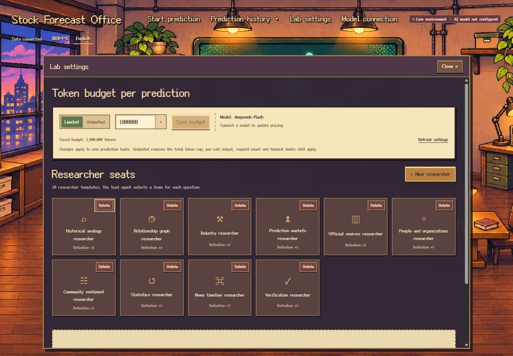
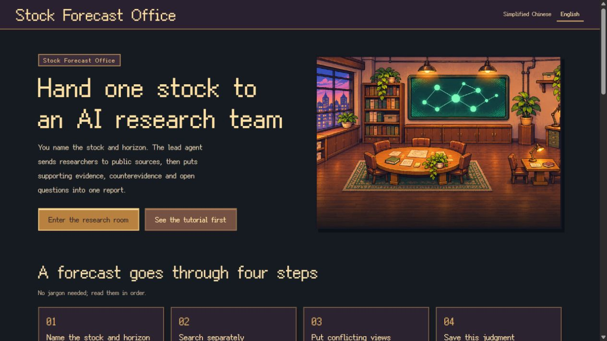
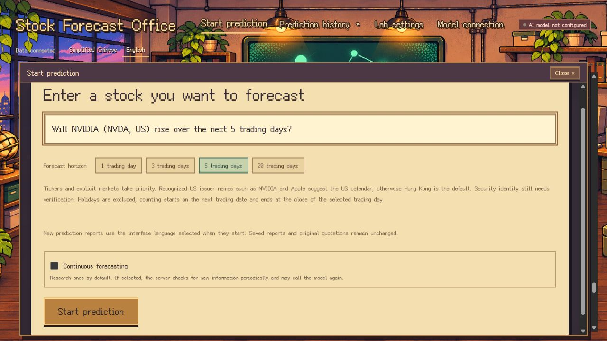
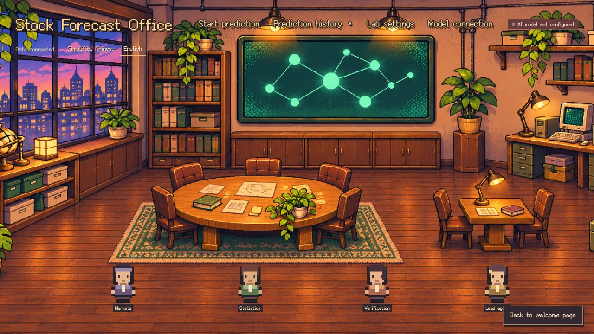
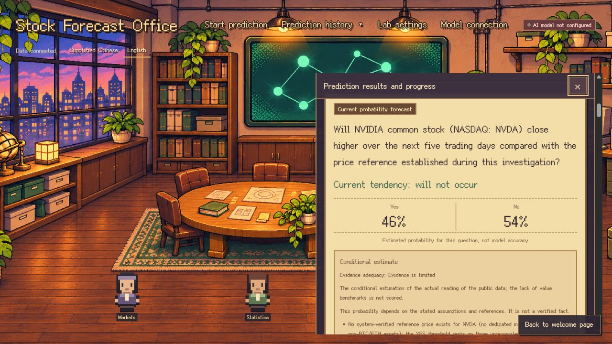
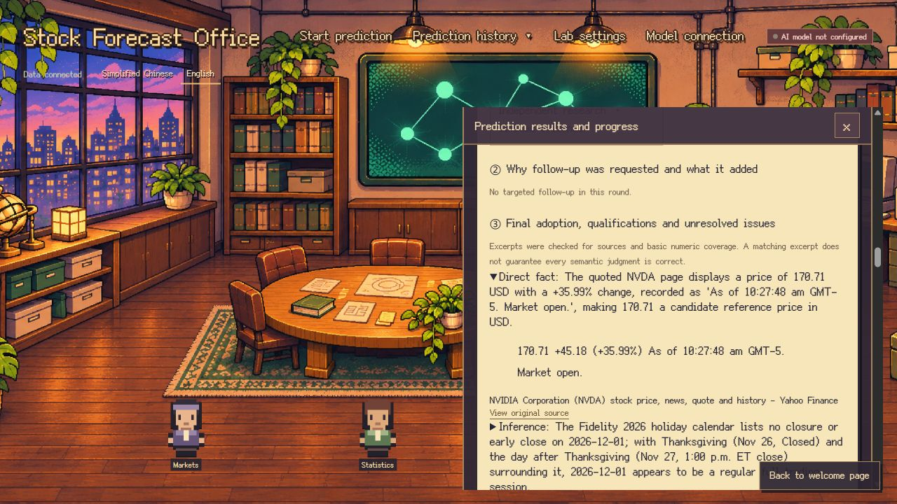
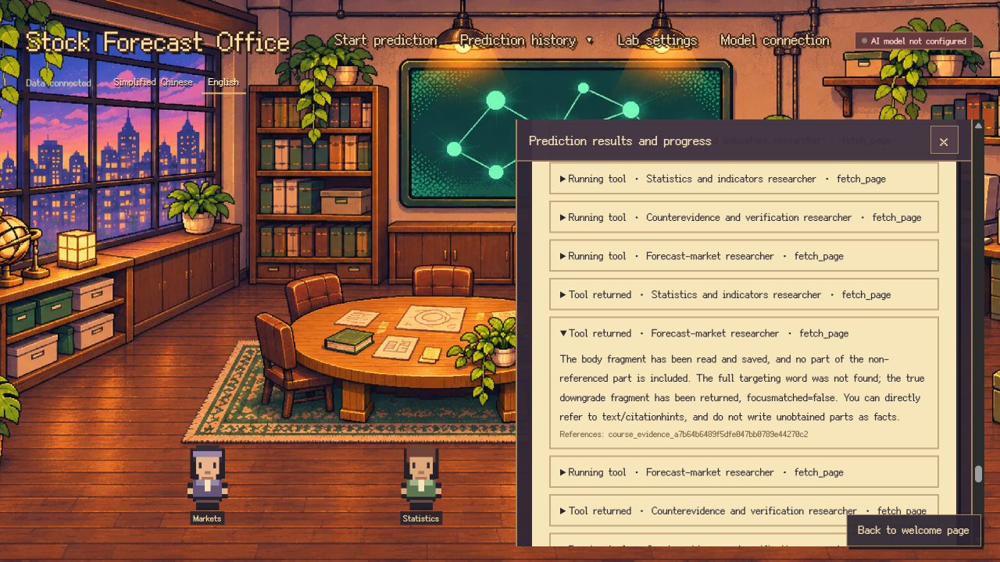

# LLMword — Stock Prediction Studio

**V4.4 · Current release on `main` · Multi-agent forecasting research**

LLMword turns a short stock question into a visible multi-agent investigation. A lead agent clarifies the question and deadline, delegates research to specialists, compares their cited reports, and publishes a **Yes/No judgment with an estimated probability**. The pixel research room shows assignments, tool activity, reports, and disagreements as the investigation runs.

The current product focuses on stock, security, and fund questions. It is a research prototype: its probabilities are model estimates, not measured accuracy or guaranteed returns.

**[Read the English User Guide](docs/USER_GUIDE.md)** for a complete walkthrough, model setup, result interpretation, and troubleshooting. For version changes, see [Development History](DEVELOPMENT_HISTORY.md).



*Lab-settings screenshot from V4.3, showing the budget and researcher seats. V4.4 retains this room and adds a welcome page and expanded tutorials. Historical screenshots and results remain tied to their original versions.*

## A quick visual tour

The screenshots below show the current V4.4 interface in English. The NVDA result, evidence, and tool views reopen a saved live-model/live-source investigation from **23 November 2026** in a preview without model credentials. Their figures are historical model estimates, not a new market forecast or an accuracy benchmark.

### 1. Understand the project before starting

The welcome page explains the research workflow and introduces the team. Choose **Enter the research room** to use the app, or **See the tutorial first** to explore the read-only collaboration, follow-up, and recovery examples without a model key.



### 2. Ask one question and choose a horizon

Enter the stock question, select **1, 3, 5, or 20 trading days**, and decide whether to enable **Continuous forecasting**. A single investigation is the default. The lead agent chooses the research team; you do not need to upload evidence or assign researchers manually. This screenshot shows an unsubmitted example; connect your model before starting live research.



### 3. See which agents belong to the investigation

The pixel room represents the selected question's lead agent and researchers. During a live investigation, saved assignments and public activity drive the characters and bubbles. This completed NVDA record shows the **Markets**, **Statistics**, and **Verification** researchers alongside the lead agent; opening another record restores its own team and activity.



### 4. Read the answer together with its limitations

The result panel separates the **Yes/No probability**, the question's meaning, and evidence adequacy. This saved five-trading-day NVDA investigation estimated **Yes 46% / No 54%**. It remains a **conditional estimate** with limited evidence and no system-verified numeric benchmark, so it is **not scored**. Read the fixed deadline and resolution rule before interpreting a result.



### 5. Inspect the evidence behind a claim

Expand a claim in **How collaboration influenced the forecast** to inspect its quotation and **View original source** link. The surrounding record distinguishes direct facts, inferences, qualifications, and unresolved issues. A matching excerpt helps trace a claim, but does not guarantee that the model's interpretation is correct.



### 6. Check what the tools actually returned

**Public collaboration records** preserve assignments, tool requests, returns, failures, and submitted reports. Here, `fetch_page` returned a saved body fragment with an evidence reference and a warning that the requested focus text was not found. This makes a partial retrieval visible instead of presenting it as a fully verified source. These are public execution records, not private model reasoning.



For the full operating instructions, continue to the [English User Guide](docs/USER_GUIDE.md).

## What you can do

- **Ask a short question.** Enter a stock question and choose 1, 3, 5, or 20 trading days. Five trading days is the default.
- **Watch the research.** The lead agent normally selects three distinct responsibilities from a ten-role catalog, including verification. Researchers independently search, read sources, and return reports.
- **Inspect the answer.** Read the probability, evidence adequacy, sources, counterevidence, and the lead agent's assessment together.
- **Follow a question over time.** Continuous forecasting is optional. Later checks can use prior judgments and source relationships as context while preserving earlier forecasts.
- **Learn without a model key.** V4.4 opens with a welcome page, researcher introductions, and three read-only tutorials: full collaboration, new-evidence review, and failure recovery.

Tutorials use labeled simulated/replayed archives. They do not create live tasks, call models, or demonstrate forecasting accuracy.

## Run locally

You need **Node.js 22.17 or later**, npm, and network access for live research. The repository's `.nvmrc` selects Node 22.17.1. Normal use does not require Python, a separate database server, or a frontend build.

```bash
git clone --branch main https://github.com/Bryce0312/LLMword.git
cd LLMword
npm ci
npm start
```

Open **[http://127.0.0.1:4174](http://127.0.0.1:4174)**. Keep the terminal running while using the app. The server listens on the local machine by default; SQLite archives are stored under `.data/live/`. Some Node versions print an experimental warning for `node:sqlite`.

The npm startup banner still uses the package metadata version `4.2.0`; this guide describes the **V4.4 product release** on `main`.

An API key is **not required to start the app or read the tutorials**. Live investigations require a configured model and working information services. The public startup is live-only; there is no `start:mock` command in V4.4.

### Use another port or data directory

If another copy is running, choose a separate port **and** a separate data directory. Use one service instance per data directory.

**Windows PowerShell**

```powershell
$env:PORT = '4196'
$env:WORLD_DATA_DIR = '.data/live-b'
npm start
```

**macOS / Linux**

```bash
PORT=4196 WORLD_DATA_DIR=.data/live-b npm start
```

Then open `http://127.0.0.1:4196`.

## Your first prediction

1. **Choose English.** Select English before creating the task if you want English reports. A task keeps its creation-time generation language; switching the interface does not rewrite saved reports or source text. Where supported, optional browser-local translation can change how historical Chinese content is displayed.
2. **Explore the tutorials.** On the welcome page, choose **See the tutorial first**. No key is needed. An example at the end can prefill a live form, but it is never submitted automatically.
3. **Connect your model.** Choose **Enter the research room**, then **Model connection**. Enter your API key, chat-completions URL, and model name. The default preset uses the official DeepSeek endpoint. Save the connection and inspect its status.
4. **Start a prediction.** Choose **Start prediction**, enter a question such as **“Will Apple (AAPL) shares rise?”**, and select the horizon. Leave **Continuous forecasting** off for a single investigation. Review any interpretation or clarification shown by the app.
5. **Inspect progress and results.** Open **Prediction results and progress** to see assignments, tool receipts, individual reports, sources, and the final judgment. **Prediction history** lets you reopen a saved run.

You do not need to upload research material or manually choose the team for a normal prediction. The agents collect information through the registered tools. Live model and information-service requests may consume provider quota.

For recovery, manual follow-up, export, history removal, and optional configuration, continue to the **[English User Guide](docs/USER_GUIDE.md)**.

## How the agents work

```text
Question + horizon
        |
Lead agent: clarify the claim, fix the deadline, assign specialists
        |
Researchers: search -> read -> cite -> report independently
        |
Lead agent: compare support, counterevidence, and gaps
        |
Targeted follow-up if needed and within budget
        |
Saved Yes/No judgment + probability + sources + limitations
        |
Optional continuous checks using earlier judgments as context
```

The ten roles cover official sources, news timelines, industry, people and organizations, statistics, markets, communities, historical analogies, relationships, and verification. Not all ten run on every question.

| Component | What it does |
| --- | --- |
| **Multi-agent orchestration** | Gives researchers separate assignments and contexts, then hands structured reports back to the lead agent. |
| **Tools** | Executes registered searches, page reads, supported quotes, and other permitted operations. A search snippet alone is not a read source. |
| **Harness** | Enforces permissions, budgets, time boundaries, citation checks, publication rules, cancellation, and recovery. |
| **Skills** | Versioned role methods and [agent playbooks](docs/agent-playbooks/) guide how each researcher investigates. |
| **Memory** | Retrieves recent judgments, reports, and source relationships as historical context. Old sources must be checked again before supporting new claims; model weights are not retrained. |
| **Pixel interface** | Projects saved backend events into characters, bubbles, tool activity, and public collaboration records. It does not display private model reasoning. |

The frontend uses native JavaScript modules, HTML, and CSS. The backend uses Node.js, built-in SQLite, and Ajv schema validation; the orchestration is implemented in this repository.

## Technical implementation

### Stack and runtime architecture

| Layer | Implementation |
| --- | --- |
| Browser | Native JavaScript ES modules, HTML, and CSS. Hash-based navigation keeps the pixel room separate from forms, results, and tutorials. No frontend compilation is required. |
| Service | Node.js HTTP server with asynchronous orchestration and cancellation through `AbortSignal`. |
| Model adapter | DeepSeek or an OpenAI-compatible Chat Completions endpoint, with native function-tool messages and provider-specific configuration. |
| Validation | Ajv JSON Schema checks for action arguments, role-specific tool contracts, reports, and tool results. |
| Storage | Built-in `node:sqlite`, using separate domain, research, and runtime databases under the selected data directory. |
| UI updates | The current research screen polls request/run snapshots, waits 1.5 seconds between refreshes, and projects saved events into the selected room. |

```text
Browser: question, settings, selected run
                | HTTP JSON
Node.js service: research state machine
                |-- Lead agent / independent worker contexts
                |-- Model adapter -> configured model endpoint
                |-- Tool gateway -> public information services
                `-- SQLite -> runs, receipts, evidence, reports, forecasts
                |
Public snapshots -> run-scoped projection -> actors, bubbles, result panels
```

The [service entry](server/app.mjs) assembles these components. The project uses its own orchestration and persistence code; the external systems listed under design credits are references, not runtime dependencies.

### Agent communication and the research loop

The [research orchestrator](server/course/course-service.mjs) turns model actions into explicit state transitions. A new general-purpose investigation follows this sequence:

1. Seal the deadline, language, budget, and relevant role versions. The lead agent clarifies the question and delegates to three distinct responsibilities, including verification.
2. Create separate worker assignments with objectives, context, permitted tools, and checkpoints. General-purpose workers run independently and concurrently; fixed single-source resolution policies serialize them to protect their reporting budgets.
3. Run each worker through the [tool loop](server/runtime/worker-loop.mjs). The model requests a registered function; the server validates and executes it, then returns a tool message with the matching `tool_call_id`. The worker can investigate again or call `submit_report`.
4. Hand structured reports back to the lead agent: summaries, evidence IDs, supporting and contrary claims, gaps, and individual probability estimates. The lead agent records which findings it adopts, qualifies, or rejects, and can request bounded follow-up.
5. Publish an immutable binary forecast when the contract permits it, or preserve a limited/failed result with its reason. Later research creates another run and retains the earlier record.

The [model adapter](server/runtime/model-provider.mjs) handles provider protocol, timeouts, usage receipts, and safe error classification. Agents communicate through assignments, tool returns, reports, and stored review records; their private protocol context is not exposed as room dialogue.

### Tools, evidence, and the harness

Tools are executable backend functions with input schemas and per-assignment permissions. The [web gateway](server/course/web-tools.mjs) supplies registered operations. The [worker loop](server/runtime/worker-loop.mjs) limits execution to the intersection of assignment permissions, agent permissions, enabled tools, and registered handlers.

| Tool | Role in the investigation |
| --- | --- |
| `search_web` | Discover public pages and candidate sources. |
| `search_news` | Search news across relevant languages and publication contexts, when allowed for the role. |
| `fetch_page` | Retrieve source text or a usable fragment, recording partial reads and retrieval failures. |
| `read_run_evidence` | Explicitly reread evidence saved in the same run, including during follow-up. |
| `get_market_quote` / `get_market_history` | Retrieve supported market observations for the relevant asset/rule subset; these are not universal stock-data APIs. |
| `compare_financial_metrics` | Check financial quantities and comparisons for permitted statistical research. |

Evidence records preserve source URLs, content hashes, publication/retrieval times, and the assignments that actually read them. [Grounding checks](server/domain/claim-grounding.mjs) validate references and quoted text against those reads and applicable time boundaries. Search snippets alone do not count as a source read or citable evidence. These checks provide traceability; they do not prove every interpretation is correct.

The harness also enforces per-run and per-worker model, tool, token, and timeout limits, reserves room for reporting, and bounds follow-up. Recorded receipts and input hashes detect conflicting reuse of call identifiers. Cancellation checks prevent a stopped run from publishing late results. Public receipts retain failures and partial results so they can be inspected.

### Memory, relationships, and continuous forecasting

The [memory policy](server/course/memory-policy.mjs) retrieves history for the **same question and prediction version**, using a fixed cutoff for each new run:

- **Short term:** at most four substantive judgments from the previous seven days, together with bounded report summaries, probabilities, influencing factors, and unresolved gaps.
- **Long term:** source leads and evidence-to-claim relationships from the previous 90 days. These records are marked historical and require refresh before serving as new evidence.

These are retrieval windows, not deletion deadlines. Earlier archives remain stored. Memory helps the next investigation compare what changed, revisit a weak source, or test an earlier assumption; it does not update model weights or automatically transfer conclusions between unrelated questions.

Relationships are stored as evidence-backed `supports` or `contradicts` records, with provenance and timestamps. They are not fitted correlation coefficients or proof of causality, and no separate graph database is required.

Optional continuous forecasting is scheduled by the server. It checks candidate sources, deduplicates content, and triages meaningful changes before commissioning more research. Routine changes can involve a relevant researcher plus verification; larger changes or conflicts can recall the team. A check that produces no new judgment preserves the previous probability without inventing another chart point. The browser does not own this scheduler; the Node.js service and usable credentials must remain available.

### Persistence, recovery, and the pixel interface

The [research store](server/course/course-store.mjs) uses SQLite transactions, foreign keys, and WAL journaling for requests, runs, assignments, public events, receipts, evidence, source-read records, relationships, forecasts, and monitoring state. Current research checkpoints stay with their runs and assignments; the domain and advanced-runtime services have separate databases. Durable checkpoints support recoverable tool loops; retry behavior still follows the task's recovery policy, so an ordinary failed investigation can create a new run instead of continuing at an arbitrary model step.

The browser's [run projection](web/course-projection.mjs) and [room renderer](web/workbench-course-room.js) convert saved public activity into movement, status, and speech bubbles. The selected run owns the room. Historical views reconstruct that run without inserting dialogue from another task or replaying every old utterance as a new event. This snapshot-polling path is separate from the older workspace's SSE event channel.

Interface labels, report generation, and optional display translation have separate lifecycles. New tasks save their output language; original reports and evidence remain unchanged in storage. Where the browser supports it, [local display translation](web/locale-local-translator.mjs) can render historical Chinese content in English without sending another model request.

## Model and information-service setup

The easiest setup is through **Model connection**. Defaults are `https://api.deepseek.com/chat/completions` and `deepseek-flash`; custom compatible endpoints are also supported. Use the exact model ID and endpoint permitted by your provider.

**Model access and source access are separate.** A key for a custom model endpoint is not automatically forwarded to the official search/document service. Such setups can require a separate `WORLD_SEARCH_API_KEY`. A successful model connection does not prove that every research tool is available.

For environment-based setup, copy `.env.example` to your own ignored `.env`, fill in the required values, and start with:

```bash
node --env-file=.env start-live.mjs
```

`npm start` does **not** automatically load `.env`. See the [User Guide configuration reference](docs/USER_GUIDE.md#configuration-reference) for details.

Keys entered in the UI stay in the server process's memory and are not saved to project files or browser storage. The current page may retain the masked input while navigating; a full refresh does not refill it. Restarting the server requires re-entering a web-session key. Do not commit credentials or local archives.

## Read results correctly

- **Yes follows the question.** For a decline question, Yes means decline, not growth. Read the stored interpretation and deadline.
- **Probability, evidence adequacy, and agreement are separate.** A high probability or unanimous team is not a measured accuracy score. A provisional result can still require review and remain unscored.
- **Missing information remains visible.** A run can return limited reports, fail, or end without a publishable probability. Missing values are not replaced by an invented 0% or 50%.
- **Research completion is not outcome settlement.** Automatic outcome verification currently covers specific strict BTC-USDT and official-warning rules; general stock settlement and broad calibration remain incomplete.
- **Continuous checks need the server.** Closing a browser tab does not stop a running backend, but shutting down the Node process stops scheduled work. Server restarts also require available credentials to resume live work.

Dedicated authorized integrations for every social platform, a full temporal causal graph, and large-scale accuracy comparisons are not delivered capabilities. See [Forecast Reliability](docs/FORECAST_RELIABILITY.md) and [Implementation Status](docs/IMPLEMENTATION_STATUS.md) for evidence and remaining gaps.

## Documentation and development

| Document or path | Purpose |
| --- | --- |
| [English User Guide](docs/USER_GUIDE.md) | Installation, daily operation, results, recovery, and troubleshooting. |
| [Development History](DEVELOPMENT_HISTORY.md) | Version changes and historical verification records. |
| [PRD](docs/PRD.md) | Product contract, research workflow, and implementation boundaries. |
| [Architecture](docs/ARCHITECTURE.md) / [Decision Log](docs/DECISION_LOG.md) | Code structure and design decisions. |
| [Implementation Status](docs/IMPLEMENTATION_STATUS.md) | Dated implementation and validation evidence. |
| `web/` | Welcome page, tutorials, research room, and bilingual UI. |
| [Research orchestration](server/course/course-service.mjs) | Current multi-agent research, tools, reports, memory, and outcome checks. |
| `server/domain/` / `server/runtime/` | Persistent domain records and tool-loop runtime. |

After installing dependencies, developers can run:

```bash
npm test
npm run verify:collaboration
```

Automated protocol tests use simulated responses and local fixtures. Passing tests does not establish live forecasting accuracy. Previous live runs, failures, costs, and acceptance limits remain recorded in the [4.2 Release Notes](docs/V4_2_RELEASE_NOTES.md) and related evidence; V4.4's interface changes do not replace those checks.

### Design and asset credits

The implementation was informed by [Anthropic's multi-agent research system](https://www.anthropic.com/research/multi-agent-research-system), [LangGraph persistence](https://docs.langchain.com/oss/javascript/langgraph/persistence), [MCP tool contracts](https://modelcontextprotocol.io/specification/2025-11-25/server/tools), [Agent Skills](https://agentskills.io/specification), [Reflexion](https://arxiv.org/abs/2303.11366), and [FutureSim](https://arxiv.org/abs/2605.15188). These are design references, not a claim that their frameworks are installed.

The room backgrounds `web/assets/lab.png` and `web/assets/lab-play.png` were generated or edited with ImageGen. Pixel researchers are drawn and moved separately by the browser. Historical project materials remain in `docs/`.
