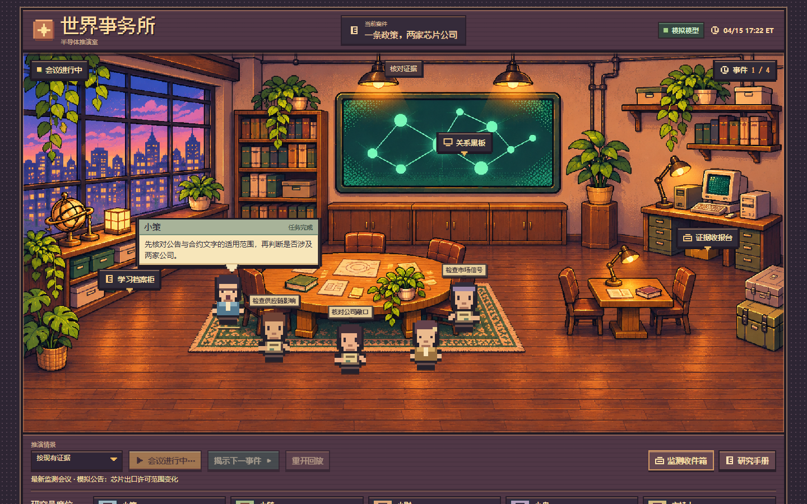
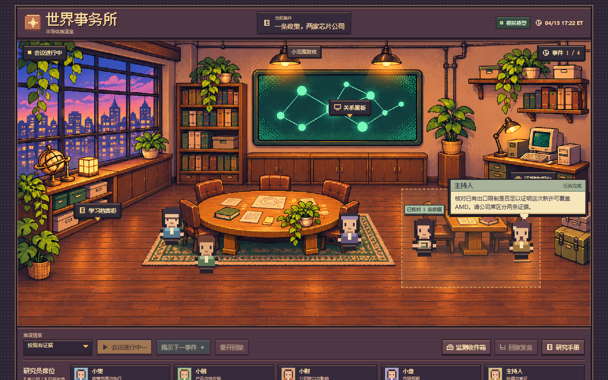
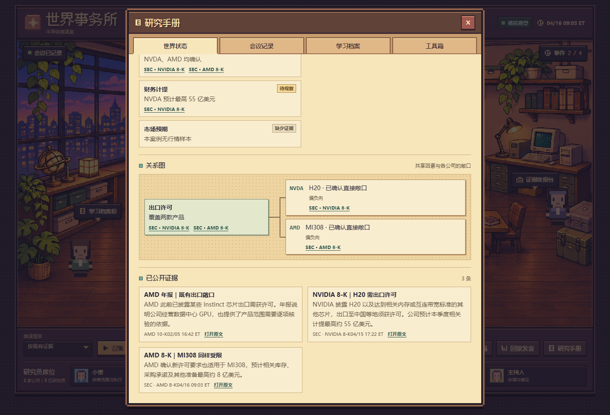

# 世界事务所

世界事务所是一个中文像素风研究室。以 2025 年 AI 芯片出口许可为例，沿时间轴查看同一政策怎样改变 NVIDIA 和 AMD 的产品敞口，召开研究员会议，从同一时间点做假设推演，再用后续披露核对已经封存的预测。

## 项目截图

截图使用模拟模型。第一张由模拟监测消息触发，后两张来自 NVIDIA 与 AMD 的历史案例回放。

### 01｜收报后自动开会



后台收到模拟芯片许可公告后自动召集会议。图中小策已经完成政策研判，结论从他头上冒出，供应链、公司和市场席仍在各自核查。

### 02｜到侧桌复核分歧



主持人请公司研究员区分 AMD 此前的出口许可敞口和本次措施覆盖的产品。两人在侧桌核对证据后，回圆桌汇总判断。

### 03｜从关系图查回证据



点开「关系黑板」可看到同一项出口许可与两家公司产品的联系。每条关系附有出处，证据区只显示回放时点已公开的材料。

## 在本地运行

需要 Node.js 20 或更高版本。项目使用原生 Node.js 和浏览器 JavaScript，无需安装 npm 依赖。

在项目根目录运行：

```powershell
node start.mjs
```

打开 [世界事务所](http://127.0.0.1:4173)。默认是模拟模式，无需 API key。Node 服务只监听本机。回放状态存到 `.data/world.json`。可用环境变量 `PORT` 和 `WORLD_STATE_PATH` 指定端口与存储文件。

## 一期研究室

- 回放与自动会议都由实际任务事件驱动。研究员完成取证、核查或研判时，结果会从该研究员头上冒泡；完整研判同时留在会议记录。角色按任务状态在待机、工作、走路和发言的像素帧之间切换。产品范围未核实或判断分歧达到阈值时，相关研究员走到侧桌复核，之后回圆桌汇总。断线重连可以补收近期事件，完成后的回放和会议记录也可继续查看。
- 后台默认每五分钟检查 NVIDIA、AMD 的 SEC EDGAR 申报索引和 Polymarket 的相关合约。每个来源首次成功检查时建立基线。后续通过申报条目或合约主题、价差、流动性及报价变化判断是否开会。监测收件箱显示最近一次同步、各来源状态、原始链接、调度理由与最近一次自动会议。
- 浏览器可以关闭。只要 Node 进程和网络在运行，检查及自动会议会继续。重启后读取去重记录、排队任务及最近一次会议。实时监测与历史回放分别存档，公开来源的当前数据不会进入历史预测。后台初步研判不会把 Gamma 合约报价当作股价预测，也不会自动结算或训练。

环境变量 `WORLD_MONITOR` 支持 `public`（默认）、`demo`（无网络模拟）、`off`。可用 `WORLD_POLL_MS` 修改检查间隔，公开模式最短一分钟。部署者可把 `SEC_USER_AGENT` 设为应用名与有效联系邮箱。用 `WORLD_MONITOR_PATH` 可为观察任务指定单独的持久化文件。

想立即观看一次自动会议，可以从新存档启动模拟观察。模拟信号在启动约 12 秒后到达，随后还有一条被跳过的行政事项。重新使用同一存档不会重复召开该会。

```powershell
$env:WORLD_MONITOR = 'demo'
$env:WORLD_MONITOR_PATH = '.data/monitor-demo.json'
node start.mjs
```

模拟模型用固定间隔交付各席实际生成的结果，便于观看。自动化测试可设 `WORLD_MOCK_PACING=0`，真实模型按实际返回进度推送。

## 接入真实模型

在本机环境中设置 `WORLD_API_KEY`，再按供应商选择模型和端点。兼容端点应提供 Chat Completions 接口。真实模型默认使用独立的 `.data/world-live.json` 存档。

```powershell
$env:WORLD_MODEL = 'openai'
$env:WORLD_MODEL_NAME = '<模型名称>'
$env:WORLD_BASE_URL = 'https://api.openai.com/v1'
$env:WORLD_STATE_PATH = '.data/world-live.json'
node start.mjs
```

密钥由 Node 后端读取。真实模型模式会把当前角色技能、允许读取的案例数据和已结算经验发往配置的模型端点。演示自带的数据来自公开披露。

## 两分钟演示

1. 从「初始披露」召集会议，打开会议记录查看研究员的工具调用、各自的判断和汇总结果。历史主线的预测在当前截止时点封存。
2. 切换到「限制范围较窄」或「限制范围较广」再推演。分支共用同一份已观察证据，假设只影响分支结果。
3. 回到主线并揭示下一事件。AMD 披露后，可在「学习档案」看到第一项预测的结算。接着召集会议，查看第二个预测怎样使用已结算经验。
4. 揭示 NVIDIA 的季度业绩后再次查看学习档案。事件尾声提供 AMD 的后续实际计提。重开回放会清除本次演示进度和学习记录。

## Harness、工具、技能与学习

- **Harness** 负责共享时间截点、角色分派、运行顺序、调用限制、证据校验、情景隔离和提交。浏览器通过同源 HTTP API 获取状态和结构化记录。
- **工具** 是后端可执行能力，接收参数并返回结构化数据。工具箱可以查看它们的用途，会议记录可以查看实际调用。
- **技能** 是仓库内角色工作手册，告诉 Agent 如何检查信息、采用证据和处理不确定性。点开研究员席位可查看其技能和工具。
- **持续学习** 是应用层记忆与有界概率修正。后续材料首次满足结算条件时写入一条带出处的结果，计算 Brier 误差 `(p - y)^2`。后续预测读取已结算经验。模型权重保持固定。情景推演和重复运行不会增加已结算样本。

## 数据范围

回放使用可查的公司披露。时间轴采用 SEC 接收时间作为演示时钟。模拟模式中的 Agent 发言与概率由可复现的规则生成，用来验证流程。当前案例只有两个可结算的经营事件，股价回测、预测效果评估及 X、Reddit、小红书等授权渠道属于下一阶段。Polymarket Gamma 返回的合约价格在缺少明确报价时间时标记为未知，监测以本次观察时间记录。

- [NVIDIA 初始 8-K](https://www.sec.gov/Archives/edgar/data/1045810/000104581025000082/nvda-20250409.htm)
- [AMD 后续 8-K](https://www.sec.gov/Archives/edgar/data/2488/000000248825000039/amd-20250415.htm)
- [NVIDIA 财务结果](https://www.sec.gov/Archives/edgar/data/1045810/000104581025000115/q1fy26pr.htm)
- [AMD 财务结果](https://www.sec.gov/Archives/edgar/data/2488/000000248825000106/q22025991.htm)

## 目录与验证

- `web/` 包含页面、交互与像素画。
- `server/harness.mjs` 管理会前研究、质疑、复核、校验及汇总。
- `server/tools.mjs` 注册工具并按角色检查访问权限，`server/skills/` 存放各席工作手册。
- `server/case.mjs` 保存历史证据和可结算问题，`server/world.mjs` 管理回放时钟、预测封存、持久化及学习记录。
- `server/provider.mjs` 提供可复现的模拟模型和 OpenAI 兼容适配器。
- `server/sources.mjs` 管理公开来源，`server/monitor.mjs` 维护独立的后台调度和观察存档，`server/events.mjs` 管理会议的 SSE 推送和断线补收。

在本机运行 `node --test` 可验证后端及 HTTP 集成。兼容适配器测试使用注入的传输，不会发真实 API 请求。

## 设计参考

代码为这个课程项目独立实现。角色分工、工具注册、持久化及回放的设计参考来自 [Anthropic 多 Agent 研究系统](https://www.anthropic.com/research/multi-agent-research-system)、[LangGraph 持久化](https://docs.langchain.com/oss/javascript/langgraph/persistence)、[MCP 工具契约](https://modelcontextprotocol.io/specification/2025-11-25/server/tools)、[Agent Skills](https://agentskills.io/specification)、[Reflexion](https://arxiv.org/abs/2303.11366) 和 [FutureSim](https://arxiv.org/abs/2605.15188)。

研究室图片 `web/assets/lab.png` 由内置 ImageGen 生成。原始生成提示如下。

> Use case: stylized-concept. Asset type: decorative full-width game scene in an original Chinese-language web app, no UI/text baked in. Wide 2:1 landscape, edge to edge, an exquisitely composed isometric 2D pixel-art field research room for a friendly team of technology-world investigators, strongly nostalgic handheld 16-bit RPG but original. Four clearly distinguishable small human pixel characters seated/gathered around a big oblong honey-colored wooden conference table in the central-lower third, clothing dusty orange, sage green, lake blue, and dark grape, varied hairstyles, miniature laptops and paper diagrams. Behind them at upper center a large dark teal wall-mounted display with a simple glowing node network, no glyphs or text. Broad window at upper left overlooks twilight city, distant lavender blue skyline and warm window lights. Bookshelves, potted plants, beige lab walls, cozy dark timber floors, tiny coffee mugs, old computer station at far right. Strong clean clustering, visible large pixel grid rendered with crisp stepped edges and dither, no smoothing, little shadow color clusters, premium contemporary indie game pixel art. Cream, amber and moss accents on warm brown, midnight navy and dusky teal shadows, cozy lamplight. Main characters visually readable at website hero width, all fully inside frame. Keep the table and team as unmistakable focal point, no overcrowding, no lettering, no logos, no captions, no badges, no UI.

当前场景 `web/assets/lab-play.png` 也由内置 ImageGen 编辑生成，提示要求保留夜景、灯光、关系黑板和木质像素画风，移除原图中的人物，添加圆桌旁的双人侧桌并留出连续可走动的前景地板。研究员由浏览器单独绘制和移动。
