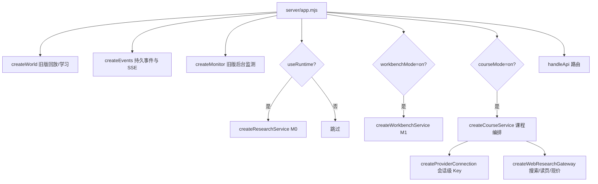
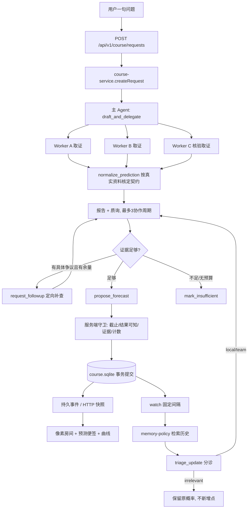

# 架构总览与代码落点

2026-11-20 编写。本文只描述**当前代码实际做的事**，用于新会话或新接手者快速建立全局图。产品契约与待开发目标以 [PRD](PRD.md) 为准，完成度以[实现状态](IMPLEMENTATION_STATUS.md)为准；两者与本文冲突时，以 PRD 和代码事实为准，并回来修订本文。

阅读顺序建议：本文 → [PRD 第 4、6、9、12 节](PRD.md) → [实现状态](IMPLEMENTATION_STATUS.md) → 要改的模块。

## 1 产品一句话与三条硬边界

一句话输入一个二元事件问题（“黄金会跌吗”“某人会不会发帖”），主 Agent 整理题意并从十类研究员里按题派三位，子 Agent 用真实工具取证，围绕分歧补查，最后发布“是/否 + 概率”，之后按固定间隔检查并带着历史判断继续更新。

三条不能越过的边界：

1. **只开放 binary**。其他题型不开放创建与运行，历史非二元记录只读。
2. **mock / live / replay 独立声明**。模拟结果不能当作真实预测或准确率证据；模型模式与来源模式分开保存。
3. **概率、资料充分度、团队一致度分开保存**。未发布或资料不足时概率保持缺值，不补成 0 或 50%。

## 2 四层实现谱系

仓库里同时存在四套东西，不要混：

| 层 | 入口 | 状态 | 说明 |
| --- | --- | --- | --- |
| 旧版案例基线 v1 | `/legacy.html` | 保留可用 | 固定五席会议、SEC/Polymarket 监测、JSON 回放存档 |
| M0 运行时验证 | `/api/v1/runtime/*` | 技术验证 | 单 worker 工具循环探针，只出研究报告，不发布预测 |
| M1 多预测工作台 | `/api/v1/topics|predictions|agents|...` | 已交付，binary 范围 | 主题/题目/角色版本 CRUD + 单研究员材料研读 |
| 课程协作主路径 V2.0 | `/api/v1/course/*` | 当前主战场 | 一句话 → 派工 → 取证 → 补查 → 发布 → 监听 |

默认首页是 M1 工作台外壳，课程面板挂在其中；`WORLD_WORKBENCH=off` 时回落到 `legacy.html`。

## 3 进程装配（server/app.mjs）

`server/app.mjs` 是唯一的装配点，不从根目录暴露固定入口；它按环境变量决定启用哪些子系统，然后起一个只监听 `127.0.0.1` 的 HTTP 服务。日常启动只通过 `start-mock.mjs` / `start-live.mjs` 两个包装入口调用它。

关键装配规则：

- `node:sqlite` 不可用时工作台与课程入口直接拒绝启动（本机验证 Node v23.5.0）。
- 课程入口依赖工作台；`WORLD_COURSE=on` 但没有工作台会抛错。
- 课程 provider 在 live 时复用 runtime provider，mock 时用 `createCourseMockProvider`。
- `providerConnection` 的 `applyKey` 会用新 Key 重建 provider 与搜索网关，再原子替换 `course` 实例；替换期间所有课程写操作返回 409 `PROVIDER_UPDATE_BUSY`。
- 默认端口 mock 4173、live 4174；`PORT` 可覆盖，用于同模式多实例。默认数据目录 `.data/mock/` / `.data/live/`；`WORLD_DATA_DIR` 可覆盖为其他独立目录，但不能指向相反模式的默认目录或 `.data` 根目录。同一数据目录仍只允许一个进程。
- 根目录旧 `.data/world.json*` 归档不在启动时读取；`scripts/legacy-data.mjs` 默认 dry-run，`--apply` 按课程运行记录迁移到对应环境的 `legacy/`，混合或未知放入 `.data/legacy/`。
- 启动时 `monitor.start()`、`runtime.resume()`、`course.resume()` 恢复未完成任务。

### 3.1 模拟/真实双入口

| 入口 | 端口 | 数据目录 | 模型与来源 | 安全边界 |
| --- | --- | --- | --- | --- |
| `npm run start:mock` | 4173 | `.data/mock/` | mock + fixture | 删除进程内 Key；模型连接 `locked`，保存返回 `MODE_LOCKED` |
| `npm run start:live` | 4174 | `.data/live/` | DeepSeek 真实模型与搜索 | 可无 Key 启动；未在网页保存 Key 前拒绝创建/恢复，搜索保持不可用 |

- 两个入口强制各自的端口、数据文件和来源，并拒绝使用对方的数据目录。
- 真实入口允许无 `WORLD_API_KEY` 启动：装配层使用未配置占位 provider，`/api/v1/course/requests` 与 `check` 返回 409 `MODEL_NOT_CONFIGURED`，启动时也不恢复历史运行；在“模型连接”保存 Key 后才恢复创建与恢复能力。
- 顶栏 `#wb-environment` 徽章按 `modelMode` 与连接状态显示“模拟环境 · 未配置 / 真实环境 · 未配置 / 真实环境 · 已配置待校验 / 真实环境 · 已配置已连接 / 真实环境 · 已配置未连接”；圆点绿色=已连接、琥珀色=已配置未连接或待校验、灰色=未配置。连接状态读取 `/api/v1/course/provider-connection`，保存 Key 后自动刷新。
- 保存 Key 后自动调用 `GET {WORLD_BASE_URL}/models` 校验：不消耗生成 token、消费并丢弃响应正文（不解析、不记录、不回显）；校验失败仍保存 Key，只把状态标为“已配置，未连接”。Key 不写入浏览器存储，输入框不回显，刷新后需重新输入。
- 输入框与保存按钮始终可用；已配置 Key 时，若存在正在执行、排队或持续监听的任务，保存会被拒绝（`PROVIDER_UPDATE_BUSY`），原 Key 保持不变，并在表单下方提示。首次配置没有原 Key，不受监听限制。
- 模拟环境的“模型连接”仍可输入与提交，但后端 `MODE_LOCKED` 会拒绝保存，前端明确提示“模拟环境配置失败”，不接收 Key。
- 打开课程库后、恢复任务前，`assertEnvironmentRuns` 检查历史 run 的 `modelMode`，发现相反模式即拒绝启动。
- `node server/app.mjs` 保留原有的自动模式（按 `WORLD_MODEL` 判断），不再作为根目录公开入口，仅供测试与自定义端口/路径调试，也不做数据库守卫。
- 已有混合数据库不自动迁移；旧文件作为归档保留，新环境从空目录开始。

### 环境变量

| 变量 | 作用 |
| --- | --- |
| `PORT` | 监听端口，默认 4173 |
| `WORLD_ENV` | `mock` / `live` 双入口模式锁；未设置时为 `auto`，保留旧行为 |
| `WORLD_MODEL` | `openai` 为真实模型，其余为 mock |
| `WORLD_MODEL_NAME` / `WORLD_BASE_URL` / `WORLD_API_KEY` | 模型名、端点、凭据（只从服务端环境读） |
| `WORLD_MODEL_THINKING` / `WORLD_MODEL_REASONING_EFFORT` | 思考模式与强度 |
| `WORLD_MODEL_MAX_OUTPUT_TOKENS` / `WORLD_MODEL_TIMEOUT_MS` | 输出上限与超时 |
| `WORLD_SEARCH_PROVIDER` / `WORLD_SEARCH_API_KEY` | 搜索来源与凭据 |
| `WORLD_WORKBENCH` | `on`/`off`，是否启用 M1 工作台 |
| `WORLD_RUNTIME` | `probe`/`off`，是否启用 M0 运行时 |
| `WORLD_COURSE` | `on`/`off`，是否启用课程入口 |
| `WORLD_COURSE_POLL_MS` | 监听检查间隔，默认 3600000 |
| `WORLD_STATE_PATH` | 基础存档路径，派生出三套 SQLite |
| `WORLD_DOMAIN_PATH` / `WORLD_COURSE_PATH` / `WORLD_RUNTIME_PATH` | 分别覆盖三套 SQLite 路径 |
| `WORLD_MONITOR` / `WORLD_POLL_MS` / `WORLD_MONITOR_PATH` | 旧版监测模式、间隔、存档 |
| `WORLD_MOCK_PACING` | mock 节奏倍率 0–2 |
| `SEC_USER_AGENT` | 旧版 SEC 抓取标识 |

## 4 目录与文件职责

### 4.1 根目录

| 文件 | 职责 |
| --- | --- |
| `start-mock.mjs` / `start-live.mjs` | 模拟/真实双入口：固定端口、独立数据目录、模式锁定 |
| `package.json` | 唯一依赖 `ajv`；`start:mock`、`start:live`、`npm test` |
| `AGENTS.md` | 开发工作流约束（改前读 PRD、从最早未验证里程碑开始、记录 A01–A14） |
| `smoke.test.mjs` | 进程级冒烟 |
| `runtime-http.test.mjs` / `workbench-http.test.mjs` / `course-http.test.mjs` | 三套子系统的 HTTP 集成测试 |
| `provider-connection-http.test.mjs` / `provider-recovery-http.test.mjs` | Key 会话与故障恢复的 HTTP 测试 |

### 4.2 `server/` 顶层

| 文件 | 职责 |
| --- | --- |
| `app.mjs` | 进程装配、静态托管、本机同源校验、`/api/*` 分发入口；仅由双入口或测试直接调用 |
| `http.mjs` | 总路由：`/api/v1/` 依次尝试 course → workbench → runtime；其余旧版路由；请求体 4KB 上限；Origin 校验 |
| `course-http.mjs` | 课程路由：config、requests 增查、`check`/`stop`、run 快照、events |
| `workbench-http.mjs` | M1 路由：config、topics、predictions、evidence、agents、tools、learning、imports、run events；支持 `Idempotency-Key` |
| `v1-http.mjs` | M0 路由：能力查询、`/api/v1/events` SSE、probes 增查、run 查询与 cancel |
| `provider-connection.mjs` | `GET/POST /api/v1/course/provider-connection`；Key 格式校验、忙碌拒绝、只返回是否已配置；模拟环境 `locked` 时返回 `MODE_LOCKED` |
| `environment.mjs` | 纯配置解析：模拟/真实入口的端口、数据文件、来源与 Key 默认值；`assertEnvironmentRuns` 数据库模式守卫 |
| `events.mjs` | 旧版持久事件 journal + SSE，游标补收，慢客户端断开 |
| `monitor.mjs` | 旧版后台监测（public/demo/off），去重后触发会议 |
| `sources.mjs` | SEC EDGAR 与 Polymarket 抓取、基线建立、变化判断 |
| `world.mjs` | 旧版回放状态机、预测封存、JSON 持久化、Brier 学习校正 |
| `harness.mjs` | 旧版五席会议编排与 trace 记录 |
| `case.mjs` | 2025 芯片出口许可案例数据（时间轴、证据、目标、分支） |
| `tools.mjs` | 旧版九工具注册与角色权限检查 |
| `provider.mjs` | 旧版 mock 与 OpenAI 兼容适配器、`paceMock` |

### 4.3 `server/core/` 运行时原语

| 文件 | 职责 |
| --- | --- |
| `store.mjs` | 通用 SQLite：runs、checkpoint、事件，状态迁移白名单（queued/running/waiting → completed/failed/cancelled），幂等与恢复 |
| `contracts.mjs` | probe 解析、`runtimeFailure`、公共校验 |

### 4.4 `server/domain/` M1 领域层

| 文件 | 职责 |
| --- | --- |
| `workbench-service.mjs` | 主题/预测/证据/角色 CRUD、草稿与就绪校验、单研究员研读运行；注入 runtime |
| `domain-store.mjs` | 领域 SQLite：topics、predictions+versions、evidence、agentSpecs、relations、forecasts；事务与幂等键 |
| `contracts.mjs` | `digest`/`identifier`/`validDate`/`validUrl`/`json`、`domainFailure`、记录归一化 |
| `agent-catalog.mjs` | 十类研究员定义（指令、工具、默认预算）；材料工具 `list_provided_sources`/`read_evidence` |
| `legacy-import.mjs` | 旧案例快照只读导入 |

十类 `agentSpecId`：`official`、`timeline`、`industry`、`people`、`statistics`、`market`、`social`、`analogy`、`graph`、`verification`。课程主 Agent 的内部 ID 是 `main`，前端展示时归一为 `supervisor`。

### 4.5 `server/runtime/` Worker 循环

| 文件 | 职责 |
| --- | --- |
| `research-service.mjs` | M0 单 worker 服务；`publicRun` 只暴露公开报告与用量 |
| `worker-loop.mjs` | **核心循环**：请求模型 → 校验 tool_calls → 执行 → 回填 `tool_call_id` → 直到提交报告；报告 schema 校验；发 `model.requested/completed/failed` |
| `agent-budget.mjs` | 剩余预算计数与写入 system prompt 的预算指令 |
| `model-provider.mjs` | OpenAI 兼容调用、`RuntimeError` 分类（超时/鉴权/余额/限流/协议/截断）、可取消、安全 usage |
| `probe-provider.mjs` | 离线探针 provider |

### 4.6 `server/course/` 课程协作（当前重点）

| 文件 | 职责 |
| --- | --- |
| `course-service.mjs` | **编排核心**：七类主 Agent 动作、三 worker 并行、补查循环、发布守卫、监听调度、故障暂停 |
| `course-store.mjs` | 课程 SQLite：requests、runs、assignments、reports、forecasts、relations、evidence、watch |
| `course-context.mjs` | 角色目录、按关键词建议角色、“今天”→本地日终、天气判定、期限解析 |
| `web-tools.mjs` | `search_web`/`fetch_page`/`get_market_quote` 网关；字节与字符上限；结果转 evidence |
| `market-quote.mjs` | 现价只读工具，建立固定价格基准 |
| `memory-policy.mjs` | 纯函数记忆检索包：7 天 4 次研判、90 天 8 关系 12 证据，无 IO、不写档 |
| `forecast-facts.mjs` | 仅由受控字段生成事实段/冲突标注/状态徽章，供 store、记忆、前端共用 |

`course-service.mjs` 的主 Agent 工具（Ajv schema 在文件头部 `definitions`）：

| 动作 | 用途 | 关键约束 |
| --- | --- | --- |
| `draft_and_delegate` | 第一步只整理题意与派工 | 不联网、不预测；必须 3 人且含 `verification` |
| `normalize_prediction` | 用真实资料核定契约 | 补全常见含义与假设，不伪造来源 |
| `delegate_work` | 按题选人（2–3 人） | 不能每题固定同队 |
| `triage_update` | 新正文分诊 | `local` 两人 / `team` 三人 / `irrelevant` 不更新 |
| `request_followup` | 定向补查 | 必须指向真实报告中的具体争议 |
| `propose_forecast` | 提交二元候选 | 发布由服务端独立校验 |
| `mark_insufficient` | 停止并给缺口 | 不编造 ready 或默认概率 |

### 4.7 `server/skills/`

`chair.md`、`company.md`、`market.md`、`policy.md`、`supply.md`：旧版五席工作手册，被 `harness.mjs` 读入。十类课程角色手册在 `docs/agent-playbooks/`。

### 4.8 `web/`

| 文件 | 职责 |
| --- | --- |
| `index.html` | 新工作台外壳，加载 `workbench.js`；顶栏含 `#wb-environment` 环境徽章 |
| `legacy.html` | 旧版回放入口，加载 `app.js` |
| `workbench.js` | 主控制器：缓存、Hash 路由、事件投影、渲染调度、能力探测、环境徽章 |
| `workbench-core.js` | DOM/`api`/toast/路由/格式化基础 |
| `workbench-views.js` | 公告栏、收件箱、学习档案、研究室设置、主题视图 |
| `workbench-detail.js` | 运行详情与报告视图 |
| `workbench-forms.js` | 主题/预测表单 |
| `workbench-room.js` | M1 像素房间 |
| `workbench-provider.js` | “模型连接”密码框 |
| `workbench-course.js` | 课程面板：一句输入、开始跟踪、题目列表 |
| `workbench-course-room.js` | 课程实时房间：等待标记、工具/报告气泡 |
| `workbench-course-chart.js` | 概率阶梯曲线（只画实际提交点） |
| `run-projection.mjs` | 持久事件 → M1 运行 UI 状态 |
| `course-projection.mjs` | 课程事件 → 房间状态、轨迹点 |
| `course-capability.mjs` | 能力探测与提交守卫；`environmentPresentation` 生成模拟/真实环境标签 |
| `course-workflow.mjs` | 阶段标签、模型活动、用量文案 |
| `course-runs.mjs` | 运行列表、房间归属选择、答案来源 |
| `course-status.mjs` | 终态判定、进度、推理标签 |
| `course-team.mjs` | 角色标签、团队签名 |
| `course-provider.mjs` | Key 保存与错误展示 |
| `course-memory.mjs` | 记忆策略展示文案 |
| `course-errors.mjs` | 错误展示、重试/停止可用性 |
| `app.js` / `actors.js` / `actors.css` | 旧版像素房间与人物动画 |
| `styles.css` / `records.css` / `workbench.css` / `workbench-course.css` | 四套样式 |
| `assets/` | 背景图与像素字体（附 OFL/NOTICE） |

### 4.9 `docs/`

| 内容 | 用途 |
| --- | --- |
| `PRD.md` | 产品与技术契约 v0.6 |
| `IMPLEMENTATION_STATUS.md` | 里程碑完成状态 |
| `COURSE_MVP.md` / `COURSE_ACCEPTANCE.md` | 课程范围与验收 |
| `V2_RELEASE.md` / `V2_CHANGELOG_AND_ROADMAP.md` | V2.0 交付与待办 |
| `MEMORY_POLICY_V2.md` / `PROVIDER_RECOVERY.md` | 记忆规则、故障恢复规则 |
| `DEVELOPMENT_PLAN.md` / `FRONTEND_DELIVERY.md` | 开发顺序、前端交付 |
| `M0_*` / `M1_*` | 历史里程碑验收与独立审查 |
| `DECISION_LOG.md` | 架构与产品决策记录 |
| `ARCHITECTURE.md` | 本文 |
| `TRAE_AGENT_PROMPT.md` | Trae 开发 Agent 系统提示词模板 |
| `agent-playbooks/` | 十类角色工作手册 |
| `contracts/examples.json` | 拟议接口示例（**非**运行时 schema） |
| `evidence/*.json` | 真实运行公开摘要 |
| `research/*.md` | 调研笔记 |
| `screenshots/`、`assets/`、两个 PDF | 截图、架构图、历史会议材料 |

## 5 端到端数据流（课程主路径）

发布前的服务端守卫（不由模型决定）：停止发布时间、是否已进入结果可知状态、证据 ID 必须属于本轮、报告计数与预算、二元概率范围、不可变 `forecastId`。

## 6 执行预算（代码中的实际值）

`course-service.mjs:183-188`：

| 范围 | 值 |
| --- | --- |
| 整轮模型请求 | 40 |
| 整轮工具调用 | 64 |
| 整轮 token | 300000 |
| 主 Agent 请求上限 | 16 |
| 单 worker 模型请求 | 6 |
| 单 worker 工具调用 | 6 |
| 单 worker token | 65536 |
| 协作周期 | 3（初次 + 2 次补查） |
| 单研究员调查步 | 5，第 6 步只写报告 |
| 重试 | 计入预算；临时故障（429/408/5xx）最多 3 次尝试 |

`harnessVersion=3` 表示“先派工后取证”；`harnessVersion=2` 为旧“先研究再派工”，仅用于读旧运行。

## 7 存储、隔离与不可变性

三套 SQLite，同进程内由不同 service 持有：

| 库 | 持有者 | 内容 |
| --- | --- | --- |
| `*.domain.sqlite` | `domain-store.mjs` | 主题、题目版本、证据、角色版本、关系、预测 |
| `*.course.sqlite` | `course-store.mjs` | 请求、运行、派工、报告、发布、关系、证据、监听 |
| `*.runtime.sqlite` | `core/store.mjs` | M0/M1 运行、检查点、事件 |

外加旧版 `.data/world.json` 与 `*.monitor-*.json`。

隔离规则：

- 一次运行（`runId`）固定题目版本、角色版本、工具集、模型、初始证据快照。
- 证据按运行范围校验，不能跨运行读取；旧 `evidenceId` 不能通过本轮发布校验。
- 业务写入与待推送事件同事务提交，提交后才发事件。
- 恢复时先查工具回执与已发布记录，防止检查点重放造成重复提交。
- 取消后迟到结果只写审计，不改预测/图/计划。
- 历史封存不可被摘要改写；记忆窗口滑动只改下次输入。

### 7.1 V4.3 预测历史移除（D051，2026-11-23）

课程预测历史使用独立的 `course_request_deletions` 表记录删除标记；原请求、运行、派工角色快照、事件、证据、判断和结果不改写。默认列表隐藏已移除记录，直接 GET 档案仍可读取 `deleted/deletedAt`，但不可检查、恢复、监听或核验结果。活动任务、后台作业、监听及进行中的结果核验拒绝删除；本功能不自动停止任务。

`DELETE /api/v1/course/requests/:id` 需要 `{ confirmed: true, expectedUpdatedAt, expectedLatestRunId }`。更新时间与最新运行 ID 必须匹配确认时的记录；过期确认返回 409 `REQUEST_DELETE_CONFLICT`，活动记录返回 409 `REQUEST_IN_USE`。成功返回 `{ requestId, deleted: true, deletedAt, predictionId? }`；同一确认参数重复提交返回原回执。服务端在事务内重新检查状态。

`GET /api/v1/course/requests` 返回 `requests`、`deletedRequestIds` 和 `deletedPredictionIds`。前端合并只增的删除 ID 集合，过滤迟到的旧读取响应及关联的旧 domain 预测卡，防止刷新后重新出现。独立 legacy domain 记录仍只读，不提供伪删除操作。确认对话框沿用页面主题，取消、Escape 或切换页面都不发送删除请求。

### 7.2 V4.3 English 界面与任务输出语言（D052，2026-11-23）

界面词条按 shell、workspace、course、room、legacy 分区汇入 `locale-zh-en.mjs`。`locale.mjs`原位更新固定文字、标题、placeholder、alt和无障碍属性，异步新增节点同样处理；显式 `data-i18n-ui` 只越过旧样式类／PRE等隐式保护，不越过 `data-i18n-skip`、user/model/content原文边界。日期节点保存ISO元数据，按界面语言与原时区格式化，可双向切换。输入值、Key、URL/model、报告、引用和证据不由本地化引擎读写。只保存语言偏好，不调用翻译服务；组件语言通知仅更新当前DOM中的本地状态。

`POST /api/v1/course/requests` 接受可选 `outputLanguage: "en" | "zh-CN"`，能力接口公开 `outputLanguages`。前端以提交瞬间的语言及新读取能力决定请求：支持时保存语言，不支持英文则保留输入提示更新服务；旧中文服务不发送未知字段。未传字段的旧调用保留旧输入哈希及行为，已有档案不补写字段。

请求语言随SQLite请求保存，后续检查、监听、恢复和汇总均读取该请求；不取进程全局或浏览器当前语言。统一provider边界克隆messages，在所有主Agent／研究员调用的预算预留前追加固定输出语言策略，协议键、enum、固定strict契约、原问题和证据引文不翻译。语言指令计入原有预算，无单独翻译调用；程序生成的阶段性报告和资料整理固定说明亦按保存语言生成，概率、证据归属和封存历史不改。

## 8 HTTP 与事件契约

### 8.1 路由分组

| 前缀 | 归属 |
| --- | --- |
| `/api/v1/course/*` | 课程：config、requests、requests/:id、requests/:id/check|stop、runs/:id、events、provider-connection |
| `/api/v1/topics|predictions|agents|tools|learning|imports|config` | M1 工作台 |
| `/api/v1/runtime/*` | M0 探针 |
| `/api/health|events|monitor|meeting|...` | 旧版 |
| `/`、`/legacy.html`、静态资源 | `web/` |

所有 `/api/*` 只接受本机 Host（`127.0.0.1`/`localhost`）且 Origin 必须同源。

### 8.2 课程事件类型（前端据此渲染）

`assignment.started`、`assignment.completed`、`tool.started`、`tool.completed`、`tool.failed`、`model.requested`、`model.completed`、`model.failed`、`model.retrying`、`memory.loaded`、`watch.triaged`、`forecast.published`、`run.finished`、`run.failed`。

前端投影规则：

- 只由已提交事件驱动；刷新恢复进行中状态，**不补播**历史气泡。
- 一个房间由用户选中的 `runId` 持有，后台检查不抢占；跨题或缺少归属的运行不渲染。
- `model.requested` 显示“等待模型”，completed/failed 清除；工具与报告只显示真实结果。
- 只展示公开计划与结论，不展示隐藏思维链。

## 9 记忆与事实一致性

- `memory-policy.mjs` 是纯函数，输入原始记录，输出有界检索包；不做 IO、不发模型请求、不删除历史。
- 短期：同题同版本最近 7 天最多 4 次实质研判、8 份报告；空监听/失败/取消不占名额。
- 长期：90 天内最多 8 条关系、12 条证据索引；引用前必须重新取证。
- `forecast-facts.mjs` 从 `baseline`/`kind`/`scoringEligible`/`evidenceAdequacy`/`targetAt` 生成权威事实段，检测与 `summary` 散文冲突，产出状态徽章；前端与记忆共用同一来源。

## 10 测试地图

| 测试文件 | 覆盖契约 |
| --- | --- |
| `server/course/course-service.test.mjs` | 重启恢复、协议修复、取消终态、时区偏移、来源版本追加 |
| `server/course/course-orchestration.test.mjs` | 先派工后取证、两次补查、旧版本兼容 |
| `server/course/course-provider-recovery.test.mjs` | 402/401/403 暂停、有界重试、原题重试 |
| `server/course/course-today.test.mjs` | “今天”本地日终、跨日不顺延 |
| `server/course/course-output-budget.test.mjs` | 输出截断、token 预算 |
| `server/course/course-audit.test.mjs` | 发布守卫、监听到期、事件计数 |
| `server/course/course-usability-audit.test.mjs` | 可用性审计 |
| `server/course/memory-policy.test.mjs` | 空监听不挤占、范围/版本/时间隔离、去重与上限 |
| `server/course/forecast-facts.test.mjs` | 事实段、冲突标注、状态徽章 |
| `server/course/web-tools.test.mjs` | 搜索/读页参数、上限、SSRF 防护 |
| `server/course/market-quote.test.mjs` | 现价基准与合成标记 |
| `server/runtime/*.test.mjs` | 工具循环、预算、协议配对、取消 |
| `server/domain/*.test.mjs` | 领域 CRUD、角色版本、导入 |
| `web/course-*.test.mjs`、`web/run-projection.test.mjs` | 前端投影与状态机 |
| `*-http.test.mjs`、`smoke.test.mjs` | 进程与 HTTP 集成 |

运行：`node --test`（需要 `node:sqlite` 与本机回环 HTTP）。单模块可用 `node --test server/course/memory-policy.test.mjs`。

## 11 改代码时的落点

| 想改什么 | 先看 | 通常要同步 |
| --- | --- | --- |
| 主 Agent 的行为/动作 | `course-service.mjs` 的 `definitions` 与主循环 | schema、提示词、`course-orchestration.test.mjs` |
| 发布规则/事实段 | `course-service.mjs` 发布守卫、`forecast-facts.mjs` | `course-audit.test.mjs`、前端徽章 |
| 记忆检索 | `memory-policy.mjs` | `memory-policy.test.mjs`、`MEMORY_POLICY_V2.md` |
| 搜索/读页/现价 | `web-tools.mjs`、`market-quote.mjs` | 工具 schema、`web-tools.test.mjs` |
| 监听调度 | `course-service.mjs` 的 watch 部分 | `course-provider-recovery.test.mjs`、`course-audit.test.mjs` |
| 错误码与恢复 | `course-service.mjs` 的 `runtimeMessages`、`provider-connection.mjs` | `PROVIDER_RECOVERY.md`、前端 `course-errors.mjs` |
| 前端房间 | `workbench-course-room.js`、`course-projection.mjs` | `course-projection.test.mjs` |
| 概率曲线 | `workbench-course-chart.js`、`courseForecastPoints` | `course-projection.test.mjs` |
| 存储结构 | `course-store.mjs` / `domain-store.mjs` | 迁移、相关 test |
| 角色定义 | `agent-catalog.mjs` | `agent-catalog.test.mjs`、`docs/agent-playbooks/` |
| 旧版案例 | `world.mjs`/`harness.mjs`/`case.mjs` | 旧版回归，勿影响新工作台 |

## 12 已知边界（不要误认为已实现）

以下能力在 PRD 中属于目标，当前代码**没有**完整实现：

- 自动到期结算与评分 UI、准确率对照（M4 部分）。
- 自主调整监听频率、通用时序图推理、完整跨事件因果图。
- 完整社交平台连接器、更多授权来源（M5）。
- 其他输出头（多选/数值/排名）的创建与运行入口。
- LangGraph 执行器替换（保留候选，见 [M0 选型](M0_FRAMEWORK_DECISION.md)）。
- 黄金/白银等品种的结构化报价；缺固定基准时只能给条件估计且不计分。

真实运行只证明执行路径可用，不等于预测准确率已验收。
## 公开协作追溯增量（2026-11-20）

`CourseService.publicRun` 在原有公开快照上增加 `collaboration`。`buildCollaboration` 仅选择报告、证据引用、补查来源和已发布裁决；不读取私有模型消息或检查点。补查派工的 `review` 保存争议问题、原因、父 assignment 及 evidenceId，并进入被派研究员的受限上下文。

`propose_forecast.decisionNotes` 是可选结构化公开裁决，发布事务校验报告属于本轮、证据属于该报告且在发布时间可用、同报告不能重复裁决；采纳要求完整报告和至少一条引用。裁决与预测同事务封存，旧候选无此字段时保留空列表。前端跟随选中 Run 展示并导出，不能把另一轮答案混入后台无变化检查。

市场首次派工记录 `market-spot-baseline-v2`，新增时间和币种守卫；历史 v1 派工保留版本标识。报价与预测概率分别保存，固定基准不因后续现价更新而改写。离线案例由独立临时数据库生成，只输出公开快照到 `web/demo/cases.json`。
## 财报研报任务（2026-11-21）

`purpose: research` 复用派工与证据网关，独立使用 `course_research_reports` 表封存研报，不建立预测契约、概率或评分；`forecast` 的 binary 语义保持。研究任务自动监听关闭。方法版本、轻量思考和预算随新派工固定，旧角色版本与检查点不静默重写。

`search_news` 包装同一搜索网关的中英文两路请求，保留渠道状态并合并追踪链接；只有正文读取可产生证据。`fetch_page.focus` 可保存关键词附近片段和定位信息；统计席本地 `compare_financial_metrics` 限制本人已读原文、金额、单位、币种及期间，再作确定性计算。语言提示不是国家或来源独立性判定。

研报模型调用并发预留保守输入/输出预算，用量未知停止继续调用；临近研究员预算时只允许交报告。汇总 `MODEL_INCOMPLETE` 时可显式续写同一运行，最多两次、每次一个额外请求，不重置累计用量、不重新取证，失败和恢复事件均保留。新任务及显式恢复的汇总上限16384，原全轮160000限制保留。续写使用公开报告摘要与来源索引，不重传旧对话和角色目录，完整档案保留。若预检发生在全局模型请求预留前，可核对主Agent次数和全部完成Worker的用量，允许原未发请求重试一次；已计费或用量未知的失败不能走此入口。无模型整理在独立事务中校验已有报告和来源，保存harness/limited及原失败，页面明确主Agent最终裁决未完成。研报仍有独立的归属、来源时间、幂等封存和裁决校验。

## 十角色与结果核验收口（2026-11-21）

`investigation-profiles.mjs`为十类角色提供版本化方法。`news-search.mjs`接受一至三路任意语言/地区意图，兼容旧中英文参数；`bing-search.mjs`是显式可选的固定主机RSS适配器，透明回退，无Edge依赖。真正许可由本轮toolsFor注册与派工快照决定。

`domain/claim-grounding.mjs`用于新请求逐条fact/inference及原文片段检查；旧请求缺策略则保留原工具Schema及行为。JSON空白容忍仅用于完整警告快照；取得时刻与正文内容分别验证。SQLite增量表`course_read_observations`保存同正文的逐读者取得时间，首次取得字段与旧历史不回写。

`weather-warning.mjs`限定官方完整JSON与有界结果规则。仅该规则模型调用顺序执行而保持独立上下文；首轮与恢复汇总均使用公开报告摘要，失败席附非研究报告回执。只汇总恢复最多一次、原总预算与截止不变。新发布若核验席失败或来自维护重验，则reviewRequired明确提示，不把概率发布等同于质量通过。

结果核验API不接受客户端自填outcome/URL/time，也不调用模型；固定来源读取后单独封存结果证据与逐份Brier，不将事后结果混进旧Run，不改概率和用量。重复核验幂等；已结算任务拒绝再开预测Run。通用题自动结算仍未完成，此前“评分UI未实现”的边界现仅对该警告子集有所收窄。

维护入口revalidate-warning-candidate默认dry-run，只有失败review中的最后原样propose_forecast、已知用量、原期限与正常守卫全部满足才可封存。保存publicationMode与原失败；它不是日常自动恢复策略。真实记录及内容限制见DELIVERY_STATUS_REPORT.md。

## 固定价格预测与最新数据（2026-11-21）

`market-resolution.mjs`新增PRICE_POLICY/PRICE_URL/PRICE_RULE、匿名固定Binance读取、明确BTC-USDT计价以及已关闭分钟桶统计。原Coinbase报价适配器字面行为不变；只有严格价格契约由gateway.toolsFor的marketResolution选择专用get_market_quote v2和get_market_history。不是任意URL/交易/认证接口，也不在来源失败时静默换源。

价格发布守卫要求三席全部完整、各自引用本人现价、统计席引用本人历史与逐份裁决，不能以两席代替。新行情正文明确systemObservedAt，JSON只容忍字符串外空白，等值数字用十进制字符串规范化而不用Number合并大数；缺片段反馈仅提供本人已读的实际citationHints。完整rawCandles及规范化桶保存在证据，模型仅接收可引用统计摘要，避免重复传数组。

在review前，三席已完成后，由程序读取固定价格来源最新quote/history，有tool.started/completed、预算、回执及main读者证据。state.priceFinalSnapshot及latestReference独立保存，normalized.baseline不变。研究汇总只重传公开报告/证据摘要及新观察。发布时新现价超过两分钟则拒绝，下一次review重新刷新；模拟慢响应回归检查基准不移动。

价格结果独立事务封存，使用目标后5分钟首次成功新报价，验证固定契约、版本、原基准、时间/来源模式与原文值一致；Brier属于单题，不训练或校准模型。闭环无需额外模型请求。通用recordResult拒绝固定契约，API不接客户端结果标签；模拟结果与真实资格分开。第一次失败及新正常发布记录并存，实际结果和限制见FINANCIAL_PREDICTION_REPORT.md。

## 新普通预测的有界策略（2026-11-22，D048）

bounded-forecast-v1 只影响新建普通 forecast，不迁移旧检查点或固定规则验收。执行顺序为 intake 短整理/三席派工、独立 workers、程序编译既有来源/期限、review 汇总及至多一次 followup。全局设置在创建事务中封存；预算预检包含输入、工具定义、输出与并发预留，实际 usage 单独累计。研究员预留报告与修正，压缩工作上下文不改私有原始协议或制造工具配对。

监听默认关闭。开启后的新 Run 保留同题同版本契约与预算，重载历史判断、报告及关系索引，正文按本轮 readBy 重新取得；no_change 不产生概率点。普通发布按不同 role 的最新有效完整报告计席，失败补查不抹去旧完整报告；严格 BTC 三初始席等专用守卫保持。

程序汇集仍经过既有版本、时间、来源、本人读取及引用校验，且须至少两种职责的有据候选。其 publicationMode=bounded-report-aggregation，明确保留各席评分及实际聚合方式，强制 reviewRequired=true、scoringEligible=false；不能当作主 Agent 的完整模型裁决。候选不足保留 null 概率的阶段性资料。新策略未知用量拒绝正式发布，原失败与实际用量不应以兜底成功覆盖。本轮真实验证另记。

### 有限资料的交付与显式证据交接（D049）

新preset的exploratory-estimate-v1在原课程harness中执行。Worker的调查计数与报告修正独立；无效候选原样拒绝，另存经逐条原验证器检查的partialReport与原模型概率，不覆盖正式report。exploratory-reports纯模块按模型身份、同轮本人读取、实质片段、时间与有限概率挑选可用报告，不计算最终概率。Main读取可用报告及拒绝原因，进行模型裁决；Store对单席/部分依据强制初步条件估计、需复核和不计分。旧正式/严格守卫独立。

只有补查才授read_run_evidence：当前run与assignment绑定，实际复阅保存正文并登记reader，保留原evidenceId和观察时间，不提高新鲜度或独立来源数。超过完整返回上限的正文在登记前拒绝，避免借整页readBy引用未显示片段。实际采用的完整实质核验报告才计作核验完成。公开像素投影仍只消费真实事件和安全报告，未新增产品页面。
