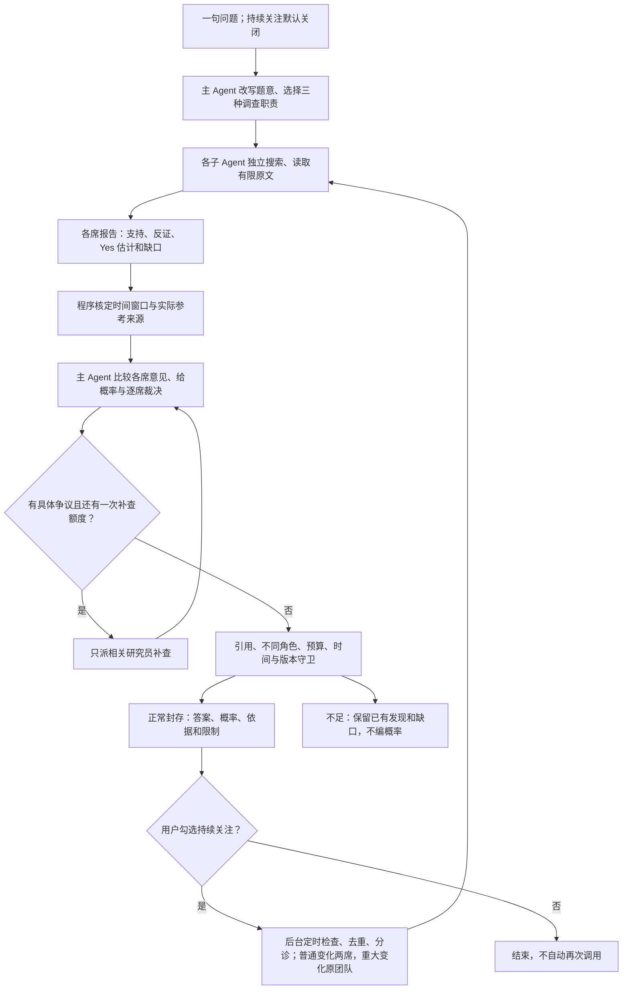

# 有界预测执行验收

2026-11-22，基于 V4.0。此文记录本次执行修复，不是预测准确率报告。原用户 4174 服务、旧运行和已冻结契约未重写。

## 执行方式

主 Agent 不先大规模搜索；一般题目的准备阶段由程序编译。最终概率仍由模型结合各席报告判断。原始引用从被采纳或保留条件的有效报告中沿用，经过同一引用校验，不要求主 Agent 重写每一段事实。

调查和最终报告分别处理：调查可推理；报告阶段根据已经取得的工具回执生成结构化答复。原始协议私有封存，公开页面只显示计划、实际动作与摘要，不展示隐藏推理。

## 预算与异常

- 新普通预测：三种初始职责，最多一次补查；每席最多六次模型请求、四次取证动作，主 Agent 最多六次请求、每阶段两次有效决策。不是强制跑满轮数。
- 输入、工具 Schema、输出一起做调用前估计，并留报告与主汇总额度。实际用量仍由供应商回执记账；字节估计不是精确 tokenizer。
- 用量未知则停止追加付费调用。不能承诺在任意小预算、来源不可读或服务拒绝时仍有合法概率。
- 主裁决未完成时，只有至少两个不同职责的有据估计才可作明确标记的程序中位数汇集；结果必须需复核、不计分，不列为正常自动裁决成功。否则交付空概率的阶段性资料。
- 旧运行保留旧策略；财报核验、固定天气和严格 BTC 三个初始席位的验收规则保留。

## 真实运行记录

全部使用真实模型 `deepseek-flash` 与联网来源，没有注入预设答案；持续关注均未勾选。模型 tokens 不包含未提供等价计量的资料服务费用，不等于人民币费用。

| 记录 | 模型请求 | 模型 tokens | 结果 |
| --- | ---: | ---: | --- |
| 原用户运行 `course_run_b810c86a-e6e4-4b69-839d-7cf61bdafb96` | 39 | 628073 | 未发布；主 Agent 约占49.3%，首轮发布规则与补查脱节 |
| 修复中第一次 `course_run_1b8927e3-07a0-4886-8191-c0129cb590a1` | 21 | 207272 | 两席有估计，主裁决格式/引用失败；程序汇集，不能算正常成功 |
| 修复中第二次：任务 `course_request_b935523b-a994-4929-a8de-34272425908d` | 22 | 202934 | 仅一席完整；报告修正和思考截断导致不足，未发布概率 |
| 修复中第三次：任务 `course_request_c634dd27-b2d2-4946-908b-d06d64d861f4` | 20 | 179469 | 报告已分离思考，但短数字引文不满8字符、格式错误反馈不具体，最终未形成有效角色估计；未发布概率 |
| 最终验证 `course_run_bbf9939d-a178-4b61-a1a3-a1e232840ce3` | 21 | 193068 | 86.147秒完成模型裁决和正常发布，Yes 43% / No 57%；条件估计、不计分，未走程序汇集 |

三次不完整运行促成进一步修复：安全的具体字段错误反馈（同时覆盖主动作和研究员报告）、主 Agent 沿用已验证报告依据、工具能力边界说明、报告阶段与调查推理分离、正文引用片段保留和去广告提示。普通预测每席最多60000模型tokens（仍受用户全局上限分配），报告预留最多24000，提前覆盖报告与一次修正的输入费用，而非只预留输出。

最终验证的主 Agent 只调用3次，计27566 tokens（14.28%）；子 Agent 共18次，计165502 tokens。主 Agent 没有搜索/抓取动作，程序核定契约1次，补查1次，封存4/4份报告的裁决。初始市场席未形成报告，补查后完整交付0.42；核验席完整交付0.45；统计席保留资料不足标记和0.35条件估计。发布依赖两种职责的有效完整评分，未将统计席或程序预算回执冒充完整核验。

本次共4次真实验证，累计84次模型请求、782743模型tokens；失败记录保留。最终一次比原用户失败运行少约69.26%的模型tokens，主 Agent 占比从约49.3%降至14.3%。这是不同时间的一次流程对照，不是严格成本基准或重复成功率证明。

预览：[最终验证任务](http://127.0.0.1:4203/#/course/course_request_64fb119f-520b-489f-8dfe-2a129ca134e3)。`watchEnabled=false`、计划`off`、`nextDueAt=null`；不会因为此次验证在后台再次自动调用。简明计量与断言见 [真实验收记录](evidence/bounded-forecast-live-validation.json)。

## 回归与边界

最终完整回归 **535/535通过**，受控协议测试验证的是程序行为，不是事件预测准确率。源码变更及新文档未发现凭据模式；Key未写入代码、日志或验收文件。

仍有实质限制：本次保留7次工具/报告拒绝事件，初始市场席需要补查，统计席未完整，不能称“零错误”或“所有席位一次完成”；需要更多独立真实样本才能评价稳定性。页面的摘要冲突检测还会保守标记“未核验基准却出现具体价格”，本例正文明确称其为网页候选参考，但旧规则仍报警；提示原样保留，没有为了截图移除。行情结构化基准缺失、一手新闻不足、概率未经校准均在页面显示。

网页采集取舍见 [资源调研](research/2026-11-22-web-reader-review.md)。本轮没有安装 Readability、Trafilatura 或 Jina 服务；先修已接通的来源网关。DeepSeek 单请求思考参数依据[官方文档](https://api-docs.deepseek.com/guides/thinking_mode/)。

本轮不新增产品功能、不重新设计界面、未提交或推送 GitHub。真实行情缺少结构化基准时仍只能形成明确的不计分条件估计，不能据此宣称已完成可结算量化预测。
