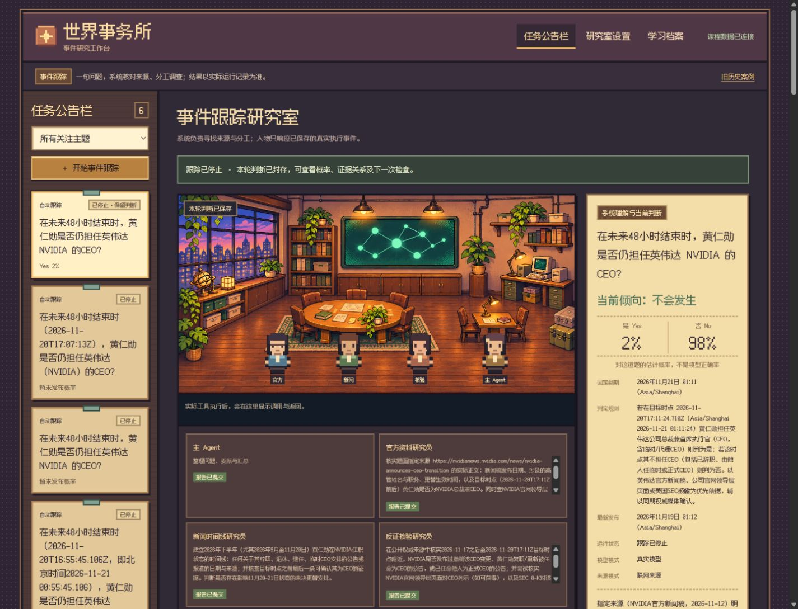
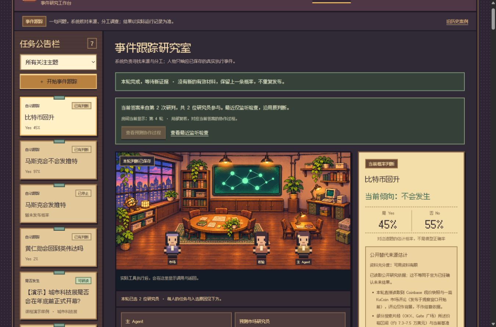

# 课程协作版验收

日期：2026-11-19，Asia/Shanghai。对应 PRD 0.5 的最小纵向交付，不代表完整平台 P0 全部完成。

## 结论

已接通口语输入、系统找资料、主 Agent 按题选三席独立工具调查、一次按争议补查、受校验的二元概率发布、来源关系与历史轨迹，以及后续监听分流和历史摘要检索。真实 DeepSeek 已完成整轮；完整应用测试 **253/253 通过，0 失败、0 跳过**。像素界面与手机入口已人工检查。

默认 `node start.mjs` 为明确标识的 mock／虚构来源演示；配置模型与搜索凭据后才会真实联网。没有凭据不以假新闻降级成真实结果。真实与模拟数据分开保存。

## 实际模型验收

本节保留最初 Flash 验收。最新 Pro 思考模式的两条用户原问题与后续真实检查见末尾追加验收及 DEMO_USABILITY.md。

本机使用 `deepseek-flash`，只向官方模型及 Search／Fetch 接口发送正常任务与公开来源；凭据留在测试／服务进程环境，未写入仓库或浏览器。

| 检查 | 实际结果 |
| --- | --- |
| 官方模型连接 | HTTP 200，可用模型名经接口验证 |
| M0 原生工具协议 | 真实模型列目录、读材料、提交报告；3 次模型请求、2 次工具调用、4039 tokens |
| 联网工具 | Search 返回候选；Fetch 真正取得正文并经回调保存后才返回可引用 ID；截断明确标记 partial |
| 课程整轮 | 请求 `course_request_d099c72a-4d8d-49fd-9bd9-8d2f36649d56`，运行 `course_run_79ed124c-ace2-4c70-b34b-7e236aa12cad`，completed |
| 角色与通信 | 三席首轮均 completed；主 Agent 发起一次核验补查，补查也 completed；报告与争议有公开记录及引用 |
| 时间与发布 | 创建后固定 48 小时；目标 2026-11-21 01:11:24.710（Asia/Shanghai），实际发布于 2026-11-19 01:12:16.733 |
| 用量与耗时 | 24 次模型请求、21 次实际调查工具调用、101296 tokens；创建到发布 52.023 秒 |
| 输出示例 | 对用户提出的 CEO 未来状态题，模型发布 Yes 2%、No 98%；这是模型估计，目标尚未到达，未做事实结算 |

首轮三个独立候选为 1%、4%、5%，中位数基线为 4%，主 Agent 复核后发布 2%。这个差异说明报告交换和复核确实影响最终候选，**不能说明复核后更准确**。需要目标到期及更多独立题目才能比较 Brier、校准与成本。八份来源快照含同源转载及元数据版本，不能当作八份独立确认。

机器可读验收摘要见 [course-live-summary.json](evidence/course-live-summary.json)，仅含公开指标、标识、概率及来源链接，不附私有模型消息或整篇网页。此前调试中对同一题的失败重跑不算独立预测样本。测试请求完成后已停止其自动检查，避免验收任务持续产生调用。

## 自动与独立检查

```powershell
node --test
```

Node v23.5.0，原生 SQLite，允许本机 HTTP。最新 253 项覆盖原有回归、课程 HTTP、服务、原生思考协议、联网工具与恢复、现价、预算、前端能力／动态角色／状态投影及六项独立可用性检查。

交叉审查者未编写课程存储、执行器或主 HTTP 接线，检查了跨运行任务 ID、发布边界、凭据／私有消息、实际用量、严格模式、变化与不变、到期和恢复；其自己编写的联网工具不计为独立自审。测试在真实临时 SQLite 上运行，HTTP 用例还启动子进程并实际连接 socket；不把协议夹具当作真实模型调用。

重点验证：

- 请求幂等、单题单活跃轮次；全局一轮在执行，内部三 Worker 并行，其他题排队。
- 参数和工具权限检查；搜索摘要不能直接成为证据，只有已保存正文可引用；禁止私网目标与 URL 凭据。
- 发布校验有限数值、版本、截止、原文归属／读取记录、指定来源和已登记结果；同轮只有一份发布与事件。
- 未来状态题不能用当前事实提前结算。该分类是明确标注的首版语义启发式，不能泛化宣称理解了全部时间命题。
- 中途关闭执行器、重新打开数据库恢复；已完成工具回执不重复读取；停止及迟到结果不复活运行。
- 没有新正文不新增概率；新正文才重新研判；原目标不顺延，旧概率点不回填；到期停止检查。
- 公开接口无 messages、checkpoint、phaseArchive、providerIdentity；错误不回显底层凭据或文件路径。
- 原生协议批调用逐一回填、无动作的有界修复；额度耗尽后拒绝额外调查，保留回执，再由模型根据现有材料提交报告。
- 阶段间主模型仅接收紧凑契约、报告与证据目录，旧完整原文协议私有归档，不反复注入模型。

## 浏览器检查

实际通过界面使用一句问题启动，未创建主题、选角色或提交正文。确认预设 48 小时及严格模式展开、四人真实任务状态与即时气泡、独立来源和关系、正式发布卡及单个真实概率点。历史刷新不重播发言。

1365px 桌面与 390px 手机均检查；手机实际文档宽 375、滚动宽 375，无整体横向溢出。课程页面在手机先显示输入／结果，再显示任务公告栏。主持气泡完整可见、指向本人，任务卡只显示子问题，不再显示内部契约 JSON。真实模型结果页控制台无 error。



## 实跑中发现并修复

1. 主模型可能返回多个只读工具调用。现在保留完整 assistant／tool 配对及检查点；不以要求单调用直接失败。
2. UTC 时刻被改成同钟面 +08。相对窗口现在由服务端固定，同一时刻可换显示时区，不能改变目标。
3. 研究员在调查预算边界继续请求，无法交报告。课程模式现在拒绝多余调查、保留匹配错误回执，并让模型用已得资料收敛；旧运行时默认行为保持。
4. 过长报告和重复网页上下文消耗预算。已缩短搜索候选、压紧报告、设有限输出额度，并按阶段隔离主上下文；总调用及 token 预算仍累计。
5. 相同正文先后发现不同原发布时间时，旧证据不能覆盖。现在保留出处元数据版本，正文哈希不变不会假装新增事实。
6. 独立审查发现跨运行任务 ID、耗用 token 回滚、严格字段覆盖及错误泄露，均已复验。
7. 旧 4187 进程仍缓存旧后端，但静态页面从磁盘读取新版，导致 `/api/v1/course/config` 返回 M0 的 `404 NOT_FOUND`（“找不到此运行 API。”）。已重启本项目旧实例并保留三个高级任务；前端现在先检查同源自动跟踪能力，未就绪禁用创建，每次写入前重新核验。旧接口、关闭接口、网络失败有不同提示，不跳其他端口。隔离实例实测关闭→恢复后，问题、24 小时、严格模式规则及来源均保留，随后实际提交成功。

第二次真实验收使用截图问题“黄仁勋会回到英伟达吗”，24 小时：请求 `course_request_539c8740-0501-426f-a248-efc204c18d0e`，三席与一次核验补查完成，23 次模型请求、24 次工具调用、114343 tokens，已发布并进入后台固定间隔检查。此记录验证接口和执行闭环，不代表题目事实或预测准确率已独立验证。

此前该次试跑发现时间表述边界（本轮对新 Run 已改进）：结构化 `targetAt` 固定为创建后 24 小时（上海 11 月 20 日 01:33），模型题目与摘要却将 UTC 日期／钟面写成上海时间。当前精确期限以“固定到期”卡及不可变结构化契约为准；不能宣称自然语言时间也已通过硬校验。现在统一向各 Agent 提供服务端生成的 UTC／本地时间上下文，由服务端生成标题与默认窗口规则；模型其余自由文字仍须阅读核对。已封存文本和概率不回写，新增用户任务未受本轮修复重启影响。

## 明确的交付边界

- 当前从十类目录按题选三位，普通新信息相关加核验两位，重大变化原团队三位。专用工具仍按实际注册许可，不代表十种完整外部系统都已接入。
- 一个固定间隔持久 WatchPlan；正文与价格变化经分诊后局部或全队复核，频率尚非 Agent 自主协商。
- 关系是报告中带出处的支持／反证记录，尚非通用时序知识图推理或可证明的统计因果模型。
- 图表来自真实发布，未来区域留白。没有过去数据时不补曲线，也不将历史概率线外推。
- 到期停止与已知结果登记已存在；自动到期抓取、完整结算评分 UI、校准训练和长期准确率实验尚未接通。
- 新课程主页面用 HTTP 轮询持久事件；高级 M1 保留 SSE。后台任务不依赖浏览器保持连接。
- 本轮模型测的是运行闭环与错误处理，没有已完成的预测准确率／盈利回测。不能由一条试跑承诺“预知未来”。

## 8–9 分钟课程展示顺序

一句问题 → 系统理解与固定期限 → 三席独立工具返回 → 指定争议与核验补查 → 答案、概率及证据 → 点开来源关系与执行记录 → 新资料检查（重复内容不刷点）→ 展示重启恢复和失败样例。若真实世界未在视频时段产生新闻，另用明确标识的历史／虚构测试快照展示内容变化，不伪造实时消息。

## 口语、动态分工与记忆追加验收

用户原问题“马斯克会不会发推特”和“比特币回升”由原失败任务直接开启新轮，原创建时间、到期、失败历史未改。Pro thinking high 已真实发布两题，安全配置为 8192 输出上限及单次 180 秒超时，整轮仍有调用／token 预算。

- 发帖题：新闻时间线、统计、核验；一次统计补查，Yes 97%，资料有限，24 模型／32 工具／238323 tokens，399.153 秒。
- BTC 题：市场、时间线、核验；基准 Coinbase 63091.745 USD，Yes 47%，15 模型／18 工具／122104 tokens。执行约 181 秒；等待首题时间另计。
- 真实后续检查：历史 47%＋3 报告＋8 关系进入记忆；8 工具、0 模型，no_change，基准和一个历史概率点均不变。
- 受控资料：local 两人、major 三人、重复不新增点；实际主与 Worker 输入包含历史；未来资料不进入旧快照；报价资产匹配、回放／合成资格不可被 live 模式洗白。
- UI：动态名单、选择／补查原因、默认口径、资料充分度、近期参照、深度研判配置、记忆与分流可读；空检查不冒充发布；重试不显示旧拒答；null 空节点已修。
- 浏览器：桌面 1365px 与手机 390px 检查；手机实际内容宽 375、滚动宽 375，图表在自身容器滚动，来源不撑宽页面。历史轮次切换不补播气泡，两页控制台无 error。

详细指标、限制及课堂操作见 [口语交互验收](DEMO_USABILITY.md)，公开原始摘要见 [真实两题](evidence/course-usability-live-summary.json)与[真实后续检查](evidence/course-usability-watch-summary.json)。概率尚未到期，不能据此宣称更准确。六次合成题模型小测仅比较协议／口语处理与耗时，不作为预测排名。

## 答案来源与监听界面修复

默认房间对齐 forecast.runId，不以最新无变化检查遮住实际多人协作。增加来源人数、研判／监听菜单标签及两个只读切换按钮。新 10 项选择／归属／来源回归加入后，该批全套 188/188；浏览器验证默认两位研究员、切到仅后台检查、刷新保留显式选择、返回协作不补播气泡、375px内容无横向溢出及控制台无error。未修改运行数据或模型配置，本轮未发新模型请求。



## 天气失败恢复与“今天”追加验收

完整回归现为216/216。补齐模型/资料HTTP故障安全分类、硬故障暂停与手动恢复、临时错误有界重试、失败题停止入口、截断已知usage记账及更大的受控思考输出。新题“今天”由创建日期锚定本地日终，旧契约不静默迁移；预设天气在无结构化实况证明时禁止自动结算，继续发概率。

两条原天气题的首请求故障记录保留。24小时题真实恢复；“今天”题因原错误日期及截断失败而停止，另从实际页面建立修正版。新题官方/统计/核验三人全部完成，固定到11月19日23:59:59.999，发布Yes35%、资料有限，19模型/22工具/166144 tokens、321.280秒。预测执行通过不代表降雨准确率通过，尚未取得可评分结果；详见 [故障与天气验收](PROVIDER_RECOVERY.md)及[修正版公开摘要](evidence/weather-today-corrected-live.json)。
