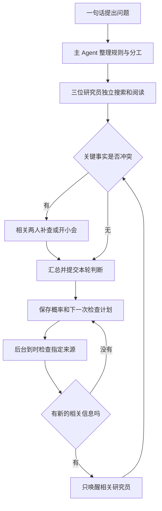

# 课程交付版：持续事件判断器

日期：2026-11-19。本文最初为调研后的设计与开发约束；用户授权实施后，课程最小运行闭环已交付，实际范围、真实模型调用和未完成项见 [课程验收](COURSE_ACCEPTANCE.md)。下文保留目标设计，不能把全部目标视为已经实现。以老师的多 Agent 作业为最终目标；沿用 binary 和像素画风。

V2.0 已改为先派工再取证，每人最多5次调查决策、第6次预留报告，初次加最多2次定向补查；最新事实、问题和后续优先级见 [详细改动与开发清单](V2_CHANGELOG_AND_ROADMAP.md)。下文早期“一次补查”及自动协商频率等表述属于设计起点，当前实现以新版清单和运行配置为准。

## 1 一句话定义与课程对齐

用户说出一个想提前知道的问题，系统把它变成有期限、可验证的是非题，自动分工找资料、核对分歧，给出当前倾向和概率，并在新信息出现时更新。

老师原文第 1–2 页允许角色分工、Planner–Executor、Supervisor–Worker、共享工作区及讨论，但要求有实质角色差异、任务分解、通信和最终决策。提示词可以定义方法；只有不同提示词、独立调用后拼接文字不足以证明协作。第 3 页明确复杂技术不自动带来更高分。权重为动机 15%、多 Agent 设计 30%、实现 25%、分析创新 15%、展示提交 15%。

本轮补充：预设允许宽泛口语，系统补全并展示假设；十角色目录动态选人、局部两人复核及历史摘要检索已完成。当前行为以 DEMO_USABILITY.md 为准。

本版只做一条可复现的完整路径：**一句话 → 自动整理问题 → 三人独立取证 → 一次针对性复核 → 二元概率 → 持久监听 → 下一次判断 → 到期核验**。从十类角色目录按题选择，初始演示由一个主 Agent 和三位研究员完成。主 Agent 的第一阶段负责翻译题意，不另外堆一个必需的第五位 Agent。

## 2 开始改造时的基线

新 M1 默认入口实际是：用户先建主题与题目，手工提交正文，选择一位研究员，执行材料目录／原文两个真实处理器，提交报告。模型协议循环、权限、预算、SQLite 恢复和 SSE 事件已存在；当前演示模型是 mock。十个模板有不同方法指令，但外部工具集合相同，没有按题自主搜索，没有主 Agent 调度、通用 WatchPlan、图服务或正式概率发布。

旧案例确有固定角色会议及 SEC／Polymarket 监测，但范围绑定 NVIDIA／AMD 案例。它不能被描述成新建任意题后就能自动跟踪。初次调研交付没有修改应用；后续本轮实施与 141 项验证另见验收，不重新将上轮 99 项计作新增测试。

## 3 用户只需要给什么

| 模式 | 用户输入 | 系统承担 |
| --- | --- | --- |
| 预设模式（默认） | 一句问题；可选 24 小时／48 小时／7 天，默认 48 小时 | 自动归档主题、解析实体、明确命题、计算截止、查找判定来源、选角色与工具、安排检查 |
| 严格模式 | 展开修改系统填好的规则、日期、来源和时区 | 同样自动调查、自动派工；不强制选择角色或粘贴材料 |

默认点一次“开始跟踪”。主 Agent 整理后展示“系统如何理解这道题”的简短纸签，可纠错；只有实质主体或判定歧义才补一个关键问题。明确写出的日期优先于默认值。结果来源尚未找到时进入“正在准备／来源不足”，不能编造 URL 把题目硬保存成 ready。

例如“黄仁勋两天后还会是英伟达 CEO 吗”整理为“在本次创建时刻加 48 小时这个固定时点，黄仁勋是否仍担任 NVIDIA CEO”。系统先核验身份与当前状态，自动寻找正式披露及辅助来源。这里是规则示例，不是对现实职位或未来概率的判断。“到某时点仍在任”和“期限内宣布离任”是不同命题，不得偷偷互换。

股票题可用预设口径，但必须在纸签明示比较基准、交易所、目标收盘、复权口径。两个自然日不能静默等同两个交易日；缺可验证报价／交易日历则保持准备状态。课程主路径优先用公开信息较易验证的科技商业事件，股票无需单做一套量化平台。[交易日历参考](https://www.nyse.com/trade/hours-calendars)

## 4 Agent 的区别落实在可执行能力上

每个在用 Agent 有方法文档、工具许可、输入输出结构、独立上下文、来源范围、预算、结束条件和监听策略。方法文本负责指导；真正的工具、派工、状态与权限由程序执行。

当前实际工具以 [运行手册](agent-playbooks/README.md)为准：搜索、正文读取及限定角色的现价工具已经接通；主 Agent 用原生动作规范问题、派工、分诊、补查和提出候选。下表保留早先设计接口，`await_reports`、`set_watch_plan` 并非独立已注册动作，等待由状态机处理，监听间隔由服务配置。

| 在用角色 | 实际职责 | 需要接通的动作／工具 | 向谁交付 |
| --- | --- | --- | --- |
| 主 Agent | 整理问题、拆解、选人、指定争议、汇总、建议更新计划 | delegate_work、await_reports、request_followup、propose_forecast、set_watch_plan | 发布处理器与调度器；不能绕过期限／引用校验 |
| 官方资料研究员 | 查正式公告、公司或机构状态、原始判定来源 | search_web（限定来源）、fetch_page、read_evidence | 主 Agent：确认事实、来源、时间、缺口 |
| 新闻时间线研究员 | 查最新进展、首发与更正，识别转载 | search_web、fetch_page、来源去重 | 主 Agent：新事实、传播链、待核验主张 |
| 反证核验研究员 | 独立寻找反例；收到具体争议后补查 | search_web、fetch_page、read_evidence、query_evidence | 主 Agent 和相关研究员：支持／反证、来源独立性和未决问题 |

首轮不让研究员先看到同伴的概率，避免直接跟随。后续围绕具体主张交换带引用的报告，补查产生新的 assignment。主 Agent 可以调整关键词、子问题、任务来源范围与检查间隔；不能生成一个不存在的工具或任意执行代码。活跃角色说明见 [角色运行手册](agent-playbooks/README.md)。

建议把 DeepSeek 官方 Search／Fetch 接到自己的 ToolGateway：模型选择搜索词或 URL，服务端真正调用并记录正文、来源与时间。官方文档提供这两种接口及同一 Bearer 认证；本次只查文档，未使用用户 key、未实跑可用性。Tavily 可作后续替代，首版只验证一个搜索提供方。[DeepSeek Search & Fetch](https://api-docs.deepseek.com/guides/search/)、[Tavily Search](https://docs.tavily.com/documentation/api-reference/endpoint/search)

## 5 “一轮”与持续关注如何编排

需要分清三种时间：预测窗口（例如未来 48 小时）、检查间隔（例如每小时）、一次研判的执行预算（例如几分钟）。它们不能共用一个“轮次”字段。

**一轮 = 围绕同一道固定目标题，完成一次有预算上限的调查、必要复核和判断提交。** 固定初始契约与已有资料快照；联网调查中新取得的原文按步骤追加不可变记录与输入清单，发布时封存最终实际输入。不能要求搜索前已经有全部网页，也不能把后取得的材料放回前一步。一次模型请求是一步，一次抓取是一次工具调用，整个 48 小时关注任务可以有多轮。补查是本轮子任务，仍消耗本轮总预算。

发现新消息不等于全体重开会。先按 URL、正文和主张去重，再判断题目相关性与影响：转载仅存来源映射；普通增量派给相关研究员；关键矛盾由相关人加核验席复查；重大变化才召集本题活跃团队，不默认叫齐十种模板。分诊的原因也公开显示。

目标设计中的 WatchPlan 包括角色、网站／搜索词、下次时间、内容水位、频率上下限、截止、退避与预算，并可由主 Agent 按事件调整。当前课程子集已实现持久计划、查询／来源去重、检查与故障暂停，间隔仍统一由服务配置（默认一小时），尚未由 Agent 自主调整或按角色协商频率。Node 服务保持运行时，关网页不影响检查；当前持久恢复与范围见课程验收，不让 LLM 在等待期间空转。

同题已有研判时，新消息排入增量队列并合并，不能往已封存的旧快照注入未来材料。没有新信息只更新检查状态，不刷概率点。到期停止预测更新；结果已知则进入核验，不继续计分发布。收不到来源不等于事件没发生。

## 6 最终输出与曲线

结果首先显示“当前倾向：是／否”和“是的估计概率”，例如 **倾向否；是 35%，否 65%**；这个数字仅为格式示例。资料不足时显示尚无判断，不能补 0% 或默认 50%。50% 本身是合法估计，可以显示“两种结果接近”，但必须区别于没有发布概率。资料充分程度与团队分歧单列，不把发生概率称作模型正确率。

新闻通常是事实与线索，不天然是一个能直接相加的概率。主 Agent 应考虑当前状态、适用基准率、支持与反证及时间条件。首版保存各自候选与最终裁决理由，用中位数聚合作简单对照；共享来源的意见不能当作独立证据相乘。图首先保存事实／主张及 supports、contradicts、updates、来源和有效时间，不把语义关系硬当因果系数。

轨迹是同一个固定到期问题的判断历史：`p(t,T) = P(目标时点 T 的结果为 Yes | 在 t 实际掌握的信息)`。每个点都有真正的发布时间、材料快照及变化原因。今天读到昨天新闻，只能更新今天，不能回填昨天的曲线。

历史判断线不能简单延长成为未来概率。若要同时问 24 小时、48 小时和一周，分别形成三个目标；课程版先只激活用户所选一个窗口。到期后继续关注可在同主题新建下一窗口，旧题照常核验，各窗口不混成同一道题评分。

每次概率发布须有独立、确定性的 ForecastPublisher：校验二元有限数值 0–1、题目版本、期限、证据归属、材料可用性、重复提交，以及已登记的结果可知状态／指定来源已有核验结果；事务写入记录和事件。它不能自动知道整个互联网是否已有答案，来源不可用仍须保留缺口。提示词中的“不要发布”不是发布守卫。结果确认单独存 Resolution，不把 0%／100% 的已知结果伪装成一次成功预测。

## 7 现有项目如何借用

以下都是本轮查证后的采用建议，未安装或整合；优先参考小模块和契约，保留自己的 Node／SQLite Harness。

| 项目 | 可借的部分 | 本期取舍 |
| --- | --- | --- |
| [Metaculus forecasting-tools](https://github.com/Metaculus/forecasting-tools)（MIT） | 研究、候选概率、聚合与报告分层 | 借结构和简单聚合基线；不搬 Python／Streamlit 全栈 |
| [DeerFlow](https://github.com/bytedance/deer-flow)（MIT） | 有工具、隔离上下文及 Skill 的子任务编排 | 对照真实派工接口；不重写成其整套运行环境 |
| [AOrchestra](https://github.com/FoundationAgents/AOrchestra)（Apache-2.0） | 按任务组合指令、上下文、工具、模型 | 十个固定模板加本次任务参数即可；其任务基准成绩不代表预测精度 |
| [Graphiti](https://github.com/getzep/graphiti)（Apache-2.0） | 带来源与时间的关系修订 | 先用小型 SQLite 证据关系表；不先部署图数据库／Python 服务 |
| [ForecastBench](https://github.com/forecastingresearch/forecastbench)（MIT 代码） | 前瞻问题、截止、结算和评分 | 做自己的小题集及对照，不接整套云部署 |
| [MiroFish](https://github.com/666ghj/MiroFish)（AGPL-3.0） | 图与角色、过程记录和模拟报告的产品思路 | 与本项目更接近的是“自主调查＋核验”；不搬大量人格社会模拟或把模拟当现实概率 |

MiroFish 公开流程偏从种子信息构建关系、角色和社会模拟，再生成报告。我们的课程特色可以是**有界分工、针对新证据的局部复核、概率变化可回查**。可演示不等于预测有效，是否更准仍须对照。[Anthropic 多 Agent 研究系统](https://www.anthropic.com/research/multi-agent-research-system)也公开了主研究员委派、并行独立上下文与工具循环，可作架构依据，而非准确率保证。

详细原始调研：[预测项目](research/2026-11-19-forecasting-projects.md)、[现有运行时](research/2026-11-19-runtime-review.md)、[产品与 UX](research/2026-11-19-product-ux.md)。

## 8 开发顺序与课程完成线

不再先做一批只有入口的配置页。下一批把原 M2／M3／M4 各取最小部分，打通一个纵向样例；原里程碑仍用于细项状态，不能据此整批宣称完成。

1. 问题整理与真实搜索：一句输入、48 小时默认、严格规则可展开；主 Agent 准备有效问题，搜索和读原文两个工具真正执行。
2. 协作与输出：主 Agent 给三位研究员不同调查任务，独立报告，针对一个争议补查；确定性发布处理器写入二元概率，像素场景显示实际派工、工具与本人报告气泡。
3. 持续更新与评分：一个持久 WatchPlan、新证据去重和局部唤醒、小型关系图、概率历史、到期核验、Brier 与单研究员／简单聚合对照。

按课程要求，必须完成：普通用户不填材料或选角色；真实模型自主调用搜索与读取工具；三人分工及至少一条有引用的通信可回查；实质争议补查有新动作；最终判断和概率可追溯；有代表性结果及一个失败案例。无真实争议时不得编造吵架。

本项目展示特色采用最小实现：一条持久监听 Job、固定间隔检查与去重、关网页后继续及重启恢复、两次真实发布形成的轨迹；关系黑板只需几条可点击出处的支持／反证边，不引入图数据库或复杂推理引擎。自动适应频率、多来源全覆盖、复杂图检索和训练校准器不作为交作业门槛。结算可先采用管理员核对约定来源后录入结果，保留出处并算 Brier；完整自动结算器属于后续，不影响普通用户免配置的调查入口。

演示压在 8–9 分钟：开场一句话建题，展示自动分工及实际来源，点开一个分歧和补查，解释最终概率与关系证据，再展示一次后台唤醒和重启恢复。真实世界未必在十分钟内产生新消息；可另用明确标识的历史快照回放展示消息变化，或缩短演示检查间隔，不能伪造实时新闻。实时运行、历史回放、协议 mock 分别标记。

准备少量可在提交前结算的前瞻题，事先封存；同时记录样本量、未结算／未判断、调用成本和失败。比较同一题／截点／模型和相近预算的单研究员、直接聚合与争议复核，用 Brier `(p-y)^2` 和成本说明收益。不能只用“CEO 两天不换人”一类高基准率事件证明系统准确，也不承诺小样本能证明多 Agent 优于单 Agent。

本文最初只做研究与规格，后续实施以课程验收逐项记实；按题选人、配置式监听、局部复核及简单证据关系摘要检索已接通；完整时间图推理、自主频率与自动评分仍未完成。课程材料包含源码运行说明、最长 10 分钟视频、幻灯片及个人贡献说明，截止按老师原文为 2026-11-23 23:59。
