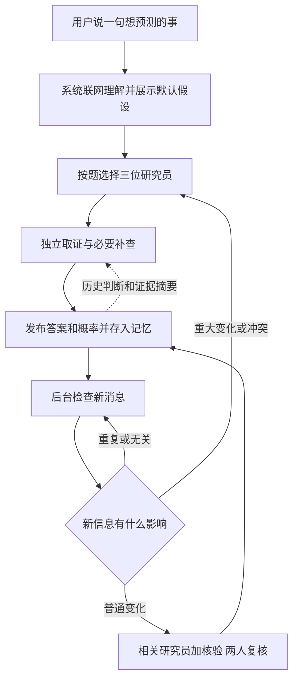

# 口语输入与持续研判改进

2026-11-19。服务于 COMP5584 课堂展示，仍只输出是／否和概率。本文记录本轮需求与验收口径；完成结果见末尾，不把设计自动计为已实现。

## 两条实际失败用例

用户输入“马斯克会不会发推特”和“比特币回升”。旧版都在主 Agent 整理问题时停止，尚未委派研究员。前者要求用户补账号、原创／转发、完整窗口和结算来源；后者要求基准价、阈值、交易所、规则及原题链接。这不适合作为默认交互。

## 用户只问一句，系统承担默认解释

预设模式以普通语言理解问题，联网调查并公开采用的假设。马斯克默认指 Elon Musk，推特默认指 X 的 @elonmusk 公开发帖，包含原创、回复、引用和转发。默认时间从本次创建到用户所选期限；不要求用户知道预测市场的合约格式。

比特币“回升”先尝试真实只读报价，默认比较目标时点与本次取得的基准现价。基准保存价格、单位、来源、证据编号及系统取得时间，后续轮次不移动基准。没有可靠报价但取得了相关公开材料时，可以明确给出条件性方向判断；这种结果不冒充可计分的精确价位预测。全部来源均不可读时仍诚实显示缺口，不制造网页或概率。

严格模式继续固定用户填写的规则、时间和来源。放宽发生在预设解释与有说明的条件输出，不放宽证据归属、数值范围、过去记录不可变、发布时间和已知结果保护。

## 按问题组织团队

从已有十类方法目录选择三位互补研究员，由主 Agent 提交子问题及选人原因。人物行为题适合社群／人物／核验；市场题适合市场／统计／核验；政策题适合官方／行业／核验。核验席可以复用，不要求为了不同而强行替换有用角色。

各研究员持有独立上下文与实际工具权限。搜索与网页读取通用；新增现价工具只向主 Agent、统计及市场席开放。专用数据源未接通时明确说明，不能把模板中计划的工具写成已安装能力。

## 监听、会议和记忆的关系

一轮是一次有预算的研判，不等于一次搜索，也不等于整个 24／48 小时关注期。发布后后端按持久计划检查，浏览器关闭不影响任务，Node 服务仍须保持运行。

收报后先去重。没有实质变化不唤醒模型、不追加概率。普通更新让相关研究员和核验席局部复核；重要冲突或重大变化才召回该题保存的团队。无需等待所有渠道都返回一批消息。来源失联与新事实分别记录。

下一轮真正收到上一预测、报告摘要、关系及未解问题，同时收到本轮新资料目录。旧内容标记历史记忆，不算第二份独立证据，不用未来结果回填过去。这属于检索和更新工作记忆，不是训练模型参数，也不自动证明预测更准。

## 模型与时间

使用 DeepSeek 官方思考配置，而不只是延长 HTTP 等待：`thinking=enabled`、`reasoning_effort=high`，并给足输出和超时预算。兼容协议必须原样回传工具循环中的私有 reasoning 字段；前端仅展示任务、真实工具回执和公开结论。

六次人工虚构资料小测比较 Flash 普通、Flash 思考和 Pro 思考。普通 Flash 约 3.8 秒，思考 Flash 约 5.5 秒，思考 Pro 约 18–22 秒。两条题目不足以证明准确率优劣；初版 rubric 的 baseline 含义有歧义，不能把自动检查分数作为模型排名。选择 Pro 思考作后续真实验收，重点检查能否补全口语、区分价格与概率、忽略未来资料、保持原生工具协议。安全观测记录见 [模型小测](evidence/course-model-usability-probe.json)。

服务端提供同一目标的 UTC 与本地时间，期限文字由程序生成。模型引用“目标时点”，避免把 UTC 钟面重标为上海时间；已封存旧文本不静默重写。

技术依据：[DeepSeek 思考模式](https://api-docs.deepseek.com/guides/thinking_mode/)、[Coinbase 公开现价接口](https://docs.cdp.coinbase.com/coinbase-app/track-apis/prices)。报价的 observedAt 是系统获取时间，不是交易所成交时间。

## 本轮验收记录

完整测试 216 项通过。六项独立可用性检查覆盖口语自动解释、不同团队、资产报价错配、严格规则、跨 UTC 午夜、历史记忆实际进入主／Worker 输入、基准不变、局部／重大／重复分流与评分资格。普通增量两人和重大三人的成功属于明确标记的受控资料测试，不伪称现实中已经产生对应新闻。

直接重跑用户原任务，保留原失败轮次与固定到期时间：

| 原问法 | 实际选择 | 真实结果与用量 |
| --- | --- | --- |
| 马斯克会不会发推特 | 新闻时间线、统计指标、反证核验；另一次统计补查 | Yes 97%，资料有限；24 次模型、32 次工具、238323 tokens；约 6 分 39 秒 |
| 比特币回升 | 预测市场、新闻时间线、反证核验 | Yes 47%，No 53%；15 次模型、18 次工具、122104 tokens；进入执行后约 3 分钟，另有等待首题的排队时间 |

BTC 固定基准为 Coinbase BTC-USD 63091.745 USD，系统取得于 2026-11-19 02:22:13（Asia/Shanghai），并不是交易所逐笔成交时间。两个概率都是未到期估计，不是正确率；题目到期前不能宣称预测已验证。来源快照数含同源或版本，不能当独立确认数。

随后实际执行一次 BTC 检查：读取上一判断 47%、3 份报告、8 条关系，8 次只读工具、0 次模型调用；分流为 no_change，未召集研究员，概率点仍为 1 个，基准原样保留。新轮只有检查，没有虚构一次报告或概率发布。

安全公开摘要：[两条实际回归](evidence/course-usability-live-summary.json)、[后续监听检查](evidence/course-usability-watch-summary.json)。不包含私有推理、检查点或凭据。

## 课堂演示顺序

先打开已完成的口语题，说明系统采用的假设、期限、答案与资料充分度。展示三席子问题、选人原因、真实工具和补查记录；再切到 BTC，展示不同团队、实际报价基准与一条真实概率点。最后在轮次菜单切到后续检查，展示历史记忆、去重和“保留原判断、未召集研究员”。若要现场新建，预留几分钟或同时展示已完成案例；本版全局一次执行一题，题内 Worker 并行。

界限：监听频率固定配置；X、Reddit、Polymarket 等主要通过公开搜索／网页研究，未部署各平台完整授权连接器。记忆是同题历史检索，未训练模型参数，尚非通用时序因果图或已校准的预测系统。机器与 Node 服务须运行，关闭网页不影响后端任务。

## 为什么有时只显示主 Agent

当前答案与最新监听检查是两个不同对象：答案由 forecast.runId 指向实际多人研判，最新检查可以没有新信息、没有新预测。比特币题的初始研究由市场、新闻、核验三席完成，当前更新由市场与核验两席及一次核验补查形成；后面的无变化检查只有后台工具动作，不代表主模型单独生成答案。

默认房间现在跟随当前答案对应的研判轮次，顶部显示实际参与研究员人数。可分别点击“查看预测协作过程”和“查看最近监听检查”；菜单区分研判、局部复核、监听无变化及失败。显式选轮或 URL 会保持锁定，未手动选择时新答案到来可自动跟随；历史展示不补播气泡。不得为展示效果伪造子 Agent 活动。
