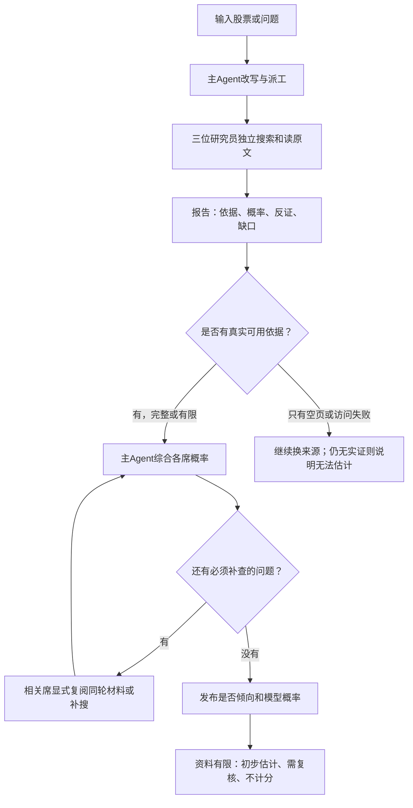

# 从“资料不足”到有据的条件判断

2026-11-22，课程 M2/M4 修复，涉及 A04/A06/A08/A10/A13/A14。保持二分输出、像素研究室与既有功能范围。

## 用户腾讯用例的实际原因

任务 `course_request_f516dbaa-baf5-4725-8178-e5887c768931`，原问“腾讯股价”。三个初始研究员实际启动：市场、官方资料、核验；随后委派核验席补查。整轮使用 21 次模型请求、182115/1000000 模型 tokens，未耗尽全局额度。

- 市场席取得联交所行情正文并提交完整报告，模型估计 0.49。
- 核验席取得新闻正文，提交带引用、模型概率 0.45 的有限报告，被 `status=insufficient` 一并排除。
- 官方席只读到免责声明等片段，0.48 只是弱先验，不能算作事件实证。
- 补查席只做了搜索，没有登记本人实际读取同伴材料，却连续提交其证据编号，三次被拒绝。
- 旧标准要求两种职责完整报告；主 Agent 两次将有限报告按完整报告采纳，触发裁决校验，最后变成整轮不足。

因此不能概括为“搜索工具全坏”或“查到的资料全没用”。搜索/网页服务确实返回部分无效页面和 404，但另有可用行情与新闻。主要缺陷是调查预算太紧、交接没有显式复阅、报告缺口与报告可用性混为一谈，以及汇总对完整核验的要求过高。被拒旧参数未全部包含在公开日志，不能将缺代码或日期的错误笼统称为验证器误判。

## 新的执行标准

只对新建普通预设任务启用 `deliveryPolicy=exploratory-estimate-v1`。旧任务和已保存结果不迁移，严格模式、固定 BTC/天气契约继续使用原守卫。

1. 每席最多六次调查决策、八次取证动作；首次报告另有两次格式修正，总模型请求最多十次。报告修正不挤占调查决策计数；仍按输入、工具定义、输出与实际 usage 管理费用。
2. 有真实模型概率、本人同轮已读正文、有效实质引用的有限报告，可以交给主 Agent 判断。原 `insufficient` 状态保留；不会改成 `complete`。
3. 普通预设任务至少一份有实证的模型估计即可形成初步条件判断。主 Agent 自己决定最终概率与倾向，并记录各席采纳、保留或拒绝的原因；数量或完整度不足则强制需复核、不计分。
4. 只有免责声明、Cookie、页面访问说明、搜索摘要、程序收尾回执，或者没有模型概率时，不能补造一个数值。
5. 坏报告逐项拒绝后，可另存 `partialReport`：只摘原候选中通过原出处校验的主张，保留原模型概率，记录被拒数量和原因，不覆盖原报告、不自动改概率。它只能由主 Agent 明确采用为有限依据。
6. 补查通过真实工具 `read_run_evidence` 复阅同轮已存材料，保存本人读取记录后才可引用。材料编号、原始正文和观察时间不变，复阅不算新的联网来源；初始独立席没有该工具。

前端只修正文案：有有效依据的部分报告显示“资料有限”，不再统一渲染成没有结果。调查、报告及修正次数按真实配置显示；没有增加页面或组件。

## 输入输出流程

## 验证记录

隔离协议回归检验程序行为；真实验证使用同一 DeepSeek 连接和联网来源，不注入答案、不模拟研究员返回。腾讯、英伟达、苹果三个新任务均关闭监听，记录每个研究员的工具调用、概率和失败，不只保存成功样本。

真实矩阵三例均由主模型完成裁决和发布，没有程序中位数兜底、没有手工调整概率。记录见 [逐席计量](evidence/forecast-reliability-live.json)。

| 原问 | Yes / No | 实际执行时长（不含排队） | 模型请求 | 模型 tokens | 发布类型 |
| --- | --- | ---: | ---: | ---: | --- |
| 腾讯股价，1交易日 | 46% / 54% | 165.5秒 | 26 | 279030 | 有据初步条件估计，需复核、不计分 |
| 英伟达股票走势，3交易日 | 47% / 53% | 147.7秒 | 28 | 310088 | 有据初步条件估计，需复核、不计分 |
| 苹果 AAPL 股价，3交易日 | 49% / 51% | 118.2秒 | 18 | 181964 | 三席完整报告的模型条件估计，仍因基准未结构化核验而不计分 |

三例合计72次模型请求、771082模型tokens。腾讯和英伟达各有定向补查；腾讯实际调用同轮复阅工具并登记本人读取。三例均无主Agent动作拒绝循环，主Agent分别只调用3、4、2次，主要取证由子Agent完成。腾讯及英伟达的有限报告保留原状态和候选概率，主Agent逐项记录采用范围与限制；没有把程序预算回执称作完整研究。

费用比原来短循环失败有所增加，这是本轮明确用更多调查和报告修正机会换取可交付结果；次数和全局token仍受限。上述tokens为模型回执，不含无法换算为同等token计量的资料服务费用，不能当作人民币账单。

旧腾讯失败任务及其原始报告保持不变。新建任务使用新策略；原4203预览与独立4204验收环境加载同一最终代码，连接已恢复，监听均关闭。

最终完整回归 **581/581通过**。额外检查了两处真实边界：只有被采用的完整实质核验报告才可减少复核要求，Cookie报告不能冒充核验完成；同轮复阅若无法完整返回已保存正文，会在授予本人读取权限前拒绝，不能获得未展示片段的引用权限。当前普通股票网页保存片段不超过4000字符，本轮三例未依赖长正文授权。

修改后的本机入口：[开始新预测](http://127.0.0.1:4203/#/predictions)。已预填腾讯与1交易日，未替用户点击再次提交。验收页：[腾讯](http://127.0.0.1:4204/#/course/course_request_73e00216-c408-4c3c-ac1f-2a7e3570280e)、[英伟达](http://127.0.0.1:4204/#/course/course_request_992880a8-ab18-4c61-bd23-37b08e70b70b)、[苹果](http://127.0.0.1:4204/#/course/course_request_55af3348-aac2-4809-9504-0d2b8a169d28)。三个记录均为真实模型和联网来源，不是静态示例。

一次或数次闭环成功只说明工程可用性，不证明股票预测准确率；条件估计不等于完成结构化行情基准或回测校准。网页可能延迟、缺数据或只是转述，原文片段匹配不保证语义或消息真实性。仍需后续真实结果标签与系统性评估，不能把接近五成的模型判断说成确定走势。
