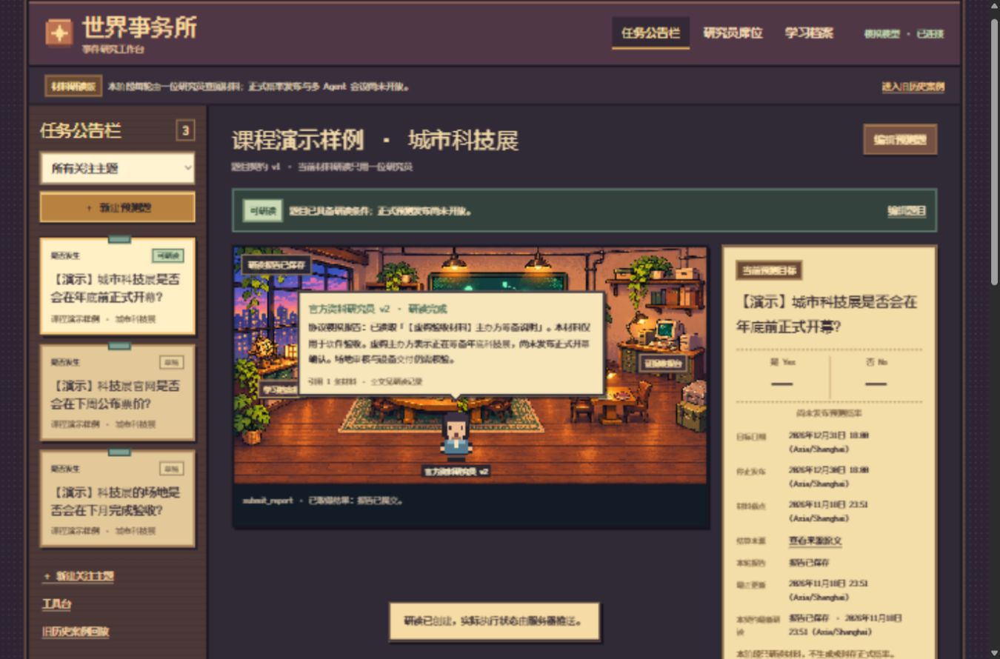
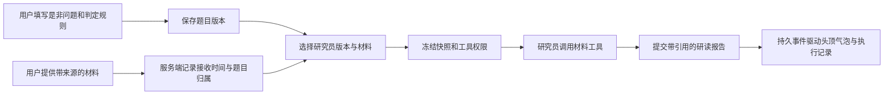

# M1 二元题目与像素工作台验收

日期：2026-11-18。对应 PRD v0.3。本轮输出类型收紧为 binary（是／否）；categorical、numeric、ranked_list 连同草稿写入均被拒绝。历史数据库的原有其他题型版本仍可读取，不会静默改写历史。

## 已交付

- 主题下可创建多道独立题目。草稿允许未填信息，保存为可研读前须填写期限、时区、判定规则、不可判定策略及结果来源；公共写入不能伪造已运行或已结算状态。
- SQLite 保存题目版本、角色版本、证据、幂等回执及迁移映射。版本冲突返回 409；编辑当前版本不改变旧运行快照。
- 十类内置研究员，可新增自定义角色、修改指令、生成新版本、查看历史版本。工具权限仅包含实际接通的材料目录与原文读取两个处理器；计划工具单独列出，不能用于执行授权。
- 运行冻结题目、研究员、Skill 版本和所选材料；材料的服务端首次接收时间与正文哈希保持不变。题目专属证据不泄漏到同主题其他题目。每轮至多 12 份材料，单题只允许一个未结束运行。
- 像素工作台通过真实 API 与持久 SSE 绑定工具及报告事件。人物在实际完成报告时冒泡；刷新或查看历史报告不重播气泡。材料收报与学习档案有独立页面和职责。
- 旧案例独立保留，可重复导入为两道不可评分的 replay 草稿，保留原始档案；迁移不修改旧案例存档，不提前暴露未揭示证据。

## 自动与交叉检查

```powershell
node --test
```

在 Node v23.5.0、真实原生 SQLite 和允许本机 HTTP 的环境下，最终 **99 项通过，0 失败、0 跳过**。其中包含：

- 11 项由非实现者针对领域存储、服务绑定和 HTTP 处理器编写的交叉审查，详见 [M1_INDEPENDENT_REVIEW.md](M1_INDEPENDENT_REVIEW.md)。角色目录及迁移模块不计作其独立自审。
- 2 项真实子进程和 socket HTTP 集成测试：三道二元题、并行研读、版本／证据隔离、幂等重试、重启持久性、重复迁移及跨源拒绝。
- 24 项纯前端投影检查，覆盖运行恢复、实际完成气泡、重复事件、乱序、取消、过期快照及跨题目串流。
- M0 原生工具协议、SQLite 崩溃恢复、HTTP／SSE 以及旧案例会议、监测和结算回归。

本轮交叉审查发现并修复了 replay 来源可改标、回放材料评分资格以及客户端可伪造已结算状态三个问题。浏览器集成另发现并修复了运行快照缺少 assignment 状态导致实际报告不冒泡的问题，增加投影回归。

## PRD 验收映射

| 编号 | 本轮结论 |
| --- | --- |
| A01 | 通过：主题、草稿、缺字段提示和就绪校验均经过 HTTP 与页面验证 |
| A02 | 部分：三题、证据、角色与运行隔离及恢复已验证；图、会议与正式封存尚未实现 |
| A03 | 部分：十类可编辑角色、自定义角色和版本可回查；主 Agent 按题选人尚未实现 |
| A04–A06 | 未完成：离线工具协议与权限测试通过，真实模型自主调查、协作争议补查待 M2 |
| A07–A09 | 未完成：新工作台图记忆与 WatchPlan 待 M3 |
| A10 | 部分：运行恢复、取消和 SSE 去重已验证；正式发布幂等尚未实现 |
| A11 | 部分：目标、期限、来源和独立目的地已呈现；正式结果尚未发布 |
| A12 | 部分：桌面／390px、键盘跳转和真实事件气泡已验；减少动态效果的完整人工检查仍待补齐 |
| A13 | 部分：只允许 binary；正式概率、结算与评分链路待 M4 |
| A14 | 部分：工具权限、预算、取消和恢复已有运行时测试；完整产品失败样例仍待集成 |

## 实际浏览器验收

使用独立预览数据库和明确标为虚构的“城市科技展”材料。通过界面完成：

1. 新建主题，一道就绪二元题和两道二元草稿；刷新后三道任务仍在。
2. 为第一题添加一份材料，另外两题可用材料为零，缺少规则时不能开始研读。
3. 选择研究员，实际调用两个材料工具并提交报告，观察头顶气泡；刷新后历史气泡不可见，报告仍可查。
4. 官方研究员保存为 v2，选择 v1 后历史指令只读；另成功创建“演示核验员”v1，研究员目录增至 11 个。
5. “证据收报台”进入材料页面，“学习档案”进入独立档案柜；无已结算结果时清楚显示空状态。
6. 重启本轮 4187 预览服务，保留数据库；页面恢复任务、材料、角色版本与历史报告。
7. 在 1365×900、390×844 两种视口检查排版；页面无整体横向溢出，窄屏任务便签与运行历史允许局部滚动。键盘“跳到当前工作区”进入 wb-content。

最后的界面调整修复启动研读后的滚动定位及窄屏气泡标题裁切：390px 定向复验时研究室顶部约为 16px，气泡顶部约为 26px、底部约为 120px，标题完整可见，长正文内部滚动。桌面控制台无 error。调整仅涉及视口定位和手机 CSS，不改运行时／投影逻辑；完整 99 项结果来自此前同轮最终业务代码。验收后已恢复浏览器默认视口。



## 输入与输出线路



## 明确未完成的部分

本轮运行的是可恢复的单研究员材料研读。mock 是固定协议夹具，不能证明模型的判断能力；尚未进行新工具循环的真实 DeepSeek 验收。研读报告不会写入预测发布表，工作台 `forecast` 为 null，“是／否”概率保持空白。

M2 下一步是主 Agent 拆解、并行委派、多轮讨论／反证补查和预算收敛，继续复用当前题目／角色版本、工具许可和公开事件。M3 再接入图记忆及持久监听。M4 仅实现 binary 正式发布、结果核验、Brier 评分与基线对照。新工作台尚未接通 Polymarket、论坛或网站自动抓取，结果来源链接只是判定依据；旧案例的公开监测不等于通用任务监听。
