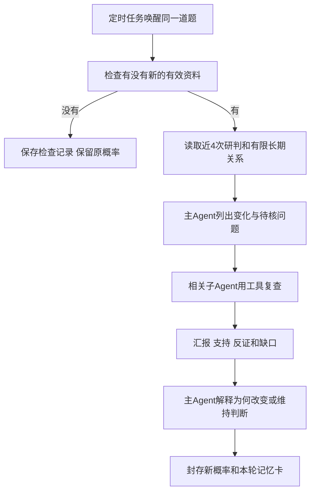

# V2.0 记忆规则：带着前几次判断继续研究

2026-11-19。本文是V2.0规则与实现边界。独立纯函数、SQLite加载、主／子Agent上下文注入和前端说明均已接入；纯函数8项及应用回归通过。真实后续检查带入上一52%、3份报告、8条关系与1次实质研判，并因无实质增量保留原概率。

目标很简单：同一道题下一次被定时任务唤醒时，系统知道前几次怎样判断、依据是什么、哪些问题仍未解决，再用新资料修正判断。记忆更新不等于训练模型参数，也不等于准确率已经提高。

已知待修复：黄金真实记录的公开总结与结构化未核验基准有冲突；目前历史预测投影也未完整携带条件估计和计分资格字段，不能只凭旧摘要判断事实已经确认。下一版需先补公开事实一致性与记忆资格标记，保留原始审计。详见 [V2.0 待办 P0-A](V2_CHANGELOG_AND_ROADMAP.md#p0-a公开总结必须与受控字段一致)。

## 1. 改造前的基线（保留对照）

改造前基线来自 `server/course/course-store.mjs` 的 `buildMemory`，以及 `server/course/course-service.mjs` 的 `memory.loaded`、主 Agent 上下文和研究员任务上下文；新版本已接入，以下表格保留旧行为对照，当前规则见后文及V2_RELEASE.md。

| 层次 | 目前保存／传入的内容 | 当前边界 |
| --- | --- | --- |
| SQLite 归档 | 题目、Run、派工、报告、证据版本、关系、封存概率、执行回执、监听计划及结果 | 没有自动删除或过期清理；关闭网页不清空 |
| 本次工作上下文 | 当前 Run 的来源、报告和工具结果；下一阶段主 Agent 使用压缩后的阶段上下文 | 私有模型协议留在检查点，不作为公开记忆 |
| 历史检索包 | 最近4条原始 Run 的最多8份报告摘要、8条关系、12条旧证据索引，以及单独检索的上一条概率 | 限同一个 requestId，并按 predictionVersion 和 asOf 筛选；没有跨题检索或时效窗口 |
| 后续使用 | 主 Agent 和研究员实际收到 historicalMemory；前端收到 memory.loaded 摘要 | 旧内容作比较和查找线索，当前引用仍须本轮实际读取 |

当前的“4条”是原始 Run 数量。纯监听无变化、失败或取消也会占位置，连续几次空检查可能挤掉真正的研判报告。因此它还不等于“最近4次有效研判”。目前只传上一条概率，也没有完整的近4次判断列表或独立的长期关系检索。

## 2. 先把计数单位说清楚

- **用户问题**：例如“黄金会跌吗”，对应一个 requestId。不同问题的记忆默认隔离。
- **题目契约版本**：同一道可预测命题的时间、对象和规则。换目标时间或口径，不能把旧概率当同一曲线上的新点。
- **一次研判**：一个 Run 中，研究员调查、汇报及主 Agent 汇总的完整批次。内部多次工具调用或多次会议仍属于这一批次。
- **一次监听检查**：检查网页或价格是否变化。没有新内容、没有实际研判时，不占用“最近4次研判”的名额。

短期记忆限制为**同题、同契约版本，最近7天内最近4次已结束实质研判**，不是最近4个用户问题、4次搜索、4条消息或4个空监听 Run。

## 3. 短期记忆目标

候选 Run 必须属于当前题目及版本，在本轮信息截点asOf之前结束（当前服务以run.createdAt加载），完成时间位于最近7天内，并且有已保存的实质研究报告或封存预测。纯检查、失败、取消和仍在执行的 Run 不作为完整判断进入这4个名额；其失败原因仍保留在执行档案。完成但资料不足的实质报告可作为缺口记忆，其概率保持缺值。

每次研判保存一张可追溯的摘要卡，直接从已提交对象整理，不额外调用模型编造总结：

| 要素 | 规则 |
| --- | --- |
| 身份与时间 | sourceRunId、题目版本、完成／发布时间和当时的信息截点 |
| 判断 | 当次封存的概率与公开结论；没有有效发布时保留缺值及原因，不补成50% |
| 主要影响假设 | 从报告的支持／反证和已有关系提取，带 evidenceId、relationId 与来源时间 |
| 分歧与缺口 | 尚未查明的事实、相反证据、来源不可读和代表性限制 |
| 变化原因 | 与前次相比为何改变或保持；不能仅写“有新消息” |

检索包保持有界：最多4次研判摘要、8份报告。一个 Run 中多个 Agent 的报告归在同一张研判卡下，不把三份同轮报告算成三次历史预测。短期卡片可带该轮支持／反证因素、异议和未解缺口；这些均来自既有记录，不额外调用模型。

未被选入工作记忆的旧研判仍在档案中。短期窗口滑动只改变下一次输入，不删除或改写历史记录。

## 4. 长期记忆

长期归档保留完整封存结果、来源证据版本和带出处关系，供回查；默认不因离开短期窗口而删除。首版不引入新图数据库、不训练模型权重，也不在不同用户问题之间自动迁移概率。

长期检索与永久归档是两件事。当前实现采用以下有界配置：

| 项目 | 起始规则 |
| --- | --- |
| 检索范围 | 同 requestId、同 predictionVersion；其他题目即使提到同一公司也不自动混入 |
| 时间上界 | 任何记录及其证据必须在本轮开始截点前已取得；未来补充和后来的结算不能进入旧输入 |
| 回看窗口 | 默认最近90天的历史关系与证据索引，不代表证据在90天内始终有效 |
| 数量 | 最多8条来源关系、12条旧证据索引；优先给返回关系配齐来源，再补最近来源；语义重复关系与相同正文索引去重 |
| 时效标记 | 附来源时间、取得时间、距今时长、适用版本及需复核标记；没有有效时间信息时明确未知 |
| 当前事实资格 | 历史资料默认只作研究线索；重新抓取并核对后才能成为本轮证据 |
| 模式 | 保留原 modelMode／sourceMode；模拟或回放材料不能因被记住而变为真实证据 |

长期关系至少包含：主体或主张、支持／反证类型、来源 evidenceId、记录时间、所属题目及版本。纯函数返回时也附原文取得时间、时长及模式，关系必须能对应到本题截点前已取得的来源。现有 supports／contradicts 是证据与主张的关系，不能显示成已测得的正负相关系数或因果强度。没有方向证据时保持未知。

不同信息的有效期不同。固定比较基准仍属于原契约，不能因刷新价格而被改写；最新价格、任职状态和即时天气则需要重新核实。回看窗口控制检索成本，不能替代逐条判断资料是否仍适用。

## 5. 记忆怎样进入下一次推断

主 Agent 用历史概率和因素判断“这次与上次有什么不同”；子 Agent 用旧证据索引找到应复查的来源，并寻找反例。记忆不能命令模型照抄旧答案，上一概率也不是新发现的事实。

同一原文被多次抓到、转载或由多个 Agent 看到，不能被重复算成新增支持。无变化检查不新增概率点。修改概率必须给出新的有效资料、重新解释的具体依据或公开说明的错误更正。

## 6. 最小实现和验收

独立模块导出 `MEMORY_POLICY_V2` 和 `buildMemorySnapshot({requestId, predictionVersion, excludeRunId, asOf, runs, assignments, forecasts, relations, evidence})`。输入为原始扁平记录，runs按最新在前传入以稳定相同时间的排序；版本未知时只接受同样未知的记录，不能默认跨版本检索。模块无IO、不发模型请求，不修改输入，也不物理删除历史。

返回policy、shortTerm、longTerm、recentJudgments，同时保留previousForecast、reports、relations、previousEvidence、sourceRunIds等兼容字段。previousForecast是90天范围内最后一条有效封存概率，明确带历史时间；不代表它一定属于7天短期窗口。raw evidence正文、任意字段、检查点及私有模型消息不进入检索包。memory.loaded与publicRun已接入；后续主Agent分诊真实使用此包，无变化时不另召子Agent。Worker上下文注入由隔离回归验证，本次真实空更新没有伪造新的Worker调用。

定向测试命令：`node --test server/course/memory-policy.test.mjs`，目前8/8通过，覆盖空监听不挤占、范围／版本／时间隔离、7／90天窗口、概率0与缺值、关系去重及上限、来源模式保留、私有数据不泄漏及输入不可变。该测试仅使用合成结构记录，不调用预测模型，不作为预测准确率证据。

至少验证以下场景：

1. 连续多次空监听不会挤掉最近4次真实研判；第5次研判只挤出最老的一次，旧档案仍可回查。
2. 多道题和不同契约版本互不串用；同名公司不能绕过范围限制。
3. 本轮开始以后取得的证据、修改或结算不进入这次记忆快照；重启恢复沿用已保存快照。
4. 主 Agent 和子 Agent 的真实输入都带可追溯历史；旧 evidenceId 不能直接通过本轮发布校验。
5. 长期检索受数量和时间上限约束，过旧／无时间资料不会冒充当前事实。
6. 没有有效概率的历史卡保持缺值，模拟材料模式保留，历史封存不可被摘要更新覆盖。

到期后按现有发布时间守卫停止新概率更新，历史封存及证据仍可查询。长期保留可追溯资料不等于持续向模型灌入所有历史，更不等于自动校准或跨题知识泛化。

实现验收记录应分别列出“已归档”“被检索”“实际送入本轮上下文”与“被新判断引用”的数量。只写入数据库或只在前端展示，不能算记忆已经参与推断。
