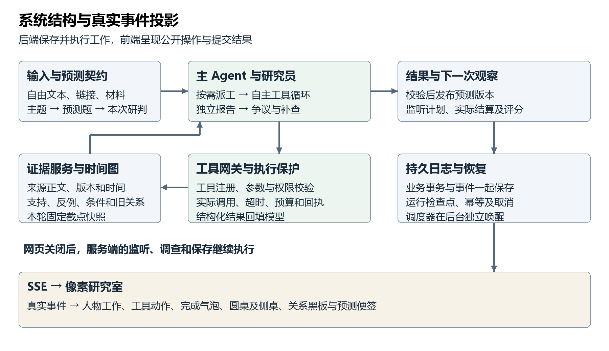
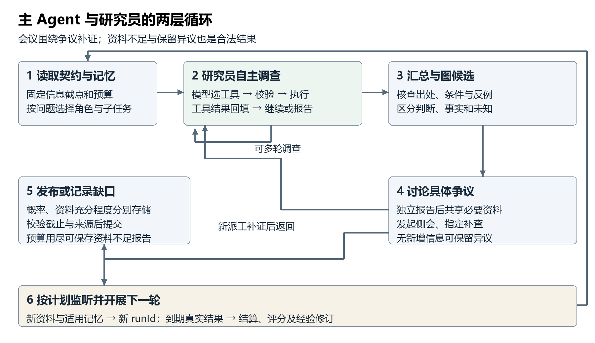

# LLMword 事件预测研究室产品与开发规范

版本为 0.6，更新日期为 2026 年 11 月 19 日。用户最新要求：所有技术服务课程作业，优先做一句话输入、系统自动调查的二元事件判断器；其他输出头仍暂缓。最小交付与开发优先顺序以 [课程交付版](COURSE_MVP.md)为准，不要求下列完整平台目标全部成为课程前置。本文用于小组对齐和后续开发，原有案例基线为 main 提交 7043e0a；最新进度见 IMPLEMENTATION_STATUS.md。文中“已有”对应当前代码或已完成的测试记录，“目标”对应下一版需求，“候选”需要技术验证。

V2.0 当前实现、真实验证与剩余工作统一见 [详细改动与开发清单](V2_CHANGELOG_AND_ROADMAP.md)。本文保留旧基线和完整目标：课程页当前采用持久事件 HTTP 快照轮询，旧版／高级路径另有 SSE；监听间隔仍由服务配置；通用题到期结算、评分和完整时序图尚未交付。以下完整架构描述不能直接当作本版完成清单。

2026-11-22 V4.0 股票方向三分类（M4，A08/A10/A11/A13/A14）：新交易日预测创建时封存 `price_direction` 题型。证据充分时主 Agent 提交上涨、持平、下跌三项概率，均在 0 至 1 内且总和为 1，证据及截止校验通过后才发布。持平指目标价格与固定基准按同一口径相等。通用股票尚无通用自动结算。严格 BTC-USDT 三分类保留独立结果核验和评分路径。既有二元任务、预测和结算仍按原题型读取。

2026-11-22 V4.0 资料不足时的股票走势与黑板进度（M1/M2/M4，A08/A10/A11/A12/A13/A14）：缺可核验报价基准或证据不足以估算概率时，主 Agent 可根据本轮已读原文提交上涨、持平、下跌之一，并记入依据、引用、缺口和提交时间。此记录保存在 Run，概率留空，评分和概率曲线只接收正式预测。预算无法发起最终汇总时，只从有本轮引用、方向一致的已保存研究报告中产出暂定走势。缺少可支持方向的证据时显示暂未判断。黑板运行态显示居中的长圆弧进度条、当前步骤及结果入口，以已保存阶段为准。

2026-11-22 V4.0 有限预测预算收尾（M2，A10/A11/A14）：剩余整轮 token 不多于总额的 15% 或一次输出上限（以较大者为准）时，研究员转为整理报告，主 Agent 取消新增补查并优先在剩余预算内提交正常汇总。模型调用预检考虑输入和并行调用占用。预算不足以安全汇总时，保存已有报告、已读证据和未完成任务作为阶段性结果，保留此前已封存的预测。不限总 token 的预测不进入这条收尾流程。正式预测继续受原有证据和时间守卫约束。

2026-11-22 V4.0 顶部导航可读性（M1，A11/A12）：研究室使用透明顶栏和纯文字导航。左上角标题和菜单沿用本地像素字体及原字号，用两像素深棕色描边和右下方阴影增强文字与场景的区分。

## 1 产品目标与课程要求

用户输入一个希望持续关注的主题，主 Agent 将其整理成可验证的预测问题，按需委派研究员。研究员独立选择工具取证，围绕具体争议开展复核，将带来源和时间的关系写入图记忆，发布本轮预测，并安排下一次监听。后续资料与真实结果会继续更新判断及经验。

产品面向通用事件预测。当前版本只以“是否发生”完成端到端闭环，其他输出类型暂缓，不开放创建或运行入口。科技商业、政策和公开机构事件可作为代表性主题，股票相关事件也须写成有期限及结果判定规则的二元题。

像素研究室是执行过程的可视界面。后端的真实委派、工具返回、证据、讨论和发布事件决定人物及面板状态。公开计划与判断摘要用于解释操作。模型隐藏思维链留在模型协议边界内。

课程原文要求明确任务、职责可区分的多个 Agent、可用信息与工具、分解与通信机制、最终决策，以及可演示的代表性案例。评分为动机 15%、多 Agent 设计 30%、实现与功能 25%、分析与创新 15%、展示与提交 15%。十类研究员、图记忆和像素画风来自本项目设计。[C1]

课程提交包含源码及运行说明、最长 10 分钟的演示视频、展示幻灯片和个人贡献说明。原文截止为 2026 年 11 月 23 日 23:59，通过 Canvas 提交。成员分工说明应写明各模块怎样交互。[C1]

研究问题定为“带时间和证据的图记忆，以及针对争议的多 Agent 复核，能否改善持续事件预测”。用对照实验检查作用，结果中同时报告失败案例和成本。

组会阅读建议：先看第 2、3 节确认产品边界，第 4、6、9 节确认工作方式，再看第 12 至 14 节分工与验收。文中预算、监听频率和候选组件是可调整的设计起点。

## 2 当前基线与目标范围

当前已有五个固定角色、九个本地案例工具、技能文本、按截点开放的 NVIDIA 与 AMD 案例、预测封存及结算、基础残差校正、公开来源监测、SSE、人物动作和任务完成气泡。DeepSeek 的兼容接口已完成两场真实会议测试。此前后端与 HTTP 共 17 项测试通过。

旧版角色及工具计划、部分复核规则和情景转换仍绑定案例。2026-11-18 的 M1 已接入主题／二元题目 CRUD、十类角色版本、单研究员原生工具循环与恢复、证据隔离和像素事件投影；当前只读用户提供的材料，未有通用自动取证、主 Agent、多人会议、图记忆、监听或正式预测发布。上轮 99 项测试证明该范围，不代表完整 P0 完成。

课程交付使用主 Agent 从十类能力目录按题选择三位研究员，普通增量可局部复核。以真实联网取证、角色通信、针对性补查和有效输出为必达；图只做少量带出处关系及历史摘要检索，监听先做持久任务。复杂图检索、全平台社交来源、自动校准与大规模评估不作为交作业门槛。

本轮实施更新：预设口语自动补全、十目录按题选三席、普通变化局部两席复核、重大变化原团队、历史判断及报告／关系摘要检索均已接通。两条用户原问题已用真实 Pro 思考模式发布，后续真实检查读入历史且未虚增概率。监听仍为服务配置的固定间隔，完整时间图推理、自动频率与到期评分尚未实现。最新完成证据与已知时间表述边界以 [课程验收](COURSE_ACCEPTANCE.md)和实现状态为准，前面的 M1 描述作为改造基线。

| 优先级 | 交付内容 | 完成判据 |
| --- | --- | --- |
| P0 | 主题与多预测题、十类角色、真实工具循环、补查会议、时序图、持久监听、binary | 从创建到发布、更新、结算可复现 |
| P1 | 更多授权来源、按条件检索经验、角色效果分析 | 各能力有独立样例及评分 |
| P2 | 规划方式比较、复杂跨事件推演、大规模公开评估 | 有合适标签和对照后逐项开放 |

十类角色都应能配置和接收任务。某渠道尚未接通时，相关角色返回能力缺口，或使用任务提供的材料。默认团队按题选择，课程演示记录角色选择理由。

## 3 用户流程与输出定义

主流程为“输入问题 → 自动整理预测题与归档主题 → 主 Agent 生成调查计划 → 独立调查 → 关系与争议复核 → 发布预测 → 按计划观察 → 新证据更新 → 到期核验”。主题可以长期存在，同一主题可挂多道独立预测题。

新建入口默认预设模式：一句问题，窗口默认 48 小时，可选 24 小时／7 天，原文明确日期优先。点一次开始后，主 Agent 自动整理命题、时间、来源和主题，界面展示可纠错理解卡；只有重大实体或规则歧义才补关键一问。严格模式展开系统预填的契约供修改，仍自动调查。用户不必先建主题、选研究员／工具或粘贴正文；用户材料保留为可选补充。

主 Agent 第一阶段负责题意规范化，不把主体、期限或结果含义偷偷改成别的问题。结果来源须实际发现和核验；未找到来源保持准备／不足状态，不伪造链接让题目进入 ready。两种模式共用服务端校验。股票问题明确基准价格、目标交易日及来源，不能将自然日静默替换为交易日。

每道题保存问题正文、类型 binary、预测对象、目标窗口、停止发布时间、时区、结算条件、指定来源、无法判定处理及版本。运行保存 timePolicy、信息截点和材料快照。实时 live 允许本轮实际取证逐步追加，fixed 用于回放和固定截点评估。停止发布时间控制有效预测更新，实际结果可知时间控制结算，系统记录时间用于追溯。

发布事务按服务端实际提交时间检查停止发布时间，并检查是否已经进入结果可知状态。截止前开始、截止后完成的运行只能保存研究报告，不能登记为有效预测；指定结算来源已公布结果时也停止计分发布。题目契约实质变化另存版本，历史评分保持原口径。

| 结果类型 | 必须保存的字段 | 面板与校验 |
| --- | --- | --- |
| binary | probabilityYes、targetAt、resolutionRuleVersion | 是与否概率；范围为 0–1 |

输出头只接收 binary：是的概率为 probabilityYes，否的概率由 1 减去 probabilityYes 计算。有效发布的概率须为 0–1 内的有限数值；未发布或资料不足显示缺值，不补成零。其他题型连草稿创建也不开放，历史非二元版本仅保留可读。

统一结果还包含预测题及版本、运行、发布时间、信息截点、证据、公开理由、未解决分歧、资料充分程度和结算状态。模型估计、已发布预测、实际结果分别显示。概率、资料充分程度和团队一致程度分别保存。结果主卡显示倾向是／否和 Yes 概率，50% 可显示两种结果接近；尚未发布的缺值不能补为 50%。

曲线记录同一题目版本、固定目标 T 的真实发布历史 p(t,T)，不能把过往判断线简单延长成未来走势。24 小时、48 小时和 7 天是不同目标，首版每题只采用用户所选窗口；到期续跟踪生成下一窗口，不能混作同题评分。每个点关联实际可见材料和变化原因，原文发布时间不能替代预测发布时间。

例如，用户关注“甲公司管理层变化”，主 Agent 可形成“在某日期前是否有正式任命”和“现任 CEO 是否在某日期前宣布离任”两道二元题。两题共享资料，各自有期限、判定规则和结算。所有演示数字均标识为样例。

## 4 系统结构与数据归属

浏览器经 API 创建主题、预测题和运行。ResearchService 为每道题固定配置与证据快照，由 Supervisor 与 Worker 循环推进。工具网关执行已注册能力，证据服务保存材料，图服务生成关系版本，预测服务校验及发布，调度器唤醒后续运行，结算服务写入结果。

数据流为“用户与来源 → 任务契约及证据快照 → 主 Agent 与研究员 → 图版本和报告 → 预测版本 → 结算和经验”。执行事件经持久事件日志与 SSE 投影到像素前端。

| 标识 | 对象与归属 |
| --- | --- |
| topicId | 用户持续关注的主题，关联多道预测题 |
| predictionId | 一个可结算问题，拥有契约版本与预测历史 |
| runId | 一次研判，固定题目、角色、工具、模型及初始图快照，记录后续输入版本 |
| assignmentId | 一项派给研究员的子任务 |
| agentSpecId 与 specVersion | 可复用角色定义及版本 |
| agentInstanceId | 某次运行中的角色实例与独立工作上下文 |
| evidenceId | 不可变材料快照，关联来源、版本和时间 |
| graphRelationId | 一条有版本及来源的关系 |
| forecastId 与 resolutionId | 发布预测与实际结算记录 |
| eventId 与 seq | 运行事件及递增序号 |

现有 taskId 在兼容层映射为 assignmentId，新接口采用上表标识。人物对应 agentInstanceId，角色模板可以跨题复用，工作上下文按运行隔离。

SQLite 作为首版业务存储，采用节点、关系、证据、任务、派工、工具执行、预测、结算、计划和事件日志表。表的外键保持上述归属。SQLite 驱动和持久检查点实现由 M0 验证后锁定。

业务状态变更与待推送事件在同一事务提交，事务后 SSE 才发送。运行检查点保存可恢复的执行位置，业务表是预测及图版本的权威记录。恢复时对照工具执行账本和已发布记录，防止检查点重放造成重复提交。

## 5 十类研究员与能力面板

Supervisor 为独立主 Agent，负责拆题、选择角色、派工、处理报告、主持争议、发布和监听安排。十类 Worker 按调查方法划分，角色名称与固定职责保持稳定。

| 角色 ID | 名称 | 方法与拟建工具 |
| --- | --- | --- |
| official | 官方资料研究员 | 查原始公告、法规和结果；search_official、read_evidence |
| timeline | 新闻时间线研究员 | 查首发、更正和转载；search_news、deduplicate_events |
| industry | 行业与专业研究员 | 检查技术及制度条件；search_domain、read_evidence |
| people | 人物与组织研究员 | 查人物履历、组织和利益关系；search_entities |
| statistics | 统计与指标研究员 | 查指标并计算；read_dataset、calculate |
| market | 预测市场研究员 | 对齐合约、盘口及结算；read_contract、read_market_quotes |
| social | 社群与舆情研究员 | 查授权社区线索、传播和偏差；search_social |
| analogy | 历史类比研究员 | 找相似事件、基准率及反例；search_history、read_memory |
| graph | 关系图研究员 | 查询路径并提出关系更新；query_graph、propose_graph_patch |
| verification | 反证与核验研究员 | 查反例、出处和独立性；search_counterevidence、verify_sources |

工具名称是目标接口，需映射到真实处理器才能启用。多个角色可共享搜索与原文读取基础能力，Skill 决定调查方法和证据要求。关系入库和计算可由确定性处理器完成。

面板分为角色定义、本次任务参数和只读运行状态。普通用户不需要配置 Agent；高级“研究室设置”保留职责、Skill、模型引用、工具许可、扩展槽位和预算上限。主 Agent 在授权内调整子问题、关键词、资料范围、轮次目标和监听建议。运行状态展示真实进度、用量、错误及资料缺口。课程在用角色的程序职责与验证要求见 [运行手册](agent-playbooks/README.md)，只有方法提示词不能代表相应工具已经实现。

首版每类提供两个扩展槽位，槽位引用已注册 ToolSpec。工具有效集合为角色许可、子任务许可和运行已启用工具的交集。编辑模板生成新版本，旧运行继续使用原快照。模型请求的身份由服务端上下文注入。

## 6 两层循环与会议规则

一轮是同一固定目标问题的一次有界研判，包含调查、必要补查和判断提交；模型请求是一步，抓取是工具调用，持续关注任务包含多轮。初始配置与已有资料固定，联网所得材料逐步追加不可变快照及输入清单，发布时封存实际最终输入。未来 48 小时的目标窗口、每小时检查的频率和单轮执行预算分别管理。

后续消息先做去重与题目相关性分诊：重复转载不重开会，普通增量只派相关人，关键矛盾由相关人与核验席复查，重大变化才召集本题活跃团队。等待期间依靠持久 Job 唤醒，不让 LLM 持续空转。同题正在运行时合并新增消息，不能向旧快照回填后来信息。

Supervisor 读取问题契约、图和已有资料，选择 delegate_work 建立派工。它可以等待报告、追加委派、指定争议开会、要求补查、发布预测、设置监听计划和结束本轮。每个动作保存原因及必要输入，模型输出经 Schema 和权限检查后执行。

Worker 接收子问题、时间策略、证据快照、允许工具和剩余预算，模型选择工具及参数，执行器校验并实际调用，工具结果回填模型。Worker 可以修改检索策略、继续取证或 submit_report。首轮独立工作，会议阶段再接收对应争议和同行报告。

报告包含 status、发现与判断、证据编号、支持及反对材料、适用条件、缺失资料、可选概率和下一步建议。complete、insufficient、blocked 均为合法状态。未取得资料时须保留缺口，后续由主 Agent 决定换来源、等待或部分完成。

会议围绕带编号的争议展开，每轮记录待验证命题、参与者、新证据和判断变化。补查产生新 assignment，完成后回到原争议。模型可以提出发布、等待或继续，执行器检查轮数、时限及预算。

事件概率低于某值可以是有效预测。是否补查看关键证据覆盖、来源独立性、未解决矛盾和新增信息。同一篇转载被多角色引用只算一条来源。没有新进展时允许保留异议结束本轮。

### 6.1 模型与工具协议

DeepSeek 优先采用非思考模式验证原生 tool_calls。请求携带 tools；返回的 assistant 消息和 tool_calls 原样加入消息历史；每个实际结果通过匹配 tool_call_id 的 tool 消息回填，然后继续请求。启用思考模式时，适配器按官方要求保留必要的 reasoning_content，仅公开操作及结论投影。[S1]

参数、工具结果、报告及发布各自执行本地校验。参数错误可给模型一次修复机会。权限错误和不可用能力返回结构化错误。finish_reason 为 length、JSON 不完整或引用越界的结果进入失败或修复状态。

ToolSpec 保存 ID、版本、输入及结果 Schema、读写属性、来源范围、超时、成本类别和处理器。只读工具可并行，写图、发布和修改计划经事务提交。来源文字作为证据进入上下文，工具能力由已注册目录提供。

主 Agent 控制工具包括 delegate_work、await_reports、open_meeting、request_followup、publish_forecast、set_watch_plan、finish_run。Worker 使用调查工具和 submit_report。每个 action 关联 runId、agentInstanceId 和执行回执；Worker 及具体派工动作另带 assignmentId，主 Agent 根动作的 assignmentId 可以为空。

## 7 图记忆与经验检索

记忆分为本轮工作上下文、共享时间图和结算经验三层。工作上下文按 agentInstanceId 隔离，待引用报告通过显式通信传递；共享图只保存通过检查的材料与关系；经验档案保存已发布预测、结果及修订。持续学习首先指检索和修正这些记忆，模型参数训练及自动改写 Skill 留待独立评估。人工调整 Skill 生成新版本，不追溯覆盖旧运行。

图包含实体、现实事件、证据、主张、预测及结果。实体之间保存事实关系，证据通过 supports、contradicts、updates 等关系连接主张。影响假设绑定预测对象、条件和时间窗口。

影响假设记录 effectDirection，取 positive、negative、mixed、unknown，必须指向具体目标指标、条件和窗口；事实边允许不适用。unknown 表示证据尚不足以定方向，mixed 须说明相反条件或材料。另存 evidenceStatus、提出者、支持与反例、有效期间和版本。模型置信、事实核验状态和数据估计的统计相关各自保存。统计关联须含系数、样本、方法、时段及不确定性，语义提取形成可检验假设。[S4]

GraphPatch 先进入候选区，固定处理器检查实体、关系、来源编号、时间、类型和版本。反证研究员可核验关键更新，接受、争议或拒绝都保留理由。新事实替代旧事实时关闭旧有效期并增加版本。

一次预测结果与某条影响假设不一致时，写入反例和结算。公司供应关系等事实仍按其自身来源更新。图视图可以打开任意边的证据、反例、适用条件和历史版本。

证据保存 publishedAt、firstSeenAt、retrievedAt、原文定位和 contentHash。关系另保存 validFrom、validTo、recordedAt、supersededAt。运行固定初始 graphSnapshotId，每一步记录 inputSnapshotId，发布时封存最终 evidenceSnapshotId 与 inputManifestId，可回到各步实际可见状态。Graphiti 的有效期和来源追溯设计可作为依据。[S3]

live 的新正文按真实接收时间写入本轮工作区，下一步即可取用；各步引用必须属于当步 inputSnapshotId。发布前按当时实际已取得的具体版本封存 cutoff 和输入清单，预测保存图输入版本及本轮图更新版本。首次取证时间不能回填，后到资料留待下一版预测。

fixed 仅接受能够证明在 cutoff 前可用的具体正文版本。系统回放要求 firstSeenAt 与图 recordedAt 不晚于 cutoff，再按事实有效期间筛选。事后收集的历史资料单列为重建 replay 数据集，记录 archiveAsOf 和收集时间；仅凭旧发布日期不能宣称系统当时已经取得该材料。历史评估同样禁止把后来的网页正文和结算写入早期输入。

检索先按时间和归属过滤，再根据实体、事件类型、条件、关系角色和预测窗口选路径，初始限制为两跳及有限证据。检索同时返回支持材料和反例。已结算经验要求结果在该截点已经可知，并按题型、模型和版本匹配。

首版 SQLite 保存结构化图并执行受限路径查询。Graphiti 完整接入另需 Python、图数据库、嵌入和抽取调用，放在独立技术验证中。角色个体表现可在结算后累计，角色权重调整须有单独实验依据。

## 8 持续监听与可靠运行

主 Agent 和会议提交 WatchPlan，包含来源、查询、检查间隔、触发条件、停止条件和理由。候选默认间隔四小时，用户可修改；来源允许的频率及配置上限由调度器检查。重要新证据可提前触发研判。

调度器保存 nextCheckAt，等待期间释放模型执行资源。相同来源可合并采集，再路由给相关主题及预测题。内容哈希、来源 ID 与原始消息关系用于去重，重复转载和重复投递不能重复计为独立证据。

每道预测题同一时刻只有一个提交状态的运行，多个预测题共享模型并发池。独立监听新收到的材料触发下一轮快照；live 研究员本轮主动取证按第 7 节规则追加。相同触发在运行期间合并为 dirty 标记，完成后再安排一次更新，避免无限排队。

创建和重试使用幂等键，重复请求返回已有运行。工具执行账本记录调用、参数摘要、状态和结果。外部模型请求允许至少一次尝试，网络超时可能已有计费；业务写入和发布通过唯一约束实现单次提交效果。

取消后中止该运行请求及派工，迟到结果只写审计，不更新预测、图或计划。重启恢复等待和排队任务；中断的工具先查回执，已完成的写操作不重复执行。单个角色失败交主 Agent 选择替代或部分完成。

429、5xx 和临时网络问题按服务端提示或退避重试，最多两次并计入预算。认证及权限错误立即交回，参数错误本地修复。运行最大轮数、请求数、token 和时间上限在启动前固定，达到上限可发布“资料不足”报告。

P0 保证单服务进程、浏览器关闭后继续运行、进程重启后恢复。机器关机期间的监听在恢复后补查，并标记缺失区间。部署为系统服务和多节点调度属于后续运行方案。

## 9 前端工作区与实时投影

采用任务公告栏和当前像素研究室。夜景、像素人物、硬边组件及可读中文延续现有风格。工位、圆桌、侧桌、收报台和关系黑板根据 Agent 运行扩展，房间布局由真实工作区域驱动。

| 场景入口 | 独立目的地 | 主要操作 |
| --- | --- | --- |
| 公告栏 | /predictions | 新建、筛选和切换预测题 |
| 主题档案 | /topics/:topicId | 背景、关联问题和主题时间线 |
| 收报台 | /topics/:topicId/inbox | 来源状态、资料、采纳与关联 |
| 关系黑板 | /predictions/:predictionId/world | 图快照、边的证据和反例 |
| 圆桌 | /predictions/:predictionId/runs/:runId | 计划、工具、争议和结论 |
| 学习档案柜 | /learning | 封存预测、真实结果、误差及经验修订 |
| 研究员席位 | /agents/:agentSpecId | 定义、版本、工具及任务参数 |
| 工具台与时钟 | /tools 及题目 timeline | 能力状态、监听与预测时间 |

这些是目标路由，可采用 Hash 路由实现。各入口拥有独立标题、内容和主操作，支持刷新、深链接与返回。当前共用研究手册的外壳造成用途混淆，证据和学习内容需要分成独立目的地。

首页常驻预测便签，显示完整问题、题型、结果、目标日期、资料截止、最后发布、变化原因、结算规则和状态。模型模式、来源模式和历史回放分别标识。空值显示缺失原因，缺概率不补零。

人物工作、走动、发言和提交物来自后端状态。完成事件到达即在对应人物显示提示，后续 started 不立即覆盖尚未读完的提示；完整报告留在记录。一个房间由用户选中的 runId 持有，后台会议提示未读，不能抢占房间。发言和完成提示按 messageId、assignmentId 及 resultId 去重。

手机先呈现预测便签和核心操作，再展示场景。角色与物件有等价文字导航，支持键盘、焦点恢复、读屏摘要及减少动态效果。390px 宽度无横向溢出，证据、参数和长报告能独立滚动。

### 9.1 事件协议

事件统一携带 schemaVersion、serverEpoch、eventId、seq、emittedAt、topicId、predictionId、runId、scope、type 和 payload。派工相关 payload 带 assignmentId、agentInstanceId 及必要的角色版本。scope 为 live 或 replay，trigger 为 manual 或 watch。

| 事件类型 | 可观察内容 | 前端投影 |
| --- | --- | --- |
| run.started 与 plan.updated | 任务启动、公开计划和委派 | 阶段和任务清单 |
| assignment.started 与 assignment.completed | 真实调查开始及提交 | 工作帧与对应人物完成气泡 |
| tool.started 与 tool.completed | 名称、脱敏参数、耗时、返回摘要和证据 | 工具动作及可展开记录 |
| meeting.opened 与 meeting.message | 争议、参与者、公开判断和引用 | 圆桌或侧桌及发言气泡 |
| graph.updated | 图版本、关系变更和来源 | 黑板变更提示和图快照 |
| forecast.published | 已提交的结果版本 | 更新预测便签 |
| watch.updated 与 resolution.recorded | 监听安排、真实结果和评分 | 时钟及学习档案 |
| run.finished 与 run.failed | 提交结果、错误和可恢复状态 | 结束动作并读取快照 |

run.waiting、run.cancelled、assignment.failed 和 assignment.cancelled 表达等待、失败及取消；assignment.completed 的 payload.status 区分 complete、insufficient、blocked。不同状态使用对应提示，只有成功取得的工具结果显示成功回执。取消立即停止人物工作与旧动画。

V0 适配器将 run-start、run-complete、run-error 映射为 run.started、run.finished、run.failed；stage 更新运行阶段；task 映射派工状态；trace 根据 kind 映射工具或发言；side-meeting 映射争议会议。movement 仅作位置投影，sync 转为权威同步。旧 scope 的 monitor 映射为 live，trigger 的 auto 映射为 watch，replay 保持原语义。旧 cursor 不能直接作为新日志序号，切换时强制重新同步。前端动作保持为执行状态的投影，动画结束不改变业务状态。

seq 来自持久事件日志，SSE cursor 为 serverEpoch:seq。重连用 Last-Event-ID 补收；服务重启或游标不可恢复时发 sync reset，并返回权威快照及 activeRuns。快照携带 snapshotVersion 与 coveredThroughCursor，客户端先替换快照，再按 eventId 去重应用水位之后的事件。前端取消旧动画和计时器，旧版本及终态不会被迟到事件倒退覆盖。

## 10 现有技术与适配决策

下列能力来自官方文档核验。包版本仅为调研快照，M0 通过后写入锁文件。沿用现有原生 JavaScript 前端与 Node API，领域契约、权限、图更新和预测结算由本项目维护。

| 资源与许可 | 采用方式 | 适配工作与验证 |
| --- | --- | --- |
| LangGraph JS MIT | 默认候选执行引擎 | 将 Worker 工具循环与 Supervisor 动作包装为节点；验证等待、并行、检查点和取消。[S2] |
| DeepSeek tool calls | 主模型能力 | 原生消息回填、结构化结果、超时和用量适配；默认非思考工具循环先行。[S1] |
| SQLite 与校验库 | 业务存储和契约 | 技术验证后锁定驱动与 Schema 库；验证事务、迁移、唯一约束和恢复 |
| Cytoscape.js MIT | 图交互候选 | 包装图快照、类型样式、来源抽屉和移动端筛选。[S5] |
| Graphiti Apache 2.0 | 时间与来源模型参考 | P0 自建 SQLite 时序边；完整服务作为后续替换候选。[S3] |
| Metaculus forecasting tools MIT | 问题与结算结构参考 | 在 Node 采用对应契约；SDK 为 Python 且标明实验阶段，平台连接单独验证。[S6] |
| DeerFlow MIT | 角色与 Skill 组织参考 | 借鉴可配置角色、技能和委派记录，保留来源；整套 Python 服务后续评估。[S7] |
| ForecastBench | 评估结构与样本参考 | 代码 MIT，数据 CC BY-SA 4.0；选定快照、来源和许可随样本保存。[S8] |

当前 SEC EDGAR 与 Polymarket 连接器可继续使用，改为按主题及问题配置查询。搜索与原文读取是跨事件能力的必要补充。DeepSeek Search 与 Fetch 是优先技术验证候选，其可用性、结果结构及用量必须实测；失败时使用用户提供资料和已经可用的来源，不将缺失标为成功。[S9]

候选工具保留 publishedAt、firstSeenAt、正文版本与引用位置。搜索摘要只作为线索，重要关系优先引用原文。授权社交来源按各平台能力接入，连接器返回 available、unavailable 或 partial 状态，角色据此调整调查。

已安装的库、文档参考和技术验证分开记录。直接复用开源代码保留许可证及署名，数据许可另行随样本保存。文档中的能力表只承诺在相应里程碑验收后启用。

## 11 API 与运行契约

目标 API 使用 /api/v1 前缀。创建和操作返回稳定 ID、version、status 及结构化错误。写操作接受 Idempotency-Key，修改接受 expectedVersion，冲突返回 409。

| 路径 | 用途 |
| --- | --- |
| POST /topics | 保存关注主题与背景 |
| POST /topics/:topicId/predictions | 创建有类型的预测题草稿 |
| PATCH /predictions/:predictionId | 新建题目契约版本 |
| POST /predictions/:predictionId/runs | 创建研判，返回 202 与 runId |
| GET /runs/:runId | 读取权威运行快照 |
| POST /runs/:runId/cancel | 取消运行及其派工 |
| GET /topics/:topicId/evidence | 查看材料和来源状态 |
| GET /predictions/:predictionId/graph | 按 snapshotId 查看图 |
| GET 与 POST /agents | 查看及保存角色版本 |
| PUT /predictions/:predictionId/watch | 保存监听计划版本 |
| POST /predictions/:predictionId/resolutions | 写入有证据的结算 |
| GET /events | 按游标接收运行事件 |

任务状态为 draft、ready、active、paused、closed、resolved 或 void。Run 状态为 queued、running、waiting、cancelling、completed、failed 或 cancelled。发布预测以不可变 forecastId 保存，active 状态可以有多次发布，计分取预先指定的发布规则。

Assignment 保存 objective、roleVersion、allowedTools、inputEvidence、budget、deadline 和 status。Report 保存公开发现、证据、缺口、争议及建议。模型返回的 ID 都经当前运行范围核验。

工具结果统一返回 status、data、evidenceIds、summary、observedAt、error 和 usage。只有实际执行及成功保存的来源才得到 evidenceId。图补丁和预测发布均引用这些 ID。

错误体包含 code、message、retryable、runId 及必要字段提示。来源不可用、资料不足、模型认证失败、预算耗尽和输出不合规具有不同 code。缺字段可以保存草稿，运行与发布各有独立校验。

## 12 开发顺序与旧版本迁移

| 里程碑 | 主要交付 | 验收门槛 |
| --- | --- | --- |
| M0 技术验证 | DeepSeek 原生工具循环、LangGraph 持久恢复、SQLite、统一 ID 和事件 | 同一角色连续实际调用两种工具，中断后恢复，取消阻止迟到发布 |
| M1 多预测任务 | 主题、题目、版本、AgentSpec、数据库迁移、任务公告栏 | 三道题切换互不串用，旧案例完整运行 |
| M2 真实协作 | 十类角色、动态派工、工具权限、补查会议、SSE 投影 | 不同问题产生不同团队及工具序列，争议补查能返回 |
| M3 图与监听 | 来源版本、关系候选、时序检索、监听与重启恢复 | 第二轮引用上一图版本和新证据，关闭页面后继续 |
| M4 预测与验证 | binary、结算、学习档案和对照评估 | 从输入到结果可评分，前端各入口有独立用途 |
| M5 扩展 | 更多来源、可选图服务 | 按能力独立验收后启用；其他输出头暂缓 |

旧案例迁为一个 replay 主题，原两个预测目标迁为两道题，时间线作为案例资料。原有模拟模型保留为确定性测试适配器。真实调用通过同一运行接口执行，模型模式与数据模式分别保存。

旧 JSON 先备份并执行版本迁移，导入以源文件哈希和记录 ID 去重。旧值保留 originalMode、legacyId 和实际缺失字段。无法证明时间或来源的记录仅作历史展示，标明评分资格。

小组可按运行时与工具、来源与图、前端投影、评估与集成四个工作包分工，人员可兼任。各包以契约样例和验收测试对接，集成负责人检查完整路径。具体姓名及可投入时间在组会上填写。

后续开发每次从最早未验收里程碑开始，先实现真实后端行为，再用同一事件接入前端。依赖变化和范围变化记录在本文决策日志，完成状态由测试、运行记录及示例证明。

M0 若发现候选框架不能满足恢复、取消或现有工具适配，保留现有 Node 执行器并按同一契约扩展显式状态机，记录验证结果后再选型。组件迁移不应阻塞领域闭环。第 14 节的限制按整个 Run 累计，补查派工继续消耗剩余预算。

课程排期建议以 11 月 19 日完成 M0 验证、20 日打通 M1/M2 主路径、21 日整合 M3/M4、22 日冻结演示、23 日完成提交为目标，须按实际成员投入修订。若进度不足，课程演示保留一个通用主题、两道二元预测题、十种可配置角色和按需选用的三至五种研究员、真实工具循环、一轮争议补查、一次图更新及一次监听恢复。社交平台新增连接器继续列为后续交付；未通过 A01–A14 的项目逐项标记，课程样例通过不等同于全部 P0 完成。

## 13 验收与实验

| 编号 | 可复现验收场景 |
| --- | --- |
| A01 | 创建主题后形成问题草稿，缺少期限或结算规则时清楚提示，草稿可保存 |
| A02 | 三道预测题并存，证据、图、会议、取消及封存结果互不串用 |
| A03 | 十类角色可编辑，三种不同题目按需选人，角色版本能回查 |
| A04 | 真实模型自主连续调用两种工具；工具参数、结果和证据相互关联 |
| A05 | 扩展槽工具可用，越权或未注册工具返回失败，界面无成功气泡 |
| A06 | 独立判断发生冲突后发起补查，返回会议并引用新增证据 |
| A07 | 新资料修订关系而保留旧版本，历史截点可重建，反例可点击 |
| A08 | 下一轮使用适用图记忆，未来结算与后来的网页版本不会进入历史输入 |
| A09 | WatchPlan 到时唤醒，重复消息去重，浏览器关闭及服务重启后恢复 |
| A10 | 重试、断线、乱序、重复及迟到事件保持状态一致，重复发布只有一份结果 |
| A11 | 首页明确目标、结果、期限和依据；收报台与学习档案有不同目的地 |
| A12 | 桌面和 390px、键盘及减少动态效果可用，人物动作对应实际事件 |
| A13 | binary 从发布到结算完成，是／否概率、真实结果及评分可追溯；其他头不能创建或运行 |
| A14 | 资料不足、来源失败、模型失败和预算终止有可恢复状态及失败样例 |

实验以同一问题、同一信息截点、同一模型及相近调用预算比较单 Agent、多 Agent 直接汇总、加入争议复核，再比较普通文本记忆和时间版本图检索。逐项增加能力，并记录成本，避免把更多调用量当成架构收益。

binary 使用 Brier，准确率只作补充。报告样本量、概率分布、来源错误、缺失结果、耗时和 token。样本允许时给事件分组的置信区间。小样本结果作为探索，前瞻封存单列。

历史回放用于开发和故障诊断，记录模型可能已知历史的局限。主评估优先采用模型版本固定后发生的问题或真实结果出现前已封存的预测。题集按事件及时间分组，计算均受当时可见材料约束。

结算来源迟到时保持 pending。来源更正时追加 Resolution 修订并重算分数。重复会议不是独立样本。图经验按独立事件计数，统一残差校正保留为旧版基线，新版校准按题型和版本单独验证。

演示材料按“输入与拆题、角色委派、工具取证、争议补查、图修订、预测输出、监听恢复、结果核验”的顺序取真实记录。课程报告解释协作带来的变化，并列出一个失败案例。

## 14 组会决策与维护规则

建议组会先确认 P0 范围、代表性主题与二至三道二元示例题、可用来源和 API 预算，再分配工作包。图数据库升级和更多社交连接器留在里程碑列表中；其他输出头暂缓。

本文采用的当前方案为通用事件入口、仅 binary、十类角色能力库（课程先主 Agent 加三位研究员）、Node 显式状态机与 SQLite、现有像素前端。默认预测窗口 48 小时；官方来源每四小时、新闻每小时是可配置检查起点，不是预测窗口。LangGraph 的实测与暂缓依据见 M0_FRAMEWORK_DECISION.md。

候选初始上限为每次运行四个活跃 Worker、每 Worker 六次工具调用及八次模型请求、会议三轮、全局四个模型并发。总模型请求 40 次、累计 token 60000、运行 15 分钟、单请求超时 60 秒作为技术验证起点；重试均计入预算。金额成本以供应商 usage 和配置价格估算，不明费用显示未知。

每个开发改动引用需求或验收编号，说明接口、来源、迁移及验证。外部组件通过 M0 后锁版本并保存许可证。主文档为实现契约，[接口样例](contracts/examples.json)展示目标字段，尚未作为运行校验器。项目根目录 [AGENTS.md](../AGENTS.md)规定开发入口，[实现状态](IMPLEMENTATION_STATUS.md)记录里程碑证据。PDF 版用于组会阅读，同版本以项目内 PRD 为维护源。

初始决策记录：2026 年 11 月 18 日，采用通用事件入口、两种首发题型和三层记忆；保留原生前端，组件均按技术验证结果接入。角色上限、观察频率和 P1 开放时间待组会对齐，讨论不影响已授权的文档及技术验证工作。

2026-11-18 决策记录：用户将范围收紧为单一 binary 输出头，替代此前两种首发题型。API、前端和验收已同步收紧。此前 PRD v0.2 PDF 保留为历史组会材料。

2026-11-19 决策记录：用户指出填写、选人和提供材料的负担过大，要求系统自己整理问题、按需派工、自动取证与持续检查，输出答案及概率时间轨迹；进一步要求技术全部服务于课程交付。本轮完成现有实现审查、官方资源调研、最小课程规格及在用角色手册。预设／严格模式、主 Agent、自主搜索、监听和正式概率仍未实现；不以文档更新计成功能完成。后续优先按 COURSE_MVP.md 的纵向闭环开发，不等待额外审批，不先扩建平台。

同日实施记录：用户随后明确授权多 Agent 分工开发与真实模型测试。课程子集、真实接口与整轮调用已落地，141/141 测试通过；方法模板仍保留，不以角色数量替代真实协作。总预算、阶段上下文、固定目标时刻、结果来源读取与发布守卫由代码执行；完整成果及限制见 COURSE_ACCEPTANCE.md。当前不再扩建平台，后续优先补可结算样本及课程演示材料。

## 15 官方资源与依据

[C1] COMP5584 Group Project Guidelines，用户提供的三页英文课程原文，2026 年 11 月 19 日再次核对。中文译本辅助理解，要求与权重以英文原文为准。

[S1] [DeepSeek 工具调用](https://api-docs.deepseek.com/guides/tool_calls/) 与 [Chat Completion](https://api-docs.deepseek.com/api/create-chat-completion/)。用于模型动作循环及消息回填。

[S2] [LangGraph JS 持久化](https://docs.langchain.com/oss/javascript/langgraph/persistence)、[流式事件](https://docs.langchain.com/oss/javascript/langgraph/streaming) 与 [公开包配置](https://github.com/langchain-ai/langgraphjs/blob/main/libs/langgraph-core/package.json)。用于执行与检查点选型。

[S3] [Graphiti 官方仓库](https://github.com/getzep/graphiti)。用于时间版本、来源和图检索语义。

[S4] [GraphRAG 输出定义](https://microsoft.github.io/graphrag/index/outputs/)。用于区分抽取关系权重与统计相关。

[S5] [Cytoscape.js 官方文档](https://js.cytoscape.org/)。用于交互图、布局与图 JSON。

[S6] [Metaculus forecasting tools](https://github.com/Metaculus/forecasting-tools) 与 [问题模型](https://github.com/Metaculus/forecasting-tools/blob/main/forecasting_tools/data_models/questions.py)。用于预测题型与结算契约。

[S7] [DeerFlow 官方仓库](https://github.com/bytedance/deer-flow) 与 [发布记录](https://github.com/bytedance/deer-flow/releases)。用于角色、Skill 与委派设计。

[S8] [ForecastBench 代码](https://github.com/forecastingresearch/forecastbench) 与 [数据及许可](https://github.com/forecastingresearch/forecastbench-datasets)。用于评估流程与题集快照。

[S9] [DeepSeek Search API](https://api-docs.deepseek.com/api/search/) 与 [Fetch API](https://api-docs.deepseek.com/api/fetch/)。用于通用取证能力的技术验证候选。

2026-11-19 口语交互改进决策：preset默认补全常见实体、口径、窗口及可取得的参照点，公开假设；strict锁已填字段。缺价格基准但有可读资料可给明确条件估计、不计分；来源、版本、时间和有限概率守卫保持。初始按十目录选三位，普通新信息相关加核验两位，重大冲突原题团队。见 DEMO_USABILITY.md 和 COURSE_ACCEPTANCE.md。

2026-11-19 展示归属决策：答案卡与房间默认对齐 forecast.runId，最新后台检查独立呈现；来源人数按实际独立角色计算，补查不重复计人。自动选择跟随新答案，用户显式选轮保持锁定；跨题或缺归属运行不渲染，历史不补播气泡。

2026-11-19 服务恢复决策：账户额度／鉴权／访问硬错误使用安全原因码，停止本轮并将 WatchPlan 标记 paused_provider；模型临时故障在预算内有界重试。用户可在尚无预测契约的失败原题下手动创建新轮恢复，旧失败与已发布预测不改，轮询不自动提交重试。见 PROVIDER_RECOVERY.md。

2026-11-19 天气用例复核决策：新建问题中无具体时刻的“今天／今日／today”固定为创建时当地日期日终，跨日重试不顺延；严格targetAt优先，已编译契约及旧封存不迁移。预设降雨题仅实况可确认结果，预报只支持概率。最终来源限制可重新提交，准备缺口保留。深度输出提高受预算约束上限，截断不能发布且已知usage仍计费；失败任务可停止。原错误日期任务停止后另建修正版，不冒充同一正确历史。

2026-11-19 V2.0决策：新Run使用内部harnessVersion=3，先intake整理并派工、子Agent实际取证，再编译ready契约，初始主Agent不联网研究。协作周期最多3个（初次加2次定向补查），单研究员最多5次调查决策、第6次只报告；足够则提前总结，不凑轮数。system prompt每次刷新职责、字数、token及剩余预算，后端硬守卫并行实施。真实model.requested/completed/failed驱动各自等待标记，不公开隐藏推理。旧v2历史不迁移。详见[V2.0交付](V2_RELEASE.md)。

同日记忆决策：短期同题同版本最近7天最多4次实质研判，空监听、失败、取消不挤占；长期检索90天内8条来源关系与12条证据索引，原始档案不自动删除；旧证据需重读，不训练模型参数。[记忆规则](MEMORY_POLICY_V2.md)。新增“模型连接”密码框，Key只留服务端会话、不回显不写盘；有运行、排队或活动监听不能替换，保存不触发预测。贵金属暂无结构化报价工具，黄金/白银方向题可条件估计但缺基准不计分；下跌与上涨比较方向分开。

2026-11-20 市场 Agent 本地改进决策（M2，关联 A04/A14）：首次建立 BTC/ETH 涨跌题时，市场研究员的完整报告须引用本人本轮实际取得、交易对匹配且有有效数值和观察时间的现价快照；缺失或资产错配时改为资料不足，清除该研究员的概率候选并向主 Agent 交代缺口。规则版本写入新派工，旧检查点不强制迁移。新材料检查及定向补查沿用已经封存的原始价格基准，不因新报价重写旧契约。模拟适配器按原问题选交易对并引用报价；黄金和白银仍无结构化现价能力。Node v22.17.1 本地全套 264/264 通过；尚未新增真实模型调用。
2026-11-20 协作追溯决策（M2，A04/A06/A08/A10/A11/A12/A14）：在现有市场补丁和最新环境隔离上，新增本轮公开协作投影、带来源的补查关联及可选逐报告裁决。发布守卫验证裁决引用，旧数据保持可读；界面不推断未记录的采纳理由或争议已解决。七个离线案例独立标识为mock/replay，真实DeepSeek记录另存，不将模拟结果当预测成绩。范围与验证见 [交接](COLLABORATION_HANDOFF.md) 和 [验证记录](COLLABORATION_VALIDATION.md)。
2026-11-21 财报研报决策（用户已选择，M2，A04/A06/A10/A11/A14）：新增 `purpose: research` 调查任务，服务已披露财报及管理层表述核验，不创建未来预测契约、不输出事件概率、不自动监听或计分。默认forecast仍仅支持binary。专项方法、双语新闻检索、受引用约束的金额比较和关键词定位正文已接入；新派工保存方法与轻量思考配置。研报独立事务封存，汇总截断允许原运行只续写一次，不重复取证或重置用量。参见 [财报交接](FINANCE_RESEARCH_HANDOFF.md)。

2026-11-21 汇总调试决策（用户追加授权）：单次8192输出导致两次截断后，将研究汇总额度提高至16384，研究员仍为8192，保留原160000累计预算。原Run显式手动续写上限增为两次，每次仅追加一个模型请求；恢复事件记录策略和额度，禁止重跑取证。预检未发出的请求可核对总预留次数和完整研究员用量后原地重试一次，不增加付费续写次数。汇总输入只重传公开报告摘要和来源索引，不重复发送角色目录和旧对话；完整档案保留。无模型资料整理须标明harness/limited及主Agent裁决未完成，保留原失败事件。GitHub上传按用户最新指示暂缓。

2026-11-21 交接收口决策（M2/M4课程子集，A03/A04/A06/A08/A10/A11/A12/A13/A14）：按用户及组长要求保留十类Agent，初始每题三类不同职责含核验；五类受控问题累计执行覆盖十类。新请求固定investigation-methods-v2及quoted-claims-v1，逐条保存事实/推断和实际已读原文片段，旧封存不迁移。新闻检索支持任意语言与地区意图，Bing国内/国际只作显式可选适配，失败透明回退，不依赖本机Edge或登录，不把入口数量当独立来源数量。

新增香港天文台红色火灾危险警告的固定URL、固定目标后5分钟首次有界观察规则。结果与旧预测分开封存，来源失败不判No，mock/真实资格分开，单题Brier不等于准确率验收。短窗口使用必要工具、独立上下文顺序执行及摘要汇总；一次受控汇总恢复受原用量/预算/截止约束。真实第二例经维护重验原模型候选后发布，保留核验席失败与原摘要内容缺陷，不作为完整自动流程通过。见[质量报告](DELIVERY_STATUS_REPORT.md)、[交接](DELIVERY_HANDOFF.md)及D029—D031。学号/姓名/实际贡献和声明待团队填写。未上传GitHub。

2026-11-21 金融预测验收增量（用户追加授权，M2/M4固定规则子集，A04/A06/A08/A10/A11/A12/A13/A14）：新增Binance BTC-USDT同源现价固定基准与有界结果核验，不混同原Coinbase BTC/ETH-USD工具或USD口径。只在严格来源/规则精确匹配时启用，三席market/statistics/verification全部完整且各自读取报价才允许正常发布。目标后5分钟首次有效现价严格高于初始基准为Yes，平/跌为No，失败/早/晚不结算；结果与旧Run分开保存。

用户要求可提高token并尽可能用最新数据。修复版新价格任务上限300000、研究员80000/6请求、主Agent8请求，旧预算与用量不变；上限属于程序配置，不是课程或Codex要求。取得元数据明确标记、无损十进制等值、真实短片段反馈、统计摘要精简及失败立即停止。三席后刷新现价与已关闭分钟桶，发布前最新观察最多两分钟旧；固定基准不随之改变。最新正常三席金融记录和当前结果见[金融验收报告](FINANCIAL_PREDICTION_REPORT.md)。通用股票接口、统计校准和全部题型自动结算仍不列完成。

2026-11-22 V4.0 模型连接配置（M0/M1 已有连接能力增量，A04/A10/A11/A12/A14）：Key 下新增 URL 与 model 可编辑下拉，默认官方完整地址 https://api.deepseek.com/chat/completions 和 deepseek-flash；校园预设保留 https://genai.comp.polyu.edu.hk/api/v1//chat/completions 与 DeepSeek-V4-Flash。切换预设 URL 自动匹配模型，自定义输入原样传到运行时，完整 URL 不重复追加路径。校园默认通用兼容协议，不发送官方私有思考参数。Key 仍仅会话内存保存，配置校验失败、存在运行/监听或替换失败时保留原配置。校园/自定义模型 Key 不自动用于官方资料服务，独立 WORLD_SEARCH_API_KEY 可单独提供。全量 node --test：349/349 通过（Node v24.22.3），包含本地假服务实际精确路径/model 请求、双斜杠、默认值、编辑、失败原子性及凭据隔离；没有调用真实校园/官方模型，不宣称校园服务实际权限或工具协议已验证。

2026-11-22 V4.0 导航精简（M1 前端增量，A11/A12）：模型连接只保留顶部主导航入口，移除全局左侧任务栏及研究室设置标题中的重复“模型连接 · API Key”链接。路由和配置表单保留。web/workbench-views.js 语法检查、现有工作台 HTTP 测试2/2通过；静态资源直接生效，无需重启真实服务。

2026-11-22 V4.0 导航精简追加（M1，A11/A12）：按用户要求移除模型连接页标题中的“返回任务公告栏”按钮，并清理不再使用的 link 导入。页面语法检查通过，运行中真实服务已提供更新资源，无需重启。

2026-11-22 V4.0 研究室预算与模型价格（M1/M4 配置增量，A04/A10/A11/A12/A14）：研究员席位上方新增单次预测总预算设置，有限/无限切换，可编辑正整数并提供100000/300000/500000/1000000预设，默认有限1000000；无限保存为null并灰化数值框，仅取消全局token上限，保留单次输出、请求数、研究员局部预算与超时。GET/PUT /api/v1/course/settings持久存储于课程SQLite，新forecast（含固定价格/警告）创建时封存设置；旧request/run及后续watch/check保持原预算，research仍采用专项预算。当前模型价格每次连接保存后重新读取官方公开价目，展示每百万tokens的输入缓存命中/未命中及输出两档分时价格、来源和读取时间；校园/自定义无可核实收费表时明确未公开，不套用官方或补零，失败不保留旧价冒称最新。价格请求不带Key、不调用模型。全量node --test 374/374通过，涵盖无限实际mock闭环、设置持久/隔离、连接价格刷新及来源解析失败路径。

2026-11-22 V4.0 预算下拉交互修正（M1，A11/A12）：以常驻箭头的可编辑组合框替代原生过滤式datalist；输入已有数值时仍显示全部100000/300000/500000/1000000预设，支持点击及键盘选择、手动输入、失焦收起，无限/保存中同步禁用输入与展开按钮。未修改用户已保存预算。语法检查及现有相关前端测试14/14通过，真实服务静态资源已更新，无需重启。

2026-11-22 V4.0 研究室标题统一（M1，A11/A12）：预算标题移到浅色设置面板上方，复用“研究员席位”的header组件，统一字体、字号、颜色、行高及手机样式；删除原小号wb-budget-title规则。预算控件与价格区保留原功能。语法检查及相关前端测试6/6通过，静态资源已更新。

2026-11-22 V4.0 研究员删除与价格对齐（M1/M2 增量，A02/A03/A04/A10/A11/A12/A14）：每个席位卡片右上角新增独立删除按钮，原生确认弹框显示名称与影响，取消不写入，确认后DELETE当前expectedVersion；处理中防重复，使用中/版本冲突拒绝，失败保留卡片。SQLite持久注销并保留全部角色版本、运行与报告，重启不复活内建或自定义席位，历史版本只读；删除回执幂等。新任务及后续watch/check按未删除目录预检，缺核验/不足三席/缺固定规则所需席位在模型调用前拒绝，已创建Run使用角色版本快照，补查不混入后来模板。未对用户数据库实际删除任何席位。价格区改为靠左的紧凑四列表格，时段、输入命中、输入未命中、输出逐列对齐，保留单位/规则/来源/读取时间。全量node --test 392/392通过，覆盖确认取消无请求、删除幂等与冲突、历史及重启、快照隔离和零模型团队预检。

2026-11-22 V4.0 页面冗余内容清理（M1，A11/A12）：按用户截图删除顶部“事件跟踪”功能介绍整栏，以及底部宣传语/2025芯片许可回放页脚；同步删除说明栏渲染、页脚保存状态写入及对应常规/手机样式，保留独立role=status操作提示。两个JS语法检查及相关既有测试12/12通过，纯静态更新无需重启。

2026-11-22 V4.0 模型配置徽章（M1，A11/A12）：真实环境徽章统一为“真实环境 · 模型未配置”或“真实环境 · 模型已配置”；按configured布尔值决定文案和红/绿底纹，未配置红底，已配置保留原绿色。连接验证的圆点与悬停说明保留，模拟环境不变。语法检查及已有能力/徽章测试9/9通过，无需重启。

2026-11-22 V4.0 成功连接后保留脱敏Key（M1，A10/A11/A12）：按用户最新要求，API返回configured=true且connection=connected后，在password输入框恢复并保留用户实际输入，仍可编辑；提交期间暂清空，失败/待校验/拒绝不保留。本次文档内以verifiedAt/url/model/keySource匹配缓存，可在SPA切换后恢复，状态变化失效且不覆盖用户编辑；整页刷新不恢复，不写localStorage/sessionStorage，后台GET仍不回显Key。相关前后端配置与徽章检查31/31通过，纯前端更新无需重启。

2026-11-22 V4.0 全局数据状态统一（M1，A11/A12）：所有菜单正常读取本地后端时统一显示“数据已连接”。模型连接页不再用读取/保存模型配置的操作文字改写右上角；课程研究室正常状态也使用同一回调，避免切页遗留专用文案。模型操作结果保留在页内，真实断线/重试提示保留，Key保留与配置徽章逻辑不变。三个JS语法检查及相关测试26/26通过，无需重启。

2026-11-22 V4.0 顶部说明与主题确认框（M1，A03/A10/A11/A12）：两个顶部状态新增用途悬停说明，环境徽章改为“真实环境 · AI模型已配置/AI模型未配置”，红绿判断不变；数据状态说明网页与本机后端的数据连接，两者使用帮助光标。研究员删除改用页面主题dialog，提供名称/影响、取消和确认删除，默认焦点取消；ESC/遮罩/关闭/路由变化/触发卡片移除均取消，清理DOM和监听并回焦。删除helper在等待异步确认前锁定pending，仅严格true发送带expectedVersion的DELETE，取消/reject不写入。全量node --test 398/398通过；未操作用户真实Key或删除用户席位，纯静态更新无需重启。

2026-11-22 V4.0 入口临时隐藏与品牌调整（M1，A11/A12）：主页通过独立 body 显示开关隐藏高级材料研读、工具台、旧历史案例回放、学习档案及财报案例入口，并隐藏整条模式切换与严格配置；页面、路由、字段、事件及严格模式 API 保留。隐藏开启时，新建和重试均使用 preset，不提交旧 strict 字段；移除相应开关即可恢复，操作说明已写入 README。主应用与浏览器标题改为“金融事务所”，删除品牌副标题及图片上“有出处的调查，有期限的判断。”文案外框，历史 legacy 页不变。JS 语法检查、相关既有测试20/20及补丁格式检查通过；真实环境4174的静态资源、两个开关和保留页面已只读核对，无需重启或模型调用。

2026-11-22 V4.0 金融标的单输入与交易日窗口（M1/M2增量，A04/A06/A10/A11/A12/A14）：首页红框仅展示“写下一个你关注的股票证券基金”标题和一个单行输入，研究目的/模式/重复标签不展示；字段错误与可访问名称保留，原小时及严格表单源码可通过financial-entry与hide-strict-mode开关恢复，旧research重试不改成forecast。关注时长改1/3/5/20个交易日，默认5；用户明确未注明市场默认港股，明确代码优先，冲突拒绝。按创建时市场日期之后下一开市日起计数，第N日收盘为固定目标，官方休市日/半日市/纽约夏令时均确定计算。SQLite创建事务封存实际创建时钟、市场、日历版本、来源与sessions，幂等重放/重开/后续检查不重算，模型归一化锁定截止时间；旧小时和严格/历史契约优先级保留。已核验日历为沪深A股2026、港股及NYSE现金股票2026/2027，超范围明确拒绝，不近似为自然日；证券身份、个股停牌、场外基金净值日和之后临时休市须另核验。裸标的缺行情基准保持条件估计、不计分。前端在旧服务缺交易日能力时禁止提交并保留输入，改标的重新识别市场。模型连接浅色面板铺满工作区宽度。全量node --test 414/414通过（含9项交易日及7项真实表单隔离检查），补丁格式通过；真实环境4174在空闲时重载并只读验证，历史1项任务和用户预算保留，未创建用户任务或调用真实模型。重载清除会话Key，需要用户重新连接。证据：docs/evidence/v4-financial-entry-regression.json。

2026-11-22 V4.0 侧栏开始入口精简（M1，A11/A12）：按截图移除左侧“＋ 开始事件跟踪”按钮。主页金融标的表单、开始提交、任务列表与新建路由继续可用。脚本语法及相关既有测试10/10通过，运行中真实服务已提供更新静态资源，无需重启。

2026-11-22 V4.0 首页标题与侧栏文案（M1，A11/A12）：金融首页主标题改为“写下一个你关注的股票证券基金”，副标题改为“主 Agent 按题选择研究员，查来源、讨论并生成预测结果”；输入面板不再重复标题，输入框aria-labelledby改为引用页面主标题。独立新建表单继续拥有自身可访问标题，旧小时入口保留。左侧下拉框默认文字由“所有关注主题”改为“历史金融预测记录”。两个JS语法、既有表单测试7/7与真实服务静态资源核对通过，无需重启。

2026-11-22 V4.0 金融预测命名与侧栏精简（M1，A11/A12）：金融入口按钮统一为“开始预测”，提交时显示“正在创建预测…”，能力状态重绘后仍保留新文案；旧小时与research分支保留。按截图移除侧栏“任务公告栏”标题及数量整行；下拉框默认文字按用户最新要求改为“历史记录”。主站品牌与浏览器标题同步改“金融预测事务所”，README当前名称同步。两个JS语法与相关既有表单测试7/7通过，真实环境静态资源已核对，无需重启。

2026-11-22 V4.0 预测页放大（M1，A11/A12）：顶部“任务公告栏”菜单按用户要求改为“开始预测”，原路由保留。金融入口新增独立布局类，参照模型连接页铺满工作区；纸面改为满宽单列，扩大输入高度、内边距和开始按钮，像素研究室图片移至下方横幅保留。桌面表单具有最小高度，760px及以下取消该高度并缩小输入/图片，原小时表单与其他研究室布局不受影响。脚本语法、既有表单7/7、补丁格式与真实静态资源检查通过，无需重启。

2026-11-22 V4.0 常驻全屏研究室与菜单弹窗（M1/M2前端增量，A06/A08/A10/A11/A12）：默认空地址或#/room显示全屏空闲研究室；开始预测、研究室设置、模型连接通过站内非模态操作窗口编辑，顶部菜单保持可切换。主任务scene与overlay使用独立context/generation，打开菜单不销毁房间或轮询；关闭移除旧owner节点、恢复当前任务及runId并回焦，过期provider/角色保存和删除回调不覆盖新面板或导航。结果、来源及真实执行记录收于右侧折叠面板，房间与人物按共同坐标画布缩放，保留原投影/归属和历史不补播规则。预测历史记录下拉放开始预测之后，展开只读刷新实际接口，区分空、错误与旧缓存，选择只恢复记录；默认页和菜单不创建或重试任务。半透明紫色顶部底纹使用50%透明度、2px轻模糊，保留文字不透明。窄屏与可视视口resize更新菜单高度，背景信息在编辑面板开启时inert，确认框Escape与owner移除取消规则保留。全量node --test 437/437通过，真实服务静态资源/历史接口及补丁格式核对通过；未重启、未修改用户任务或调用模型。computer-use预览遇用户输入占用后停止，未宣称完成窗口视觉验收。证据：docs/evidence/v4-room-shell-regression.json。

2026-11-22 V4.0 纯文字菜单与界面中英切换（M1，A10/A11/A12）：按用户最新截图去除顶部底色、边框、阴影、模糊与图标装饰，四个菜单显式使用品牌同款字体且字号较小，选中状态以文字及下划线呈现，原环境红绿状态保留。最右侧加入简体中文/English；274条界面词条及16个锚定模板覆盖主要菜单、表单、按钮、状态和常用说明。运行时使用WeakMap记录每个界面Text/静态属性的最新原文和译文，原位切换并跟随异步渲染，不重建表单或房间；同值属性不重复写以避免observer循环。显式保护题目、报告、证据、名称、配置、数值及select数据选项，不读取输入value，固定placeholder/aria-label仍可译，语言码仅存world-lab.locale。静态空槽位选项单独允许翻译，历史数据和模型原文不调用翻译服务。全量node --test447/447通过，含10项真实词典DOM行为回归及数据读取陷阱/事件保持/双向恢复/存储异常/零网络检查，真实服务静态资源与补丁格式核对通过。未重启后台或提交用户任务。用户以物理Escape停止computer-use后未再操作浏览器，未宣称完成现场视觉验收。证据：docs/evidence/v4-locale-navigation-regression.json。

2026-11-22 V4.0 房间重复状态条精简（M1，A11/A12）：按用户要求移除全屏房间上方调查阶段条和下方工具调用条，以room-host限定样式隐藏；调查周期、研究员状态和工具执行记录统一从“预测结果与进度”查看。原事件驱动节点保留，人物动画、气泡、运行归属与旧页面不受影响。既有workflow检查8/8、真实服务静态样式核对通过，无需重启。
