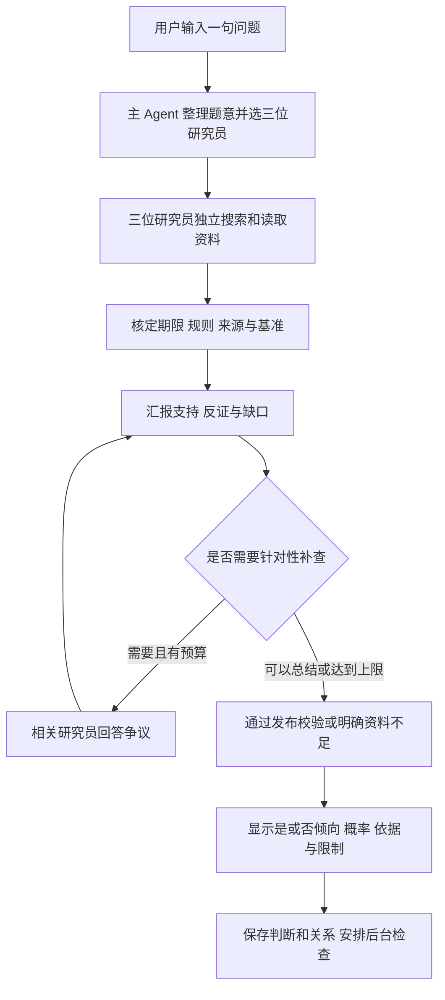
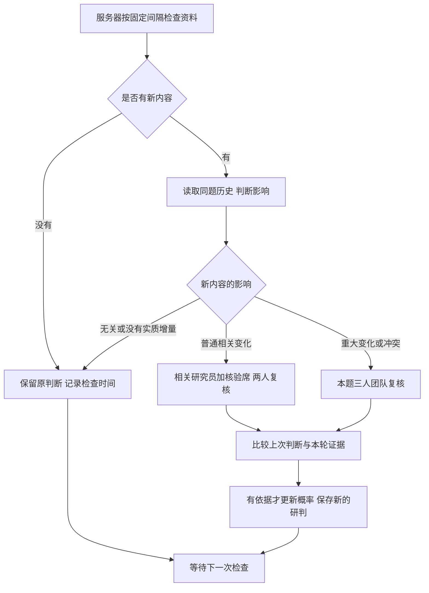

# V2.0 详细改动、验收结果与后续开发清单

更新日期：2026-11-19。产品版本为 `2.0.0`，发布分支为 `V2.0`，内部执行协议为 `harnessVersion=3`，PRD 为 `0.6`。这些编号分别描述产品、执行协议与需求文档，不是三个不同的产品版本。

本文汇总本次 V2.0 交付及其前置修复，供组会讲解、开发交接和课程验收使用。功能基线提交为 `4f2ac62`；本文之后的文档补充不代表新增了预测能力。历史 M0、M1、旧案例和本轮课程路径分开记录，不把旧测试数量重复相加。

## 1. 这一版到底完成了什么

**用户输入一句问题，主 Agent 按题派出三位研究员；他们独立使用真实工具找资料，提交支持、反证和缺口，必要时定向补查，最后输出有期限的是／否倾向与概率。服务器保存本次判断，之后检查新资料，再决定是否需要重新研究。**

本版的主要改进是：让调查真正交给子 Agent；在模型调用尚未结束时就能看见每位研究员；让后续监听带着以前的判断继续工作；提供用户自己的 API Key 入口。

当前交付的是可运行的课程演示项目。真实执行路径已经验收；预测准确率、概率校准和所有领域的资料可靠性尚未通过系统评估。后文分别说明已完成、部分完成和未完成项。

### 1.1 当前技术栈

| 部分 | 实际使用 | 负责什么 |
| --- | --- | --- |
| 前端 | 原生 JavaScript、HTML、CSS | 像素研究室、角色状态、气泡、任务卡、概率轨迹、连接设置；目前没有采用 React |
| 后端 | Node.js HTTP 服务 | 接口、运行调度、取消、工具调用、发布守卫和监听 |
| Harness | 自己实现的显式状态机、独立 Worker 循环与预算守卫 | 决定谁能做什么、何时结束、怎样恢复、什么结果可以发布 |
| 存储 | SQLite、持久化执行事件与检查点 | 任务、契约版本、报告、证据、来源关系、概率历史和监听计划 |
| 结构校验 | Ajv 与服务端业务校验 | 工具参数、二元输出、归属、版本、期限和权限 |
| 模型与联网 | 当前课程入口使用 DeepSeek 模型及 Search／Fetch；另有受限行情工具 | 真实模型决策、搜索和读取原文、BTC／ETH 现价快照 |
| 方法文档 | 十类角色手册及主 Agent 手册 | 调查方法、输入输出、边界和报告要求；由程序执行权限与循环 |

LangGraph、Graphiti 等出现在调研及实验记录中，当前正式课程路径仍使用自己的 Node／SQLite 实现。不能把参考过的框架写成已经接入的依赖。技术验证与取舍见 [框架选型](M0_FRAMEWORK_DECISION.md)。

## 2. 本版逐项改了什么

### 2.1 输入：一句话就能开始，保留严格模式

- 默认预设模式只需写问题；默认预测窗口为 48 小时，可选 24 小时或 7 天，不要求用户先选择角色、配置工具或上传材料。
- 主 Agent 将口语问题整理成命题、对象、时间、常见假设和待核验项。草稿会展示给用户，但草稿不等于来源已核实的正式契约。
- 严格模式可固定规则、来源、时间和时区，后续自动调查不得私自改写已填条件。
- “今天／今日／today”且没有具体钟点时，按创建当天所在时区的日终处理；隔天重试沿用原始创建日，不能把旧题顺延成今天。具体钟点及复杂日期仍需模型或严格模式解析。
- 没有有效概率时显示缺值，不自动填成 0% 或 50%。到期时间、发布时间和检查间隔分开保存。

用户看到的变化：先输入想知道的事情，再看系统如何理解；无需承担后台研究配置工作。时间规则仍有边界，不能声称所有自然语言日期都已可靠解析。

### 2.2 主 Agent：先派工，再核定完整契约

旧流程先让主 Agent 自己搜索、读取和核定完整题目，完成后才派子 Agent。主 Agent 可能消耗较长时间，用户看到的也只有主 Agent。

新流程第一阶段只开放 `draft_and_delegate`：简短整理题意，从角色目录选择三个不同职责，必须包含 `verification`。第一阶段主 Agent 没有联网工具，资料调查立即交给子 Agent。子 Agent 返回真实来源后，主 Agent 再完成正式规范化和后续汇总。

调查阶段提前分配稳定的题目身份，以便隔离证据；它不用于伪造 ready 状态。正式发布仍检查来源、时间、契约版本、实际引用和报告有效性，至少需要两份有效完成的独立报告。

用户看到的变化：主 Agent 很快给出分工，随后不同小人开始各自的实际模型与工具工作，而不是等主 Agent 全部查完。

### 2.3 子 Agent：按题选人，有自己的任务、上下文和工具循环

十类目录为官方资料、新闻时间线、行业专业、人物组织、统计指标、预测市场、社群舆情、历史类比、关系图、反证核验。每题通常只选三位；不是十位一起上，也不是所有领域固定同样三人。

| 能力 | 当前实现与边界 |
| --- | --- |
| 任务差异 | 主 Agent 保存本轮入选理由、目标及调查侧重点；同一角色可在不同题目中接收不同子任务 |
| 独立性 | 每位研究员有独立上下文、工具结果、检查点、预算和结束状态；首轮不读取同伴刚生成的报告 |
| 可执行工具 | 课程角色可搜索和读取网页；只有主 Agent、市场席和统计席另有 `get_market_quote` 权限，主 Agent 初始阶段仍不能联网 |
| 报告 | `submit_report` 提交真实引用、支持、反证、缺口、公开摘要、可空候选概率和下一步建议 |
| 通信 | 首轮报告交给主 Agent；后续针对具体争议带着已有报告和问题定向补查，不要求虚构争吵 |
| 能力限制 | 目前角色主要共享通用 Search／Fetch，方法和任务范围不同；并非十种专业平台 API 全部接通 |

多 Agent 由真实委派、工具许可、独立循环、报告交换和定向补查共同构成，角色提示词只是其中一部分。[完整运行手册](agent-playbooks/README.md)

### 2.4 循环：允许多步调查和多次复核，也有明确终点

| 单位 | 含义 | 本版上限／规则 |
| --- | --- | --- |
| 一次模型请求 | 一次向供应商发起的模型调用 | 传输重试也计入预算，不等于一次完整会议 |
| 单人调查步骤 | 研究员决定下一步取证或提交报告 | 最多前 5 次模型决策用于调查；第 6 次预留为只提交报告，资料够可提前结束 |
| 协作周期 | 一批报告返回后，主 Agent 汇报、质询和决定下一步 | 最多 3 个周期，即初次加最多 2 次定向补查 |
| 一个 Run | 同一题目的一次检查或完整研判 | 可以含多位研究员、多次工具调用及多个协作周期；仍消耗同一 Run 总预算 |
| 持续跟踪任务 | 固定目标题目的完整生命周期 | 可以先后产生多个 Run；不是让模型一直在后台空转 |

达到报告阶段或工具额度用尽后，模型只拿到报告动作；服务端也拒绝继续调查。补查使用新的 assignment 身份，避免同一角色第二次出场时错误复用上次已完成的任务。到达周期或总预算上限后，给有限结论或明确不足，不无限搜索，也不为了动画强行凑满五六次。

### 2.5 System prompt 与服务端预算同时约束

| 范围 | 当前新版配置 |
| --- | --- |
| 整个 Run | 最多 40 次模型请求、64 次工具调用、累计 300000 tokens |
| 主 Agent | 最多 16 次模型请求，同时受整轮预算限制 |
| 单次 Worker assignment | 最多 6 次模型请求、6 次工具调用、累计 65536 tokens，同时受整轮限制 |
| 思考模型单次输出 | 默认上限 16384 tokens；显式配置可提高至 32768，本次真实验收采用 32768 |
| 本次真实验收超时 | 每次模型调用 180 秒；整轮耗时可长于一次调用 |

每次调用的 system prompt 会刷新当前职责、阶段、调查／报告机会、已用及剩余请求／工具／token 预算。主 Agent 的题意、任务、理由和总结，以及 Worker 的摘要、支持、反证与缺口都有公开文字长度目标。

中文字数目标与 token 硬上限分开处理。模型服务中的思考／输出计量遵循供应商口径；更长思考不会自动等于更准确。截断内容不能冒充完整报告；能够安全取得的实际 usage 会记账，未知 usage 保留未知标记。前端展示公开执行摘要，不展示模型隐藏思维链。

### 2.6 前端：调用过程中就出现子 Agent，状态有真实来源

- 新增按研究员记录的 `model.requested`、`model.completed`、`model.failed` 状态。派工后角色即出现，真实请求期间头顶显示“等待模型”，返回、失败和终态时清除。
- 工具调用、工具返回、报告和阶段推进来自已保存的后端事件。小人动作和气泡服务于这些实际动作，不能用固定台词代替工具执行。
- 页面刷新可恢复正在进行的角色状态；已完成的历史发言不会重播成现场。迟到的旧请求回执不能清掉新请求的等待状态。
- 展示真实模型次数、工具次数、用量和协作周期，区分旧执行协议与新版协作；空值不显示成字面量 `null`。
- 房间区分“查看预测协作过程”和“查看最近监听检查”。最近一次安静检查可以只有主 Agent；用户仍能打开生成当前答案的那一次多人协作。
- 修复模型连接页受到其他运行订阅影响的问题，连接状态按实际课程接口响应更新。

像素风格继续保留，已有工作、走路和发言动作继续使用。本版没有完成一套新的复杂游戏 AI、全新 GIF 动作库或任意自由行为模拟。

### 2.7 Memory：从“最近四条运行”改成“最近四次实质研判”

旧逻辑可能让失败、取消或纯无变化监听挤掉有价值的报告。新逻辑按以下规则装配本轮历史输入：

| 层次 | 保存／检索什么 | 范围与期限 |
| --- | --- | --- |
| 本轮工作上下文 | 本次真实工具结果、报告及阶段状态 | 当前 Run，按执行顺序使用 |
| 短期记忆 | 历史概率、公开理由、支持／反证因素、分歧和缺口 | 同题、同版本，最近 7 天最多 4 次已结束实质研判，最多 8 份报告摘要 |
| 长期检索 | 带出处的支持／反证关系、旧证据索引、上一条有效概率及其时间 | 同题、同版本，最近 90 天，最多 8 条关系、12 条证据索引 |
| 原始归档 | 任务、版本、报告、证据、封存概率和执行记录 | SQLite 保留；当前不自动物理删除 |

检索截点固定为本轮开始时，不能把之后取得的材料倒灌进旧输入。纯无变化检查、失败、取消和进行中的 Run 不占四次实质研判名额；有实质报告但资料不足的记录可以保留缺口，概率仍为空。

记忆的用途是比较“上次怎么判断，这次新增了什么，哪些假设要重新核查”。旧 evidenceId 不能直接当本轮新证据，引用需要重新读取。旧概率不是事实，也不是必须沿用的答案。

7 天／90 天是向模型检索的窗口，**不是数据库删除时间**。当前不做跨题自动记忆迁移、参数训练或自动概率校准。关系里的 `supports`／`contradicts` 是带出处的语义支持／反证，不是经过统计估计的正负相关系数或已证明的因果关系。[完整记忆规则](MEMORY_POLICY_V2.md)

### 2.8 监听：有新消息先分流，不默认全体开会

| 检查结果 | 当前处理 |
| --- | --- |
| 正文重复或没有新内容 | 更新检查状态，通常不调用模型、不新增概率 |
| 有新页面但缺实质相关内容 | 可调用主 Agent 做分诊；判为 `no_change` 时不派工、不新增概率 |
| 普通相关变化 | 唤醒相关研究员加核验席，共两位 |
| 重大变化或关键冲突 | 召回本题原三人团队，再按争议决定补查 |
| 服务鉴权／额度／访问权限故障 | 暂停监听，显示安全原因，等待修复后手动重试 |

因此，不要求所有渠道凑齐一波资料才开会，也不要求任何一条新消息都叫来所有研究员。当前检查器按服务配置的固定间隔工作，演示配置默认一小时；尚未实现由各 Agent 讨论后自主协商各自频率。

监听计划、去重记录和运行历史持久化。关闭网页不影响 Node 服务继续检查；电脑、Node 进程和网络仍需工作。当前全局同时执行一个完整 Run，多个任务会排队；一个 Run 内的三位初始研究员可以并行工作。多任务管理不等于多道题无限并发。

### 2.9 故障处理：明确停下、重试和保留历史

- 对模型／资料接口的 401、402、403 返回安全的鉴权、额度或权限原因，并将监听设为 `paused_provider`，清除下一次唤醒，防止后台反复扣费式重试。
- 429、408、5xx 或网络临时错误采用有界重试；主模型单步传输最多三次尝试，来源工具临时失败最多一次重试。重试仍受取消和总预算限制。
- 页面可“重试本次调查”；题目尚未形成正式 predictionId 也能恢复。失败题目可以停止跟踪。
- 后续失败不抹掉已发布的旧答案。失败、取消、旧协议记录和旧错误日期保留，不能改写成成功历史。
- 不把接口错误自动切换成 mock，也不因页面轮询自动重新发起调查。敏感响应正文、Key 和账户余额数值不公开。

并行批次中已有请求可能在首次硬故障前已经发出，不能宣称第一次报错时绝对只产生一个网络请求。[故障恢复细节](PROVIDER_RECOVERY.md)

### 2.10 API Key：新增真正可用的“模型连接”页面

顶部、侧栏和设置入口可到 `#/model-connection`。密码框通过 `/api/v1/course/provider-connection` 保存当前课程路径的 DeepSeek Key，同一 Key 用于模型、搜索及网页读取。

- Key 仅留在服务器进程会话内存；输入框提交后清空，不回显、不写 localStorage、应用数据库、`.env` 或仓库。服务器重启后需重新输入；部署者原有环境配置方式另外保留。
- 默认无 Key 的模拟启动也能通过此页切换到真实课程模式；历史模拟记录继续标明原模式，不改写成真实。
- 保存本身不测试余额、不调用模型、不创建预测，也不自动重试失败题。
- 有执行中、排队中运行或活动监听时不能更换 Key，需先停止这些跟踪；已暂停且无下一次唤醒的故障任务不阻止保存。
- 接口只接受本机同源、受限大小的 JSON，服务端在更换前复查空闲条件，只向页面返回是否已配置等安全状态。

目前没有多用户账户、每用户独立 Key、持久加密保险库或任意供应商选择器。它是本机单用户课程项目的会话连接入口。

### 2.11 金融、天气和概率输出增加边界保护

- 价格工具目前只直接支持 BTC-USD／ETH-USD；识别黄金、白银等价格题，不再因为题目没有英文 ticker 就漏掉金融基准检查。
- 缺少匹配且可核验的结构化价格基准时，基准值保持 `null`，只能给 `conditional_estimate`，并设置 `conditionalOnly=true`、`scoringEligible=false`。不能用 BTC 价格代替黄金基准。
- 天气预报可支持未来概率，但不能冒充降雨实况。当前没有结构化实况连接器，预设降雨题的自动结果登记被 `WEATHER_OBSERVATION_REQUIRED` 守卫拦住。
- 城市级预报、代理站和具体地点区分，特定雨量阈值不等同于“某条街任何一点下雨”。
- 输出只开放 binary；名单、排名、连续数值和交易下单均不属于本版交付。

这些守卫降低了错误结果被计分的风险，但没有解决全部自然语言事实质量问题，尤其是第 5 节列出的总结与结构化字段不一致风险。

### 2.12 版本、资料和发布整理

版本号更新为 `2.0.0`，发布到公开 `V2.0` 分支，保留 main。README 加入真实等待、连接入口、记忆检查等截图；提供真实运行公开摘要、记忆规则和故障说明。API Key、环境文件、运行数据库及本机私有配置不在公开提交中。

仓库中的 PRD v0.2 PDF 和早期展示附录是历史会议材料；当前范围以 PRD v0.6、实现状态和本版验收为准。旧材料的其他输出头和宏大平台目标，不代表当前已经完成。

## 3. 本版真实验证了什么

| 检查 | 真实结果 | 能说明什么／不能说明什么 |
| --- | --- | --- |
| 应用代码回归 | `node --test`，253／253 通过，0 失败、0 跳过 | 覆盖协议、预算、恢复、隔离和界面投影等；不是 253 次真实模型预测，更不是准确率 |
| 初始真实黄金题 | “黄金会跌吗”，三位研究员为市场、统计、反证核验，三份报告完成；15 次模型请求、17 次工具、159288 tokens，493.076 秒 | 证明真实派工、独立调用、工具及发布路径跑通；最终 Yes 52% 是条件估计，基准未核验、不计分 |
| 先派工检查 | 派工事件 seq1377 早于首个来源调用 seq1386，派工前主 Agent 来源调用为 0 | 证明初始研究由子 Agent 开始，并非主 Agent 查完才补画三个人 |
| 真实等待展示 | 独立研究员请求／返回事件、运行中截图和刷新检查 | 证明模型等待时可看见实际研究员，终态会清除等待；不展示隐藏思维链 |
| 后续真实记忆检查 | 读入上一 52%、3 份报告、8 条关系、1 次实质研判；4 工具、1 次主 Agent 分诊、35018 tokens | 新页只有栏目标题，判 `no_change`，没有新派工、没有新概率；证明安静检查和历史上下文路径可用 |
| Key 页面 | 实际保存、清空输入框；回归检查不落盘、不回显及空闲限制 | 证明连接配置入口可用；保存动作本身不证明余额足够或预测质量合格 |

初始真实运行于北京时间 2026-11-19 11:10:34 创建、11:18:47 发布。主运行 ID 为 `course_run_604d72c6-506c-4d29-b4c5-e91eef80f8b5`；后续检查为 `course_run_4459f01e-da71-4605-88de-695ba0dbada6`。公开原始摘要：[初始研判](evidence/v2-live-gold-summary.json)、[记忆检查](evidence/v2-live-memory-summary.json)。

早先黄金试跑发现识别缺口后中止，没有发布结果；修复后新建上述任务，失败和取消记录保留。验收结束后已停止该测试题自动监听以免继续消耗额度，历史仍可查看。其他历史 BTC、社交及天气运行记录见 [课程验收](COURSE_ACCEPTANCE.md)，其旧配置和数量不与本次混算。

**本次后续检查没有新 Worker，因此不能把它说成“真实验证了有新资料时，Worker 如何在记忆帮助下改变预测”。** Worker 历史输入的装配有隔离代码测试；需要再用真实相关增量补齐这条端到端证据。

## 4. 哪些做完了，哪些只是部分完成

| 项目 | 状态 | 还缺什么 |
| --- | --- | --- |
| 一句话输入、预设／严格、二元输出 | 已完成当前范围 | 继续覆盖模糊实体、具体钟点及更多日期说法 |
| 先派工、独立工具循环、预算和定向补查 | 已完成当前范围 | 真实补查案例与收益分析仍需积累 |
| 运行中研究员与真实气泡状态 | 已完成当前范围 | 长耗时、错误及大量事件下的易读性继续完善 |
| 同题短期／长期记忆检索 | 已实现；主 Agent 后续检查已真实使用 | 有相关增量时的 Worker 真实记忆使用及效果对照 |
| 后台持久监听与局部／全队分流 | 已实现固定频率子集 | 正增量完整实跑、自主频率协商及生产级调度 |
| 支持／反证关系记忆 | 已实现小型子集 | 完整时序图、过期／撤回关系、跨事件检索与因果验证 |
| API Key 页面 | 已完成本机会话范围 | 持久加密、多用户、连接诊断与部署方案 |
| 广泛来源 | 部分完成 | 现阶段主要为公开网页搜索／读取，专用平台连接器不足 |
| 到期结算和评分 | 当前课程链路未完整交付 | 旧案例有部分结算能力，通用题的核验、评分 UI 和实验未打通 |
| 概率准确率、校准、创新收益 | 待评估 | 小题集、真实结果、同预算基线与失败分析 |
| 课程最终提交包 | 待小组确认完成 | 最终演示视频、最新幻灯片、个人贡献说明和干净环境复现 |

不用一个“完成百分比”混合这些层次：代码存在、代码测试通过、真实执行通过、预测准确和课程材料齐备是不同的验收结论。

## 5. 已知问题与下一版优先级

以下是待办清单，不表示这些功能已经做完，也不自动授权持续付费实验。继续开发应先完成 P0，再按课程需要取舍 P1；P2 保留方向，不扩大当前交付范围。

### P0-A：公开总结必须与受控字段一致（✅ 已完成）

**现有证据：** 黄金题的 `normalized.baseline` 和 `forecast.baseline` 为 `value:null`、`verified:false`，且 `scoringEligible:false`；但模型的公开 `forecast.summary` 仍把某个报价写成已经核验的固定 P0，该文字又进入后续 `previousForecast.summary`。不能把这段模型文字当已确认的真实金价。当前防线阻止了计分，却没有完全阻止误导性解释。

**要做：** 由受控字段统一生成基准、期限、证据充分度和计分状态的事实段；限制自由总结中的冲突断言，冲突时标注或重写后再公开。历史摘要保留审计原文，面向用户及记忆输入增加醒目的“未核验／条件估计”说明，避免旧总结在下一轮升格为事实。

**验收：** 缺失基准的题目，结果卡、正文、记忆卡和后续模型输入均不得声称该数值已核验；可信基准存在时也只能引用匹配字段。增加有冲突摘要、旧冲突记忆和正常有效基准的回归案例。负责方向：后端＋模型输出校验，前端配合。

**已完成（2026-11-19）：** 新增 `server/course/forecast-facts.mjs`（`buildForecastFacts`／`detectSummaryConflict`／`forecastStatusLabel`／`deriveForecastStatus`）。`publishForecast` 封存时写入 `statusFacts`、`summaryConflict`、`baselineVerified`、`conditionalOnly`、`statusLabel`，`summary` 保留审计原文；`memory-policy.mjs` 的 `projectForecast`／`recentJudgments` 注入派生字段；前端 `renderAnswer`／`renderMemory` 展示事实段、冲突警告与状态徽章。旧数据无需迁移：新字段只写新预测，记忆侧从既有结构化字段（`baseline`／`kind`／`scoringEligible`）现场重推导，旧冲突摘要进记忆时同样被标注。新增 `forecast-facts.test.mjs` 7 条回归，全套 260/260 通过。

### P0-B：来源时间、有效正文和题意范围再收紧一层

**问题：** 真实资料中仍会出现旧新闻、空栏目、转载和时间／数字互相矛盾。宽泛输入可以宽泛估计，但不能把不适用材料当最新事实。

**要做：** 区分发布时间、抓取时间和事件发生时间；对空正文、明显过旧或相互冲突的行情保留缺口与降级原因。把系统补出的实体、方向、目标时点和观察口径集中展示，严格字段仍保持不可偷偷改写。

**验收：** 至少覆盖“今天某地会下雨吗”“某人会不会发布动态”“某价格会跌吗”三类；旧页和栏目页不能单独支持确定结论；不同地点、天气预报与实况、历史与现价不能混用。负责方向：来源工具＋主 Agent 规范化＋独立校验。

### P0-C：补齐一条真实相关增量，而非只验无变化

**要做：** 选一个资料容易取得且会发生真实更新的题目，保留初次发布；后续真的出现相关资料时，由分诊唤醒两位或原三位研究员，确认历史判断进入上下文，并展示本轮支持／反证如何变化。没有新资料时不伪造更新来凑案例。

**验收：** 保存两个真实信息截点、初次和增量报告、实际记忆装载摘要、分诊理由、用量及真实概率变化或保持原因。若只观察到无变化，记录该结果并明确正增量链路尚缺。负责方向：集成＋模型＋验收。

### P0-D：从发布走到可核验结果与最小评估

**要做：** 优先允许人工核对实际来源后登记当前通用题的 Yes／No／无法判定结果，记录核验时间和出处，再接最小评分汇总；不必先做全网自动裁决。天气和缺行情基准等受守卫限制的题目继续保持不可计分，不能用手动入口绕过证据要求。

**验收：** 同一固定目标 `T` 的预测 `p(t,T)` 能与独立实际结果对应；条件估计、到期后发布、未知结果和有口径变化的题目排除或分组。报告有效样本数、Brier 分数及成本，未结算题不记成功率。少量样本只作案例分析，不宣称统计显著。

**对照建议：** 同一材料截点及近似预算下比较单 Agent 与多 Agent，再比较记忆开启／关闭；先做小规模、可回查实验。现有实时取证不能自动当严格历史回测，须保存可用时间和输入快照，避免未来信息泄漏。负责方向：评估＋后端结算。

### P0-E：整理课程提交，固定可复现演示路径

**要做：** 准备简洁主案例、真实增量或无增量案例、一例故障恢复，展示角色差异、真实工具、通信、发布与记忆。补齐最终幻灯片、最长 10 分钟视频、成员贡献说明和运行环境；老师要求摘要见 [PRD 第 1 节](PRD.md#1-产品目标与课程要求)。

**验收：** 新环境按 README 启动后能自行填 Key、发起真实题目；屏幕可说明“谁正在工作、正在等什么、结果为何可信或不充分”。演示用量可解释，截图与日志不含秘密；视频若使用历史真实记录明确标注，不把回放说成现场。负责方向：前端＋文档／展示＋主集成。

### P1：课程核心稳定后，按实际需要补

| 待办 | 交付物 | 验收重点 |
| --- | --- | --- |
| 专业数据连接器 | 若继续展示股票／黄金，接匹配的报价、交易日历和结果源；天气则接实况 | 单位、品种、交易日、有效时间、延迟及权限明确；不串用基准；费用可控 |
| 来源质量与关系修订 | 语义重复合并、更正／撤回记录、关系失效和出处查看 | 转载不重复放大支持；新事实不会抹掉旧审计，也不继续把失效关系当当前事实 |
| 监听和队列操作 | 更清楚的排队原因、暂停／恢复及受限频率设置 | 区分停止跟踪与关闭网页；重启不重复执行；提高并发前验证预算隔离与公平性 |
| 连接诊断与会话管理 | 独立的轻量连接检查；确有需要再接系统凭据库 | 检查不偷偷启动预测，敏感信息不回显；保持本机单用户边界或另做账户设计 |
| 研究员能力细化 | 优先为常用角色加真正专用的工具，不只追加方法文字 | 例如数值处理器／官方域名工具有明确权限、真实返回和独立验收；不是一次性堆齐十套 API |
| 前端解释与历史档案 | 点概率看本次依据、点关系看来源、区分证据与学习档案 | 用户能从答案追到报告、原文及前次差异；人物行为与当前选中 Run 一致 |

### P2：长期研究与扩展，当前先不做门槛

- Polymarket、X、Reddit、小红书等专用授权连接器。当前课程路径主要通过公开搜索／读取获得线索；旧案例 Polymarket 监测不等于任意新题都接入完整合约和社交数据流。
- 完整跨事件时序图、跨公司／事件迁移、因果推断和更复杂“世界模型”。先证明小型证据关系确实有用，再扩图。
- 自动校准、角色可靠度学习和大规模前瞻评估。需要真实标签、时间切分和稳定基线，不能用回看新闻后的解释代替预测成绩。
- 多用户部署、持久后台 Worker／任务队列、分用户凭据及成本配额。关闭浏览器继续运行不等于已有生产级云服务。
- 排名、名单、连续数值等新输出头。当前只收紧 binary，需另行确认需求再开放。

## 6. 下一轮怎样分工、怎样验收

| 负责人／工作方向 | 先完成什么 | 交给集成者什么 |
| --- | --- | --- |
| 主集成 | 冻结 binary 范围与 P0 验收；处理模块接口和版本边界 | 可运行分支、集成记录、明确通过／未通过项 |
| 后端／Harness | P0-A 字段一致性、记忆降级、必要结算接口 | 代码、关键守卫测试、兼容旧记录的方案 |
| 模型与来源 | P0-B 题意／时效核验，P0-C 正增量研究任务 | 真实输入输出、来源局限、用量，不交“看起来更好”的模拟答案 |
| 前端 | 条件估计与缺口清晰展示、预测与监听入口、状态和来源追溯 | 根据真实事件的界面与截图；不制造未发生的协作 |
| 独立校验／评估 | 检查证据隔离、时间、冲突文字、结算和对照口径 | 问题清单、复现步骤、P0 是否通过，避免作者自行宣布全部合格 |
| 文档／展示 | P0-E 课程材料与成员贡献 | 最终讲稿、视频／幻灯片、复现步骤和局限说明 |

建议顺序：**先修解释与事实一致性 → 补真实相关增量 → 完成最小核验／评估 → 固定课程演示与提交材料。** 不先重写前端框架，不先扩大角色数量，也不先搭生产级社交平台。

一项工作只有在“实现 → 关键测试 → 集成 → 独立检查 → 必要的真实验证 → 更新记录”后才能标已完成。文档修改只需检查事实、链接和差异；涉及模型行为的改动再做有边界的真实验证，单独记录耗时、调用和失败。

## 7. 开发者从哪些文件接着看

| 要了解／修改什么 | 入口 |
| --- | --- |
| 产品边界、课程要求、开发约束 | [PRD](PRD.md)、[课程最小交付](COURSE_MVP.md)、[开发 Harness](../AGENTS.md) |
| 当前进度与历史验收 | [实现状态](IMPLEMENTATION_STATUS.md)、[V2 发布摘要](V2_RELEASE.md)、[课程验收](COURSE_ACCEPTANCE.md) |
| 主 Agent 阶段、派工、复核、发布和分诊 | [course-service.mjs](../server/course/course-service.mjs) |
| 任务、历史、监听计划与记忆装载 | [course-store.mjs](../server/course/course-store.mjs)、[memory-policy.mjs](../server/course/memory-policy.mjs) |
| Worker 循环、模型协议与预算 | [worker-loop.mjs](../server/runtime/worker-loop.mjs)、[model-provider.mjs](../server/runtime/model-provider.mjs)、[agent-budget.mjs](../server/runtime/agent-budget.mjs) |
| 搜索、原文与行情 | [web-tools.mjs](../server/course/web-tools.mjs)、[market-quote.mjs](../server/course/market-quote.mjs) |
| 课程界面、房间状态和工作流 | [workbench-course.js](../web/workbench-course.js)、[workbench-course-room.js](../web/workbench-course-room.js)、[course-projection.mjs](../web/course-projection.mjs)、[course-workflow.mjs](../web/course-workflow.mjs) |
| Key 接口与页面 | [provider-connection.mjs](../server/provider-connection.mjs)、[workbench-provider.js](../web/workbench-provider.js) |
| 角色方法与能力边界 | [十类手册目录](agent-playbooks/README.md)、[主 Agent 手册](agent-playbooks/supervisor.md) |

组会只需先讲第 1、3、5 节，再用下面两张图解释运行方式。更详细的测试、旧版本和真实来源记录保留在链接文档中，不把历史描述当本版现状。

## 8. 组会可直接使用的简易流程图

### 初次预测：先分工，再取证，再总结

图中的补查最多两次，不是无限循环。核定失败或触及发布守卫时可以只有研究报告，不能为了演示强行产生一个正式概率。

### 后续监听：不是每条新消息都全体开会

讲解要点：一次模型调用不等于一轮会议；四次短期记忆是同题四次实质研判；关闭网页不会停止后台；真实跑通不代表预测准确率已经得到证明。
