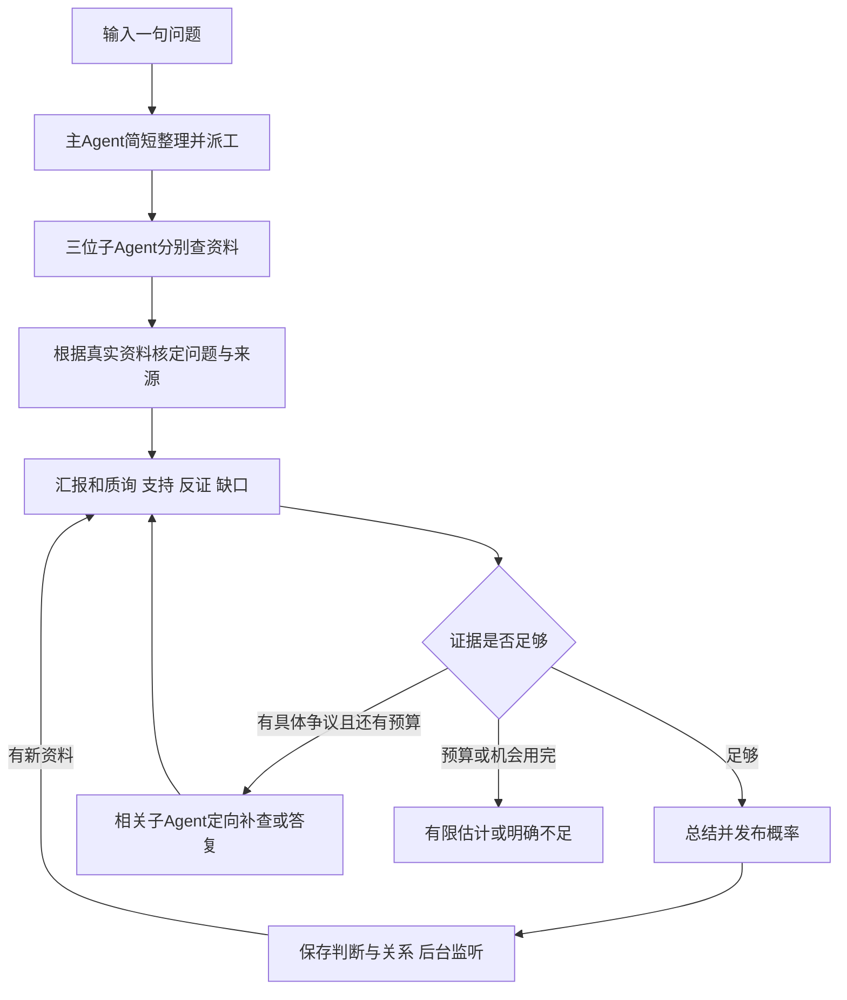
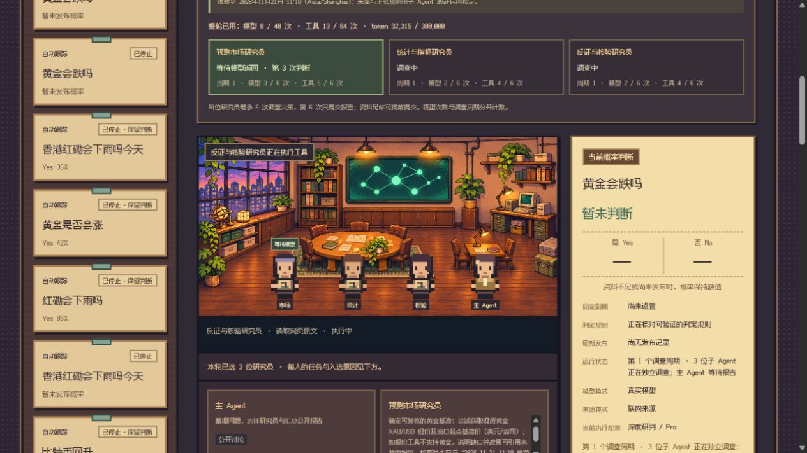
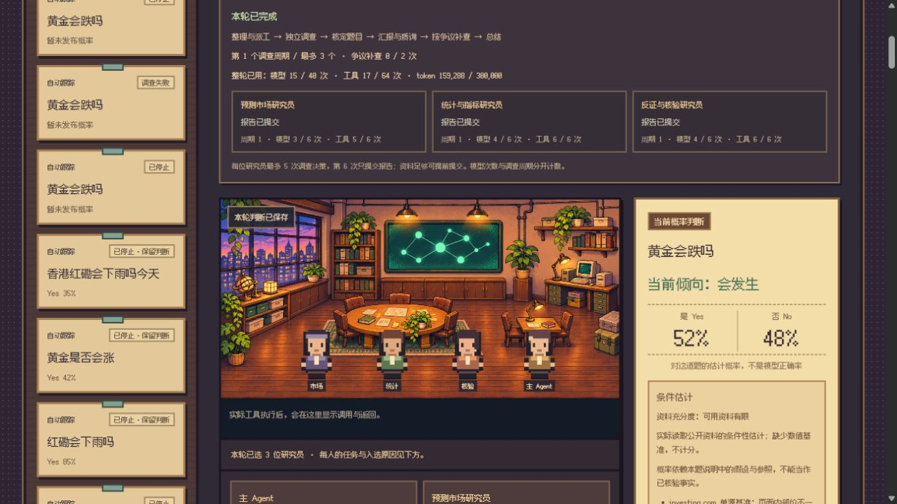

# V2.0 协作、记忆与自己的API Key

2026-11-19。产品分支名为V2.0，内部执行协议harnessVersion为3。代码回归、真实黄金题及后续记忆检查已完成，原始摘要和截图附后。

逐项改动、技术栈、轮次定义、完成边界、P0／P1／P2 待办、分工和组会流程图见 [V2.0 详细改动与开发清单](V2_CHANGELOG_AND_ROADMAP.md)。特别注意：真实黄金题证明执行路径跑通，模型公开总结与未核验基准字段仍有冲突，下一版需优先修复，不能视为金价或预测准确率验收通过。

## 为什么调整

旧版先让主Agent独自找来源、核定完整契约，之后才能派工；因此等待很长且界面容易看成只有主Agent工作。子Agent的模型请求也没有独立等待事件。旧版只支持一次补查，记忆中的最近4个Run还可能被空监听挤占。

## 现在怎样运行

主Agent最初只调用draft_and_delegate，没有联网工具；草稿不是ready契约。研究员用稳定任务身份先取得原文，再核定真实来源、规则与基准。原来的来源、时间、版本、引用和至少两份有效报告的发布校验保留。

每位研究员最多5次调查决策，第6次模型请求预留报告；工具用完也只允许报告。不要求凑满次数。一次“协作周期”指一批报告返回后汇报和质询，不是一次模型API调用；最多3个协作周期，即初次加2次定向补查。重试计入请求预算；全轮40模型、64工具、300000 tokens，单人6模型、6工具、65536 tokens。system prompt每次刷新职责、报告字数、token与剩余预算；后端同时执行硬守卫。

## 现场展示

小人只由已保存的事件驱动。model.requested显示该研究员“等待模型”和持续动作，completed/failed清除等待；工具调用和报告仍展示真实结果。刷新可恢复进行中的状态，不把历史发言重新播成现场。界面分别显示调查次数、工具数、协作周期和整轮预算；公开执行状态和结论，不展示隐藏思维链。

## 记忆

短期是同一道题、同契约版本最近7天最多4次实质研判，含历史概率、公开理由、支持/反证因素和未解缺口。纯无变化检查、失败和取消不挤占名额。长期检索90天内最多8条带出处关系、12条证据索引；原始封存档案不自动删除。旧概率用于比较，旧关系用于找需要复核的来源；本轮引用必须重新取证。没有跨题自动迁移、模型参数训练或自动校准。[完整规则](MEMORY_POLICY_V2.md)

## API Key

顶部及侧栏“模型连接”提供密码框，DeepSeek Key同时用于课程模型和搜索/网页读取。仅保存到服务器进程内存，提交后输入框清空，不回显、不写浏览器存储、不写应用数据库或.env；重启需重填。默认演示启动也可保存Key切到真实课程模式，旧模拟记录仍保留原模式。

保存本身不做余额/连通性测试或启动新预测。若有运行、排队或活动监听，禁止更换Key；需先停止旧跟踪。暂停且没有唤醒计划的失败题不阻止保存，可之后手动重试。接口只接受本机同源JSON；配置只返回是否已配置，不返回Key及片段。

## 验证与限制

代码回归与真实联网验收分别记录。单次跑通只证明执行路径、来源与展示可用，不证明概率准确率。旧v2运行不迁移；其本轮配置、封存和失败保持不变。股票之外的市场价格工具目前只直接支持BTC/ETH，黄金等品种依赖可读公开来源，缺固定报价基准时只给条件性估计、不计分。自动到期评分、完整跨事件因果图及完整社交平台连接器仍未完成。

本版完整应用回归 **253/253通过，0失败、0跳过**。以下真实记录独立于隔离代码测试。

### 真实运行记录

- 原问法“黄金会跌吗”，通过实际页面提交；使用用户已充值账号、Pro thinking/high、真实搜索/读取，无mock替代。研究员为市场、统计、反证核验，三份报告均complete。
- `course_request_06be7e53-1faf-4c74-b4a2-6e78e92c8685`，主研判 `course_run_604d72c6-506c-4d29-b4c5-e91eef80f8b5`，北京时间11:10:34创建、11:18:47发布，493.076秒。15模型请求、17工具、159288 tokens，usage已知。
- 派工事件seq1377在首个来源调用seq1386之前；派工前主Agent来源调用为0。初次页面/GET观察为4个模型请求，其中3个是子Agent的首请求，主Agent首步即派工。22个实际子Agent模型请求/返回事件；截图和刷新均确认等待标记按角色恢复，终态标记清空。
- 发布Yes52%（即黄金下跌的条件性估计），资料有限，`conditionalOnly=true`、基准值null、`scoringEligible=false`。公开资料存在报价不一致、时间与来源独立性缺口，不能把52%当官方概率或经过验证的准确率。
- 后续真实检查 `course_run_4459f01e-da71-4605-88de-695ba0dbada6` 带入上一52%、3报告、8关系及1次实质研判。4工具、1次主Agent分诊、35018 tokens；新页只有栏目标题，被判无实质增量，no_change，无子Agent派工、不新增概率，曲线仍1点。
- 早先试跑 `course_request_087a7613-bc8c-4150-b57f-63855595419e` 在发现黄金识别漏洞时中止，记录保留，未冒充成功。修复后另建以上任务。验收完成后停止该测试任务自动监听，历史保留、后台服务继续运行，方便用户自己配置和测试。

公开原始摘要：[初始真实研判](evidence/v2-live-gold-summary.json)、[真实记忆检查](evidence/v2-live-memory-summary.json)。实际配置入口也经页面保存与清空验证；代码另覆盖Key不落盘、不回显、同源JSON、运行及监听期间禁止换Key、默认演示切真实模式但不自动发题。

