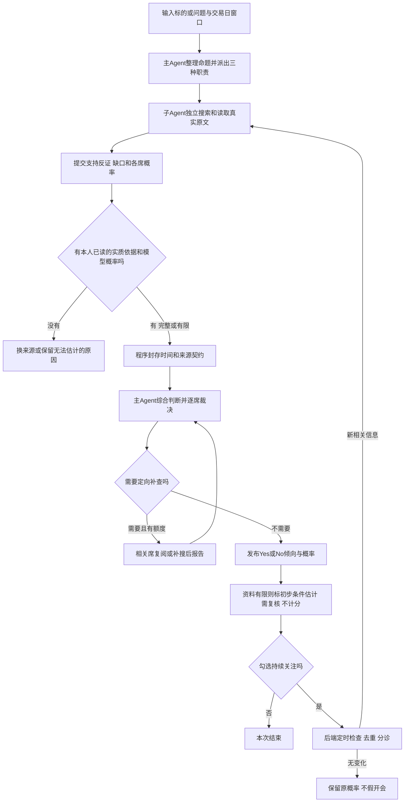

# LLMword 4.2 发布说明

更新日期：2026-11-22。交付为 [Bryce0312/LLMword 的4.2分支](https://github.com/Bryce0312/LLMword/tree/4.2)，实际提交见[该分支历史](https://github.com/Bryce0312/LLMword/commits/4.2)。本地基线为 `b2dc1ca`；远端 `V4.1` 另有演化，不以本版覆盖。本文件区分已完成的真实验收、历史记录与未验证项，不表示“所有功能无差错通过”。

本版继续服务 COMP5584 课程作业：用户输入股票或问题，主Agent拆题、按需委派不同职责的研究员；研究员调用真实工具找原文、独立报告，主Agent综合判断。像素研究室展示实际派工、工具、公开通信、报告与结果。产品范围仍是二元判断与概率，完整平台愿景不作为本版已交付清单。

## 本版主要变化

### 主Agent负责拆题与最终裁决，调查交给研究员

- 主Agent先改写题意并派出三种不同职责，包含核验席；不先用大量请求包办搜索。研究员的首轮上下文独立。
- 一般预测的准备阶段由程序根据已封存时间窗口和已读原文编译契约，不再额外要求主Agent重写一次准备协议。
- 每席提交支持、反证、缺口和自己的Yes估计。主Agent决定最终概率与摘要，逐份记录采纳、保留条件或拒绝；不把角色概率当准确率，也不把相同来源的多席意见当独立样本相乘。
- 汇总沿用已被采用报告的有效原始主张与引用，经过既有出处校验；主Agent显式提交的依据也须属于已采用报告，不能绕过裁决或注入新事实。

### 有限资料可以交付有据的初步估计

新建普通预设任务使用 `deliveryPolicy=exploratory-estimate-v1`；旧任务及已保存结果不迁移。严格模式和固定BTC／天气契约保留原有发布标准。

- 有真实模型概率、本人同轮已读正文、有效实质引用的报告，可以作为判断依据。`status=insufficient` 不再等于该报告所有内容无效；原状态仍然保留。
- 至少一席有实质依据和模型概率时，可由主Agent明确采用后发布初步条件估计。数量或完整度不足时标记 `model-provisional-estimate`、需复核、不计分，不伪装成完整三席核验。
- 对拒绝过的模型报告，可另存有审计的 `partialReport`：只保留原候选中校验通过的实质主张和原模型概率；不覆盖原报告，不把失败任务改成成功。
- 只有Cookie、免责声明、更新日期、访问状态、搜索摘要、网页缺资料说明或程序预算回执，不能支持事件概率；零实证、无模型概率或用量未知时不补造数值。
- 主模型裁决未完成时，程序中位数汇集仍要求至少两个不同职责的有据概率，并明确标记 `bounded-report-aggregation`、需复核、不计分；这条路径不能计为主Agent正常裁决成功。

### 增加调查和报告修正机会，仍由执行框架控制

| 新普通预设任务 | 上限／行为 |
|---|---|
| 主Agent | 总请求10次，每阶段3次有效决策 |
| 每席研究员 | 调查决策6次，取证动作8次，报告后最多2次修正，总模型请求10次 |
| 定向补查 | 最多2次，针对具体争议派相关席，不强制跑满 |
| 费用与停止 | 调用前考虑输入、工具定义、输出及报告预留；实际usage记账，仍受单次输出、总预算和超时约束 |
| 报告阶段 | 根据已经取得的工具回执组织结构化报告；调查与报告阶段分离，减少输出额度被重复思考耗尽 |

预算上限不是承诺每次都能取得有效原文。来源不可读、未解决的身份问题或没有实证时，仍会保留失败或资料不足结果；不会为了展示而假造完整报告。

### 工具、交接与展示

- 搜索和网页读取保留参数、权限、来源与引用校验；错误返回具体可修正的字段／片段问题，研究员可换来源或修正单条主张。
- 补查新增真实工具 `read_run_evidence`，复阅同轮已保存正文后登记本人读取。只知道同伴证据编号不等于已经读过；复阅不冒充新联网来源。
- 研究员自己的概率、部分报告、失败任务中保留的有效依据和主Agent逐席裁决可在协作面板查看。人物与气泡由真实持久事件驱动，不用预设对白填充运行过程。
- 新预测默认只研究一次，勾选“持续关注”才安排后续检查；复制纠正题保留这一选择。
- 新任务的证券日历识别补充苹果／Apple与英伟达／NVIDIA的窄名称线索；代码和明确市场优先。名称线索只用于日历，不等于证券身份或上市地已获核验；旧任务已封存期限不回填修改。
- 新预设任务另存 `forecastWindowPolicy=sealed-forecast-window-v1`：主Agent拆题必须回显服务器固定的targetAt，派工前拒绝明显的预测窗口冲突，报告与最终摘要也校验明确的窗口声明。各任务使用独立工具Schema副本，旧任务不追套新必填项；历史回看、公司指引和回购期限仍可作为资料语境。此为窄规则校验，不是任意自然语言的语义正确性证明。
- 概率显示统一保留至多一位小数，Yes量化后再计算No补数：真实0.5%估计显示为0.5%／99.5%，修复此前两侧分别取整显示1%／100%的错误。协作、历史、曲线及记忆显示同步，后台原概率不改。
- 普通预设调查的官方来源范围可包含相关公司与市场官方域名，避免首个媒体参考页把后续一手核验锁死；严格指定来源的边界保留。新AAPL与字节问题已另建真实任务复验，未用修复前记录替代；具体网站是否成功读取仍以各次工具回执为准。

## 真实验证证据分层

### 先前阶段已经完成的真实股票运行

以下来自[预测可靠性记录](FORECAST_RELIABILITY.md)及[逐席公开计量](evidence/forecast-reliability-live.json)，验证时点为 `2026-11-22T10:35:40.274Z`。三例使用真实DeepSeek模型和联网来源，没有注入固定答案；均未启用监听。这是本轮全面UI验收之前的证据。

| 原问／窗口 | Yes／No | 模型请求 | 模型tokens | 当时结果与范围 |
|---|---:|---:|---:|---|
| 腾讯股价／1交易日 | 46%／54% | 26 | 279030 | 主模型发布有据初步条件估计；需复核、不计分 |
| 英伟达股票走势／3交易日 | 47%／53% | 28 | 310088 | 主模型发布有据初步条件估计；需复核、不计分 |
| 苹果AAPL股价／3交易日 | 49%／51% | 18 | 181964 | 三席完整报告的模型条件估计；缺结构化核验基准，仍不计分 |

合计72次模型请求、771082模型tokens。三例没有程序中位数兜底、没有手改最终概率；不证明涨跌命中率、收益率或所有前端功能通过。模型tokens不包含没有等价token回执的资料服务费用，不是人民币账单。

较早的[有界预测验收](BOUNDED_FORECAST_VALIDATION.md)另记载一次Yes43%的真实流程成功及此前失败。该文件里的6次研究员请求／4次取证等为当时策略，不能代替本版10次／8次的新策略说明。其535项回归和可靠性阶段581项回归均为各阶段当时结果，不是本轮最终测试总数；协议回归也不能当作本轮真实模型验证。

### 本轮只读检查发现的用户原始记录

本轮检查了4203服务上两条真实用户记录，没有停止、重跑或改写它们。记录证明真实模型和多席执行过，但存在语义／时间问题，不能统一记为最终通过。

| 用户原问 | 真实发布／执行 | 本轮发现 | 4.2验收状态 |
|---|---|---|---|
| 苹果股价会跌 | Yes52%，表示下跌；最终成功轮20次请求、209172tokens，初步条件估计 | 标的解释为AAPL，但旧契约封存港股日历；摘要又近似为另一交易日 | 原记录保留；下面的新AAPL任务已验证纽约日历，不能以旧成功状态证明口径正确 |
| 字节股票 | Yes2%；26次请求、282535tokens，三席与一次补查 | 将未上市股票方向改成“窗口内出现可交易股票并上涨”的合取命题；官方核验还曾被来源域锁阻断 | 原记录保留；下面的新字节任务已停止换题、保留无概率澄清，旧2%不能当现有股票涨跌概率使用 |

苹果首次余额失败及后续成功属于不同Run；原失败没有被抹去。上述两题目标尚未到达，没有本轮涨跌命中或Brier成绩。最终说明应以正式forecast的 `scoringEligible`、`reviewRequired`、`publicationMode` 为准，不能拿准备契约中的默认字段当计分资格。

### 本轮真实UI与后端验收

主代理通过唯一浏览器会话操作真实应用，使用真实模型与联网来源；只读观察没有代替点击提交，也没有注入预设模型答案。以下与上面的历史三股票记录分别计量。

| 本轮任务／轮次 | 模型请求／研究工具 | 模型tokens | 实际结果与验收范围 |
|---|---:|---:|---|
| 新“苹果AAPL股价会跌”三交易日首轮 | 22／17 | 224977 | Yes52%，Yes表示下跌；目标固定为2026-11-25 16:00 America/New_York，即21:00Z；初步条件估计 |
| 同题自然监听轮次 | 25／22 | 372405 | 关闭全部4205预览页、同数据重启并在UI恢复会话Key后，于11:48:45 UTC自然开始；Yes52%→54%，目标、版本、原forecast及既有证据哈希保持不变 |
| 4204腾讯手动检查 | 15／11 | 220012 | Yes46%→45%；读取上一run、4份报告、8条关系；普通增量只派市场与核验两席，本轮资料有限 |
| 新“字节股票” | 19／15 | 180971 | 未核验公开可交易证券身份后明确澄清；无normalized契约、无预测概率，不转为IPO或代理标的题 |
| 显式字节IPO事件 `course_request_82cc96b4-2cb7-4fad-aa24-8ebcc36b74d5` | 20／15 | 191152 | 程序状态completed、发布9%，但解释／报告／摘要按24个月推断，与所选1交易日契约冲突；作为真实语义失败保留，未修改原值 |
| NVDA20交易日 `course_request_6a382a7e-e6c1-42bb-b629-ac785ac9137c` | 9／12 | 55063 | 三席实际调查与工具返回后UI停止，cancelled、无概率；47.7秒后复查无晚到发布。只覆盖创建及活动取消，不是完整20日预测验证 |
| 相同IPO问法修复复验 `course_request_457448bc-1f21-428e-a71a-45da95a65144` | 21／17 | 213109 | 真模型0.5%；拆题明确回显11月23日16:10香港时间，派工与最终摘要均围绕这一个交易日；不沿用旧两年概率 |
| 不同截止的美股回归 `course_request_e9dbede5-18e8-4676-8680-e113b6e18960` | 24／20 | 281341 | 真模型下跌47%；三交易日截止为11月25日16:00纽约，模型草稿回显、派工及最终摘要一致；一次市场席补查，仍需复核、不计分 |
| 排队取消 `course_request_a79c770a-c4e0-4a1f-822c-89db22fcd53d` | 0／0 | 0 | 真实排队后从UI取消，没有模型调用或虚构结果 |

本轮8项案例、9个运行合计155次模型请求、129次研究工具、1739030模型tokens，包含语义失败与取消，不是成功样本数。用量为供应商已返回及框架已保存的计量，不是最终账单；资料服务另收费，取消不保证供应商免费。历史三股票不重复计入本轮。报告存在部分状态、工具／报告拒绝及修正记录，不是“无错执行”。没有已到期的真实股票结果标签，不能据此报告准确率。完整安全元数据见[evidence/v42-live-regression.json](evidence/v42-live-regression.json)。

本轮AAPL题为 `course_request_4a017234-5b6b-4935-984b-755cf5b07e8a`；首轮 `course_run_54dbd66d-e5be-4234-84a3-7cb1b2b76bd8`，监听轮 `course_run_95aaf22d-b9dd-4f88-a581-41c17891750c`。腾讯手动轮为 `course_run_3d901dc6-01ba-4cab-8d49-df5cb073ec2d`。新字节题为 `course_request_59bc2bb0-6ae4-432a-9887-abf6d6b3de46`。这些编号用来对照实际持久记录，不以截图代替用量计量。

| 功能组 | 本轮实际操作与观察 | 结论 |
|---|---|---|
| 新建与窗口 | 空输入被阻止，默认持续关注关闭；1／3／5／20交易日按钮均通过UI真实创建任务 | 创建路径通过；20日仅观察真实调查后取消，无完整预测结果 |
| 运行中的子Agent与多任务 | 实际看到市场／核验思考状态，字节任务显示市场／官方／核验；切换任务未混入别题对白 | 通过实际观察；不代表所有十角色都被真实模型逐个选中过 |
| 报告、协作与来源 | 已展开各席报告、原文、裁决和部分状态；未把程序回执显示成完整研究 | 所述范围通过，拒绝及有限报告保留 |
| 历史、曲线与时区 | 实际展开52%→54%两点曲线；刷新新JS后图底目标为纽约11月25日16:00，与结果卡一致 | 已通过UI复验；固定目标未改变，不绘未来外推线 |
| 记忆与手动检查 | 腾讯真实手动检查携上一轮判断、4份报告、8条关系，局部两席研判后45% | 所述范围通过，不等于90天学习或模型权重训练有效 |
| 关闭页面、重启与自然监听 | 关闭4205全部预览页，同数据重启，UI重新填写Key，真实时间到达后产生1轮watch | 真实自然唤醒已验证，不是手动check或修改时钟 |
| 停止与排队取消 | UI停止AAPL监听后 `status=stopped`、`nextDueAt=null`；仅产生1轮watch。另将QA排队题 `a79c…`取消，0次模型调用 | 所述范围通过；未停止既有用户任务 |
| 角色与预算设置 | 新建验收专用角色、保存v2、删除后恢复十模板；4204预算1000000→1200000→1000000真实保存 | 通过，已恢复测试前设置 |
| 语言与连接 | 中英切换保留数据原文；空Key提交拒绝且保留既有连接；4205真Key校验成功，同数据重启后重填成功 | 所述范围通过；Key不写发布文件 |
| 显式上市事件的期限 | 旧9%按24个月，保留为失败；修复后相同问法新任务0.5%，全程同一交易日截止；随后AAPL不同截止也真实回归47% | 所述修复复验通过；不以旧completed冒充语义正确 |
| 小数概率 | 刷新同一真实IPO结果，主卡0.5%／99.5%、协作0.5%、曲线点0.5%一致 | UI复验通过；两侧合计100%，没有重跑或更改模型概率 |
| 协作JSON导出 | 正常点击没有页面报错；公开API载荷确有4份报告、12个来源、2次补查及54%裁决 | 载荷核对通过；CUA下载等待超时重置，Downloads未发现文件，浏览器下载未验通过 |
| 学习档案 | 当前主菜单隐藏；仅GET返回空数组，没有真实结算条目 | API空状态已观察；未做学习页面及真实结算UI验收 |

最终纯UI／日历检查32/32通过，61个变更JS/MJS文件语法通过，概率补数边界检查通过，均未调用模型；另一混合`course-trading-days`检查的本机HTTP连接有1项受权限拒绝，不能写成混合检查全过。历史581/581仅为先前可靠性阶段回归，不冒充本轮全量结果。本轮真实验收没有使用静态财报案例、Mock供应商、系统改时、注入材料或概率。20日概率发布、下载落地及学习UI仍明确留缺。

## 从输入到输出



“一轮”是同一固定目标的一次有界调查、必要补查和汇总。一次模型请求不是一轮，点击检查可能只是无变化检查；多个监听轮次不改变原问题的固定截止时间。

## 运行、连接与会话

需要Node.js 22.17或更新版本及npm；在项目目录执行：

```powershell
npm.cmd ci
npm.cmd run start:live
```

默认真实入口为 `http://127.0.0.1:4174`。本机历史4203／4204是独立验收端口，不是所有机器通用的默认地址；以本次启动输出为准。真实与模拟数据目录分离，不能把Mock数据目录拿来充真实运行。完整启动及环境配置见[README](../README.md)。

在“模型连接”输入自己的Key、URL及模型名。通过网页保存的连接仅在当前服务进程中生效；Key不写入仓库或浏览器本地／会话存储。当前网页文档内可用密码框保留已验证输入，切菜单可恢复；整页刷新后不会自动恢复输入值。后台会话仍可继续使用已配置凭据，服务重启后网页会话Key需要重新填写；显式环境变量配置按启动环境加载。

官方DeepSeek Key可供对应模型与资料服务使用。校园／自定义模型Key不会自动转发到官方资料服务；需要单独配置官方资料服务凭据。模型连接成功不等于搜索、网页正文服务也成功。更换连接时若存在运行、排队或活动监听，服务会保护旧任务；不能为验收一个保存按钮而停止用户全部任务。

持续关注默认关闭。勾选后，后端按配置定时检查；默认间隔约1小时，可由服务的 `WORLD_COURSE_POLL_MS` 配置。调度不依赖页面保持打开，但需要后端进程和有效连接持续运行。关网页不是停止监听；点击“停止跟踪”才保存停止状态、取消后续唤醒，历史仍保留。服务重启后应恢复连接并核对任务状态，不能把刷新页面当成自动重跑命令。

记忆是保存与检索上下文，不是实时修改模型权重：同题短期检索近7天、最多4次实质研判／8份报告；长期检索近90天、最多8条关系／12条旧证据索引。检索窗口不会删除封存档案。旧证据须本轮重新读后才能作为新判断引用。

## 协作记录导出说明

“导出本轮协作记录”将当前所选Run的公开 `collaboration` 对象序列化为JSON，在浏览器本地创建Blob并通过下载链接保存为 `<runId>-collaboration.json`。它不发起新的导出HTTP请求，不调用模型，也不导出隐藏推理、私有消息或检查点。

若浏览器自动化等待下载事件超时，先核实是否实际触发了点击、浏览器是否已生成下载条目、文件是否实际落地；不能单凭控制工具超时把产品判为失败。内容可通过以下只读接口交叉核对：

- `GET /api/v1/course/runs/<runId>` 的 `collaboration`。
- `GET /api/v1/course/requests/<requestId>` 的对应 `runs[].collaboration`。

应选已经结束的同一Run，核对 `runId`、团队、报告、补查、来源及裁决。接口内容一致只证明公开导出载荷可取得；浏览器下载路径仍须实际文件证据，二者分别记录。

## 当前限制与后续工作

- 当前默认金融简表没有独立严格模式、财报研究目的或方向切换按钮。可在问题中表达下跌；只支持二元概率，不支持名单、回归数值等其他输出头。
- 普通股票尚无通用结构化报价基准与自动到期评分闭环；网页价格可能延迟、冲突或只是媒体转述。未核验基准只能条件估计，不能直接变成收益承诺。
- 未上市公司、同名公司、跨市场标的和目标时点解释仍须语义核验。正确识别“未上市”不等于可以替用户把方向问题改成IPO事件；修复前的用户记录须保留并明确问题。
- 原文片段匹配和数字覆盖不等于语义正确、消息真实或因果成立。标题中的代码、日期翻译等若不在所引片段，可能触发事实数字校验；不能以笼统放开所有数字来解决。
- 仍保留一个已知展示风险：摘要明确把价格称为“网页候选、非系统固定基准”时，摘要冲突提示仍可能因出现具体价格而报警。本轮未为了截图关闭或放松此提示。
- 真实AAPL复验中，模型把跨越50%的0.45–0.55意见概括成“同向、无方向冲突”，该总结仍有瑕疵；各席原报告与最终47%保持不改。窗口守卫、引用覆盖与结构化校验不等于自然语言结论一定正确。
- 公共关系以支持／反对／更新／关联条目保存与展示，没有完成任意交互式世界图模拟。角色目录里的计划专用能力不等于全部接通了外部API。
- X、Reddit、小红书等平台的专用授权接口不是本版课程主链路的通用能力。仓库存在其他公共来源／历史监控代码，也不能据此宣称每次新预测都查询了全部渠道。
- 财报案例页是静态历史／协议存档，不是点击即进行真实模型调用。学习档案只收结算结果，不能把报告完成当作预测结算。
- 本版真实成功样本仍有限，且存在来源失败、报告修正和较高费用。需要更多真实样本、未来结果标签和可复现对照，才能评价稳定性、校准和记忆／多Agent的实际收益。

参考：[课程最小交付](COURSE_MVP.md)、[PRD](PRD.md)、[预测可靠性改动与历史真实验证](FORECAST_RELIABILITY.md)、[早期有界预测验收](BOUNDED_FORECAST_VALIDATION.md)。本轮截图及只读核验记录对应上述实际操作；实际发布内容以4.2分支提交为准，不能以文档存在代替验收证据。
